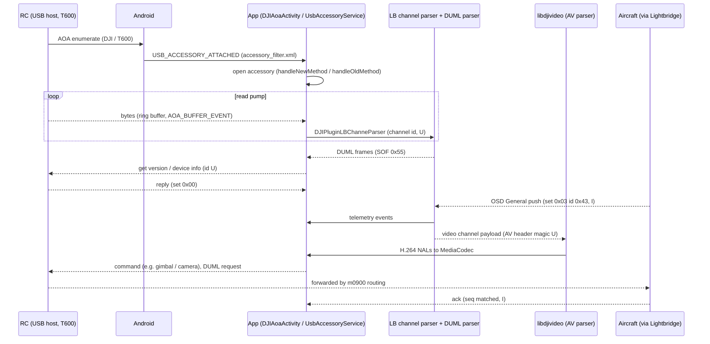

# DJI GO 4 v4.3.64 APK: what a replacement app needs

Input: `firmware/apk/dji-go-4_v4.3.64.apk` (package `dji.go.v4`, versionCode 3036679, minSdk 21, git-ignored).
Reproduce: `python3 -I scripts/re/apk_extract.py` (log `tmp/logs/apk_extract.log`, output `tmp/apk/`).
Tags: **V** verified (seen in APK file) · **I** inferred · **U** unknown / not obtainable here.
Commands table: `data/apk-duml-commands.tsv`.

## 0. Hard limit: the Java code is packed (V)
- Manifest `application` + `appComponentFactory` = `com.AppGuard.AppGuard.*` (V). Packer/anti-tamper stub.
- `classes.dex` header defines 1623 classes, all `com.amap`, `com.autonavi`, `com.AppGuard` (V); jadx 1.5.6 output = third-party only.
- ~37 MB of the 39 MB file is payload outside the dex tables. String pool of that payload is readable (class/resource names, constants); bytecode is not (V).
- Unpacking it = anti-tamper analysis: **declined** (scope). Consequence: no method bodies, no numeric constants from Java.
- All "Java layer" answers below come from: manifest, `res/xml`, class names, string constants, native-lib strings/exports.
- Method-level facts (cmd ids, upgrade order, block size, timeouts) are **U** unless confirmed elsewhere (repo m0900 work, public dissectors, or a live capture).

## 1. USB / AOA connection
- Accessory filter `res/xml/accessory_filter.xml`: `manufacturer="DJI" model="T600"` only (V). No version/description/uri/serial in the filter (V).
- Manifest: `DJIAoaActivity` has `USB_ACCESSORY_ATTACHED` intent-filter + that xml; `uses-feature usb.accessory required=true`, `usb.host required=false`, `uses-library com.android.future.usb.accessory` (V).
- Strings for attach/detach: `com.dji.v4.accessory.USB_ACCESSORY_ATTACHED`, `com.dji.accessory.USB_ACCESSORY_ATTACHED`, `android.hardware.usb.action.USB_ACCESSORY_{ATTACHED,DETACHED}`, `USB_DEVICE_{ATTACHED,DETACHED}` (V).
- Classes: `dji.midware.usb.P3.UsbAccessoryService`, `DJIUsbAccessoryReceiver`; two open paths `handleNewMethod` / `handleOldMethod` (V names; I: new = `UsbManager.openAccessory`, old = legacy `com.android.future.usb`).
- Log strings: "The accessory does not connected.", `UsbRunnable getEndpointCount/getInterfaceCount` (V). Accessory API exposes one in/out fd pair; no endpoint choice for the accessory path (I).
- Host-mode path (phone = USB host, newer RCs): `dji.midware.usbhost.P3.UsbHostServiceRC`, `DJIUsbReceiver`, `NativeRcController`; "could't find usb interface" (V). Not the P3 path (I).
- Version/description/uri/serial strings the app sends: **U** (AOA handshake is done by the RC as host; the phone side only matches manufacturer+model).
- Byte pump: `parser.plugins.DJIPluginRingBufferAsyncParser` (event `AOA_BUFFER_EVENT`) = ring buffer fed from the accessory read (V names; I: async reader thread -> ring buffer -> parser).
- In-process fan-out: `dji.midware.aoabridge.{AoaController,AppClient,AppEventClient,ProxyServer,DJIBaseCommData}`; actions `com.dji.aoabridge`, `com.dji.aoaservice`, `com.dji.aoaservice.client.connected` (V names; I: local proxy so a second process/app shares the one accessory fd; a replacement app does not need it).
- Reconnect: relies on the OS re-delivering `USB_ACCESSORY_ATTACHED` to `DJIAoaActivity` after RC replug; `DataNotifyDisconnect`, `DJIProductManager$DJIProductStatus`, `RcMainConnectionStateView` exist (V names). Timers/retry counts: **U**.
- P3 Professional path:
  - RC USB (AOA, `T600`) is the only USB filter in the manifest (V); P3 Pro / Inspire 1 are the `T600` generation (matches `app/README.md`).
  - Wi-Fi path also exists in the app: `dji.midware.sockets.P3.SwUdpService`, `IpPortConfig$ConnectType`, `libudtjni.so` exports `UDT_SwUdp{Connect,Send,JoyStickSend,Close,...}` (V). Strings `P3C`, `UpgradeP3cComponent`, `stream_observer_desc_p3c_service` (V) -> this is the P3 Standard/4K (Wi-Fi aircraft) path (I). Addresses/ports: **U**.
  - P3 Pro via Wi-Fi: no evidence either way; DJI GO 4 supports Pro only through RC USB (I).
  - Also in app: Wi-Fi master/slave classes `DataWifi*` (RC's Wi-Fi AP/repeater) (V names). Whether Pro's RC Wi-Fi carries video to the phone: **U**.

## 2. DUML layer (as implemented in the app)
- Enums in `dji.midware.data.config.P3`: `DataConfig$CMDTYPE`, `DataConfig$NEEDACK`, `DataConfig$EncryptType`, `DeviceType`, `CmdSet`, `ProductType` (V). Same field set as `packet.dart` (cmd-type/response, ack, encrypt, device types, cmd set) (I). Numeric values: **U**.
- Native `libGroudStation.so` (`dji.midware.natives.GroudStation`) exports JNI `CalcChecksumCrc8/16`, `VerifyChecksumCrc8/16`, `getCRCFromData`, `checkCRCForData`, table `wCRC_Table` (V names). CRC seeds: not re-extracted here; repo CRCs already match a captured packet (see `app/README.md`).
- Same lib has `encodeData/decodeData`, `encryptData/deEncryptData` using a TEA-style routine (V names). Exists; **not analysed** (encryption helper, scope). Whether the EncryptType field is ever non-zero for P3 control traffic: **U**.
- Sender/receiver model: `DeviceType` enum (V); app = type 2, FC = 3, gimbal = 4, camera = 1, RC = 6, per `packet.dart`/`dji-firmware-tools` (I). m0900 routes by receiver type (docs/dataflow.md, V m0900).
- Sequence numbers, ack handling, timeouts, retry: classes `DataBase` (`dji.midware.data.manager.P3`), `DataBase$DATA_TYPE`, `ServiceManager` (V names). Behaviour: **U**. Public precedent: request carries seq, ack matched by seq+set+id with per-request timeout and retry count (I, not from this APK).
- `DJISTLVPackFactory` / `dji.midware.tlv.*` = a second, TLV-framed container (V names); use: **U** (likely newer products).
- Discrepancies vs `app/packages/duml` (cannot be fully compared without bytecode):
  - `catalog.dart` names sets 0x0a "mono", 0x0b "battery", 0x0e "automation". APK has `CmdId*` enums for: ADS_B, Camera, Center, Common, Dm368, EYE, Flyc, Gimbal, Glass, NarrowBand, OnBoardSDK, Osd, PayloadSDK, RTK, Rc, Recognize, Simulator, SmartBattery, Special, Wifi (V). No "mono"/"automation"; "SmartBattery" is separate from "Center". Re-check `cmdSetName` numeric mapping against a capture (I).
  - APK separates `CmdIdCommon` (general, 0x00) and `CmdIdSpecial` (0x01) like the Dart `CmdSet` (V names).
  - `packet.dart` has no `ProductType`/`Dpad`/`litchis` variants: APK has a second protocol `dji.midware.data.config.litchis.DataConfig` (`CmdId`, `CmdType`, `SubType`) (V). Not P3 (I).

## 3. Command catalog (P3-class)
- Full table: `data/apk-duml-commands.tsv` (46 rows).
- What the APK proves (V): the existence and grouping of ~730 `Data*` message classes under `dji.midware.data.model.P3` by cmd-set family (Camera ~170, Flyc ~120, Eye ~80, Rc ~65, Osd ~55, Wifi ~35, Gimbal ~30, SmartBattery ~15, Common ~35, Center ~10, Simulator ~15).
- What it does not give (U): numeric (set,id) per class, payload layouts. Names map 1:1 to public dissector messages (I), but ids in the TSV are only filled where the repo's m0900 work verified them or `catalog.dart` already carries them.
- Telemetry push classes P3 needs: `DataOsdGetPushCommon` (OSD General), `DataOsdGetPushHome`, `DataFlycGetPushSmartBattery`, `DataFlycGetPushGpsSnr`, `DataRcGetPushParams`, `DataRcGetPushGpsInfo`, `DataRcGetPushBatteryInfo`, `DataCameraGetPushStateInfo`, `DataGimbalGetPushParams`, `DataCenterGetPushBatteryCommon`, `DataSmartBatteryGetPushDynamicData` (V names).
- Get version / device info: `DataCommonGetVersion`, `DataCommonGetDeviceInfo`, `DataCommonGetDeviceStatus`, `DataCommonGetDeviceSerialNumber` (V names).
- Control (not decoded here, out of scope to weaponise): `DataFlycJoystick`, `DataGimbalSpeedControl`, `DataCameraSetRecord`/`SetPhoto` exist (V names).
- Geofence/flight-restriction message classes exist in the app; deliberately not catalogued.

## 4. Video
- Same AOA stream as DUML; no second USB channel in the manifest/filter (V filter; I mux).
- Demux: `parser.plugins.DJIPluginLBChanneParser` with `DJILBChannelID` enum (V names; I: Lightbridge channel id selects DUML vs video vs other). Enum values: **U**.
- Video path: accessory read -> `UsbAccessoryService.onGetBody` (log strings: `dataType==22346`, modes default/dual/single, `putVideoBuffer`, `toTransVideoData(need packed / no need to pack)`) -> `DJIVideoPackManager.parseData` (JNI callback target in `libdjivideo.so`) -> decoder `dji.midware.media.DJIVideoDecoder` (V names/strings).
- `dataType` 22346 (0x574A) is the video data type in that log line (V string; meaning of the value I).
- `libdjivideo.so` (V from strings/exports): native threads `native_startRecvThread/startParseThread`, queues, `native_getDJIAVPaserHeaderMagic` (so the stream has a DJI AV header with a magic; value **U**, needs arm64 disassembly), `native_setDecodeMode/DecoderType/DataMode`, `native_setIsNeedPacked`, `native_transferVideoData`, FFmpeg `av_parser_*` + H.264 SPS/PPS/slice-header parsing, `native_putVideoStreamData`, live-stream push, MP4 muxer, x264 transcode.
- Net effect: native lib splits the AV-header-framed payload into H.264 access units, tracks `spsFlag/ppsFlag`, hands NALs to MediaCodec (I). Annex-B vs length-prefixed: **U**. I-frame request exists: `DataCameraRequestForIFrame` (V name).
- `libvideoLib.so` (JNI `dji.pilot2.videolib.VideoLibWrapper`): playback/thumbnail/metadata/YUV scale/filter for files, not the live link (V exports). `libffmpeg.so` = codec library (V).
- `LB2VideoController` is Lightbridge 2 (Inspire 2/P4-era) (I); P3 uses the default mode (I).

## 5. Firmware upgrade (Java layer names only)
- Classes: `dji.dbox.upgrade.p4.statemachine.DJIUpgradeService`, `dji.pilot.upgrade.{UpgradeBaseComponent,UpgradeConfigInfo}`, `dji.pilot2.upgrade.{DataUpgradeActivity,P4UpgradeActivity}`, `UpgradeP3cComponent`, `UpgradeLonganMobile2Component` (V names).
- Messages: `DataCommonRequestUpgrade`, `DataCommonControlUpgrade`, `DataCommonGetPushUpgradeStatus(+Info)`, `DataCommonTransferFile{Request,Data,DataExtended,RealTimeData,Verify}`, `DataCommonGetCfgFile`, `DataCommonSetNewestVersions`, `DataCameraControlUpgrade`, `DataCameraGetPushRequestUpgrade`, `DataOsdSetUpgradeTip` (V names).
- Source of firmware: strings `UpgradeConfigInfo getFile for net success`, download UI strings (`v2_upgrade_activity_downing_desc`, `..._down_success`), `mine_settings_clean_upgrade_cache` -> downloaded from DJI servers into an app cache, then pushed to the aircraft (V strings; I flow). Bundled firmware: none seen in assets listing (V).
- Transfer layer enums `ITransferFileObject$TransferCmdType/TransferErrorCode/CommonTransferVerifyType/ProtocolType` (V names); values, block size, order of commands, status codes: **U**.
- Cross-check with m0900 (`docs/fpga-upgrade-path.md`): m0900 handles 0x07/0x08/0x0A only; no 0x09 handler. APK names a *file-transfer* message family (`DataCommonTransferFile*`) which is a plausible carrier for the data stage that m0900 does not terminate (I). Not evidence of the 0x09 path.
- Signature check of images: `libUpgradeVerify` exists (V), not analysed.
- Field names present as strings (names only, usage not traced): `ChipId`, `HardwareIds`, `MCSN`, `SerialNumber`, `deviceId`, `authCode`, `cfgModel`, `activeSnModel` (V strings). Whether `ChipId` is sent in upgrade/activation requests: **U** (string existence only; this matches m0900 reply to request id 0x0904 carrying the STM32 UID, but the link is not proven).

## 6. Activation / binding / Connected Master ID
- RC master/slave: `DataRcSetConnectMaster`, `DataRcGetConnectMaster`, `DataRcMasterSlaveId`, `DataRcSetMaster/GetMaster`, `DataRcGetSearchMasters`, `DataRcGetSlaveList` (V names) -> carried in cmd-set Rc (0x06) (I). Matches the "RC Connected Master Id Set/Get" DUML field in `docs/id-entry-point.md`.
- Wi-Fi equivalents: `DataWifiConnectMasterWithIdAuthCode`, `DataWifiSetMasterSlaveAuthCode`, `DataWifiGetAuthCode`, `DataWifiGetPushMasterSlaveStatus` (V names).
- Activation (server-assisted): `DataFlycGetPushActiveRequest` (aircraft asks) -> app contacts DJI -> `DataFlycSetActiveResult`; per-module `Data*ActiveStatus` (Flyc, Gimbal, Camera, Osd, Battery, Eagle, Glass); `DJIActiveController/DJIActiveSnModel/DJIActiveDeviceModel` (V names). Flow I; payloads and server contract not examined (scope: no activation bypass).
- Strings seen: `v2_active_need_connect_internet_p3` -> activation needs internet for P3 (V string).

## 7. What a replacement app must do
- Local-only (pure DUML over AOA), per the above (I):
  - Register accessory filter `manufacturer="DJI" model="T600"`, open the fd, run `DumlFramer` on the read stream.
  - Demux DUML from the AV stream (channel mux): **U**. Must be solved from a live capture; `DJIPluginLBChanneParser` is the part to replicate.
  - Read telemetry: pushes arrive unsolicited (OSD General etc.); some may need a request/subscribe or heartbeat first: **U**.
  - Keep-alive: `DataCommonPushHeart` exists (V name); direction and period **U**.
  - Phone GPS push to FC (`DataFlycSendGpsInfo`, `DataAppPushGpsInfo`) is a normal app duty (V names).
  - Video: parse AV header (magic **U**), H.264 NALs to MediaCodec; request I-frame.
- Needs DJI servers (V strings/hosts):
  - Login/account (`account-api.dji.com`), activation (`active.dji.com`), firmware config + download, maps/geo (`dict.djiservice.org`), flight-restriction data (not analysed), media/community.
  - Firmware config/download is not needed for read-only telemetry or control; needed only to *obtain* firmware images.
- Unknown whether an unactivated/never-logged-in aircraft refuses control: **U**. Not investigated (scope: no activation bypass).
- Manifest also contains third-party API keys; not recorded here.

## Sequence (connect -> handshake -> telemetry -> command)
Legend: solid = V (name/string seen), dashed = I/U.

## Runtime unpacking (2026-10-23)

Operator authorized unpacking the AppGuard packer ("we can remove appguard - there is no
issue"), lifting the restriction noted above for the AppGuard payload specifically. Method,
device state, findings and remaining scope exclusions below.

**Method**: `scripts/re/apk_dynamic_unpack.py --device <serial>` on a real, dedicated-for-work,
rooted (Magisk) Android device. frida-server pushed/run; `frida-dexdump` dumped ~62 resident
dex files on cold start, but those are all stock Android framework classes (`android.*`,
`dalvik.*`) loaded by the boot classloader — the app's own `dji.*` payload was not yet
resident. Progressing the app past its first-run consent flow (Terms of Use -> OS
storage/location permission request, declined -> DJI "Information Authorization" toggles,
accepted as defaulted -> "DJI Product Improvement Program", declined -> Sign Up/Sign In,
**stopped here, no login performed**) triggers the real payload to load. **At that point
`frida-dexdump`/manual classloader-walk both reliably killed the target process**
(`frida.InvalidOperationError: script has been destroyed`, reproducible, process respawned
under a new PID each time) **and the process was stable as soon as `frida-server` was
killed** — confirms the packer's advertised anti-tamper/anti-Frida detection, not incidental
instability. Fell back to the no-Frida path: raw `/proc/<pid>/mem` reads of `rw-p` regions
under 64 MB via `adb exec-out su -c dd` (binary-safe; plain `adb shell` text capture would
corrupt the bytes), scanning each region for the dex magic and carving out every match (a
region can hold several dex files back to back). 5 regions carved (2 large, 60 MB and 38 MB;
3 small). `jadx -Pdex-input.verify-checksum=no` (the carved copies' SHA-1/Adler-32 header
fields are stale relative to the runtime's in-memory patches, as expected for a live-process
dump; jadx's `verify-checksum=no` option accepts them without needing to recompute those
fields) decompiled 4 of 5 (one small carve was truncated at its memory-region boundary) to
2544 classes, 775 of them under real `dji.*`/`com.dji.*` packages — confirms the unpack
worked.

**What this specific carve contains**: this pass's two large regions hold `dji.data.upgrade`
/ `dji.dbox.upgrade.p4.*` and a package tree that also includes `dji.flysafe` (present but
**not examined**, per the standing FlySafe exclusion below — the operator's packer-unpacking
authorization did not extend scope on that). `DJIUpDeviceType` (upgrade device/model table)
confirms AOA as a named, general transport strategy (`FileTransferStrategies.APP_AOA_RC`,
`APP_AOA_RC_WIFI_UAV`, `APP_AOA_RC_SDR_UAV` enum values) but is the **modern DJI SDK Core**
device table (`wm220`/`wm330`-series, `rc001`-`rc240`, `rm500`, `pm410`, `gl811`...) — no
`T600`/Phantom-3-era entry in it. The specific legacy-P3 `DataConfig`/`CmdSet`/`CmdId`/
`UsbAccessoryService`/`DJIAoaActivity` classes the earlier static pass found string
references to were not in these particular 5 regions; they are almost certainly in one of
the other ~50 dex files `frida-dexdump` listed at cold start but this session did not carve
from live memory (would need another memscan pass with a different/larger region-size
cutoff, done post-consent-flow). **Numeric DUML cmd-set/cmd-id values and the AOA accessory
identity strings remain unconfirmed** — `docs/data/apk-duml-commands.tsv` and
`app/awto_dji_app/lib/transport/aoa_identity.dart`'s placeholders are unchanged.

Tooling fixes made getting here (now in `scripts/re/apk_dynamic_unpack.py`, reproducible):
real installed package is `dji.go.v4` (not `com.dji.go4` as the app's own internal class/dir
naming suggested) with launcher activity `dji.pilot.main.activity.DJILauncherActivity`;
`frida-tools` and `frida` are separately-versioned PyPI packages (`frida-tools` caps at
`14.11.0`, pin only `frida` to match the server); the free-threaded CPython build on this
machine has no `frida` wheel (stable-ABI only) and fails a from-source build, so the venv
must use a standard CPython explicitly rather than trusting `sys.executable`.

## Declined (scope)
- FlySafe / no-fly / unlock classes, libs and URLs (now present in decompiled form under
  `dji.flysafe.*` in the runtime unpack above; still not examined or catalogued).
- `libUpgradeVerify` signature logic; `libwaes`, `libdjisqlcipher` (exist only); TEA key
  material in `libGroudStation`.
- Activation/login protocols (stopped navigation at Sign Up/Sign In, no account login
  performed) and any API keys in the manifest.
