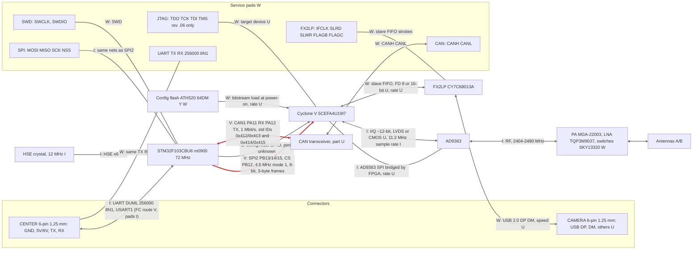

# OFDM board P01007.06 — connection diagram (firmware + wiki, NOT a schematic)

- **Built from m0900 firmware analysis and the dji-firmware-tools wiki text as quoted in `rf-sdr-and-repair.md` / `fpga-interfaces.md`.**
- **No DJI schematic, boardview or KiCad file for this board exists on this machine.** The KiCad files elsewhere belong to unrelated projects. Nothing here is a net list.
- Tags: **V** verified in m0900 code or Renode; **W** wiki-sourced (service pads, parts, connector names), not independently checked; **I** inferred; **U** unknown.
- Rates: `docs/data/m0900-buses.tsv`. Flow-level view: `docs/dataflow.md`.
- The FPGA part `5CEFA4U19I7` is wiki-sourced (W). The ground firmware ships Cyclone V (m2000/m2002) and Cyclone III/IV-format (m2001) images (`fpga-images.md`); no bitstream-derived pin or net is used here.
- Board role is unresolved: `rf-sdr-and-repair.md` calls P01007.06 the "OFDM Receiver board" yet wires `CENTER` to the ESC center board (aircraft side). The diagram follows the task framing (m0900 + Cyclone V + AD9363 + FX2LP on one board).

## Diagram

- Thick red edges = rates derived from m0900 code (SPI2, CAN1).
- Edge 1 (UART) shows the CENTER pads' wiki rate; m0900 routes FC-type DUML (types 3, 5, 10, 11, 12) to USART1 on every board (V, `m0900-can-channels.md`), so CENTER is most likely USART1. The pad-to-pin wiring is still not traced (I).
- CENTER 6-pin signal order is not published (`rf-sdr-and-repair.md`); the ESC board's 10-pin table is the only pin map and is **not** a map of this connector.
- Power rails (wiki): 3V3, 5V/6V, 2V5, 1V1, 1V2, 1V3, 1V7, 1V8; regulator topology: U.
- Revision notes (wiki): `.08` changed regulators, `.14` replaces FPGA with Artosyn AR8001/AR8003 and drops JTAG. This diagram is `.06` only.

## Connection table

| Link | Bus | Width / framing | Rate | Tag |
|---|---|---|---|---|
| MCU to FPGA (also AD9363 via bridge) | SPI2 master | 8-bit, CPOL0 CPHA1, MSB first, soft NSS; 3-byte frames `[0E/0F reg val]` | 4.5 MHz SCK (36 MHz / 8) | V |
| MCU CS to FPGA | PB12 GPIO, active low | n/a | n/a | V |
| MCU to FPGA config/reset | GPIO | discrete | n/a | U |
| MCU on CENTER | USART1 (by routing) | 8N1 | 256000 nominal (256228 actual) | V rate + route, wiring I |
| MCU to CAN pads | CAN1 | std ID, 8 B | 1 Mbit/s | V rate, pads W |
| FPGA to AD9363 | sample port | ~12-bit I/Q | 11.2 MHz sample rate | I |
| FPGA to FX2LP | slave FIFO | 8 or 16-bit | U | W |
| FX2LP to CAMERA | USB 2.0 | DP/DM | U | W |
| Config flash to FPGA | serial NOR | U | U | W |
| MCU clock | HSE 12 MHz x6 PLL | n/a | 72 MHz SYSCLK, 36 MHz PCLK1 | V code, crystal I |
| MCU I2C, USB, SPI1 | not used by firmware | n/a | n/a | V (two tools: `control-plane-re.md` "SPI1 resolved", issue #18) |

## Gaps in the model

- Two CAN-related facts conflict: wiki lists CAN pads, but `CENTER` pins in the only pin table are GND/5V/TX/RX, so which connector carries CANH/CANL (CAMERA?) is U.
- FX2LP is shown on this board because `fpga-interfaces.md` places it here; whether the FX2LP is the aircraft's or the RC's is tied to the unresolved board role above.
- `m0900`'s `SPI1` was checked as a candidate second register/config bus (issue #18, who
  writes the FPGA's `ATH520` config flash) — V, dead code, not used at all (see table above).
  Also checked whether `m0900` drives the FX2LP directly over a byte-wide parallel GPIO
  group: no such group exists in its code (`control-plane-re.md` "SPI1 resolved"). Neither
  finding identifies the actual flash writer; both only narrow the elimination list.

## What a real schematic or boardview would confirm

1. Which USART (PA9/PA10 vs PB10/PB11) lands on CENTER TX/RX, and where the other goes (air FPGA is the inference for USART3).
2. Crystal frequency for the MCU (12 MHz inferred from a compiled literal) and the AD9363 reference clock (40 MHz inferred, `phy-params.md`).
3. MCU GPIO to FPGA ball mapping (config/reset strobes), and whether the SPI pads are the SPI2 nets.
4. FPGA to AD9363 SPI wiring and clock, and the data-port mode (LVDS vs CMOS), lane count and clock.
5. FPGA to FX2LP bus width (8 or 16) and IFCLK; FX2LP USB speed; pin order of CAMERA and CENTER.
6. CAN transceiver part, which connector carries CANH/CANL, and the board strap for `get_board_version` (RAM `0x200000d8`, codes 2/4/5/6/7).
7. JTAG pad target (FPGA or MCU), flash part and its link to the FPGA, regulator tree.
8. Whether this board is the aircraft's or the RC's receiver (DM368 or DM365 side).
