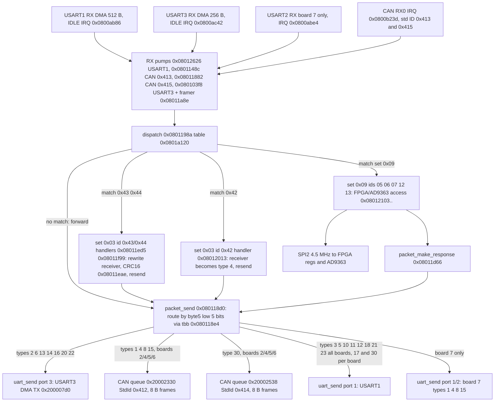
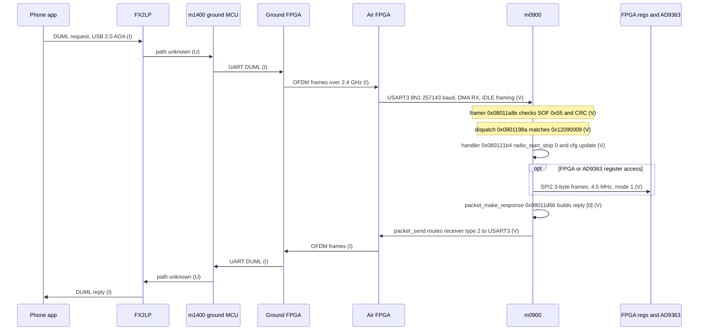
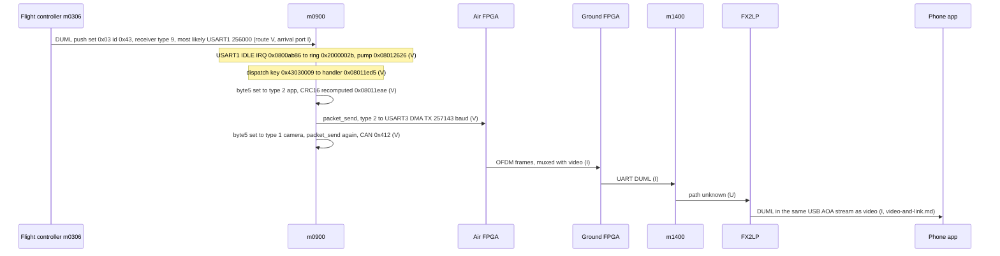

# System data flow — video, telemetry, control planes

Built from firmware evidence (m0900 `P3X_FW_V01.11.0020`, app base `0x08008000`) and the repo docs. **No DJI schematic exists on this machine**; every edge is tagged.

- **V** verified: read from m0900 code or Renode readback (address cited).
- **I** inferred: reasoned from firmware/docs/wiki, not observed.
- **U** unknown: no evidence either way.
- Bus rates: `docs/data/m0900-buses.tsv` (derivations there). Scope: architecture only, no keys, no geofence, no control bypass (`CLAUDE.md`).

## 1. Rate summary (m0900 side, all derived)

| Bus | Framing | Rate | Tag |
|---|---|---|---|
| SYSCLK / PCLK1 / PCLK2 | HSE 12 MHz x6 PLL, APB1 /2 | 72 / 36 / 72 MHz | V (code), crystal I |
| SPI2 (FPGA bridge, AD9363) | 8-bit, mode 1 (CPOL0 CPHA1), 3-byte frames, CS=PB12 | 4.5 MHz SCK (36/8) | V (code + Renode CR1=0x355) |
| USART3 (to link side) | 8N1, DMA TX/RX, IDLE framing | 256000 nominal, 257143 actual (BRR 0x8C) | V |
| USART1 (FC / center-board DUML link, all boards) | 8N1, DMA | 256000 nominal, 256228 actual (BRR 0x119) | V |
| USART2 (board code 7 only) | 8N1, DMA | 250000 exact (BRR 0x90) | V |
| CAN1 (board codes 2/4/5/6) | std ID, two DUML links: TX 0x412 / RX 0x413 (camera/gimbal side) and TX 0x414 / RX 0x415 (receiver type 30 only), see `m0900-can-channels.md` | 1 Mbit/s (36 MHz / (3 x 12 tq)) | V |
| I2C, USB, SPI1 | not used | n/a | V (absence) |
| AD9363 sample port | ~12-bit I/Q | 11.2 MHz sample rate | I (`phy-params.md`) |

- USART3 payload ceiling = 257143 / 10 bit = ~25.7 kB/s (arithmetic, not measured).
- CAN ceiling ~ 1e6 / 111 bit x 8 B = ~72 kB/s (nominal frame, stuffing ignored).

## 2. Overview — three planes plus shared RF link

- Blue thick = video. Green solid = telemetry (aircraft to app). Red dashed = control (app to aircraft). Grey dotted = configuration. Dark thick = shared RF path (all planes ride it).
- DM365 position between ground FPGA and FX2LP is **I**: `fpga-interfaces.md` draws FPGA to FX2LP directly, `video-and-link.md` puts DM365 between.

- Edge 10/16: that USART3 faces the air FPGA/link is **I**. Evidence: `packet_send` sends receiver types 2, 6, 13, 14, 16, 20, 22 (app, RC, ground modules) out USART3 on every board code (section 3). The USART3 to FPGA wiring needs a schematic.
- Edge 9/17 (**corrected 2026-10-24**, `m0900-can-channels.md`): `packet_send` routes type 3 (and 5, 10, 11, 12, 18, 21, 23) to `0x0801261c` = `uart_send(1)` = **USART1 on every board** (V). That the far end is the FC is **I** (receiver type 3). An earlier version of this doc said these types went to CAN on boards 2/4/5/6, which was a misread `tbb` target. CAN 0x412/0x413 carries camera/gimbal (types 1, 4, 8, 15); CAN 0x414/0x415 carries only type 30.
- The docs' "CENTER UART 256000 8N1 to FC" **is** reproduced: CENTER = USART1 (section 5, item 1).

## 3. Where DUML is injected and removed — m0900 as a router

Evidence is all in m0900 code (V). Sender and wire-level framing inside the link are not in m0900.

- m0900 is a **DUML router**, not just a radio configurator.
- Frame: byte 0 = 0x55, byte 5 = receiver (low 5 bits type, high 3 bits index), byte 9 = cmd set, byte 10 = cmd id.
- Dispatch `0x0801198a` walks the 8-byte records at `0x0801a120` (`[handler|1, type, index, set, id]`). Match: handler runs (packet is **consumed** here). No match: tail-call `packet_send` (`0x080118d0`): packet is **forwarded** by receiver type.
- Table `0x0801a0d8-0x0801a110` (ids `0x0901..0x0914`, `[handler|1, id16]`) is a second, 16-bit-id table. How it is reached is not traced (U).

Notes (all V unless marked):
- Receiver-type to port table decoded from the `tbb` at `0x080118e4`: types 2, 6, 13, 14, 16, 20, 22 go to USART3; types 1, 4, 8, 15 go to path A `0x0801141c` (CAN queue `0x20002330` on boards 2/4/5/6; USART1 or USART2 on board 7); types 3, 5, 10, 11, 12, 18, 21, 23 go to `0x08011938` = `0x0801261c` = `uart_send(1)` (USART1) on **every** board (corrected; `0x08011938` is past the board check); 17 goes to USART1 on boards 2/4/5/6 and to path A on board 7; 30 goes to CAN queue `0x20002538` (StdId 0x414) on boards 2/4/5/6 and to USART1 on board 7; all other types are dropped. `python3 scripts/re/m0900_can_channels.py` asserts this table.
- Names of types: 1 camera, 2 app, 3 FC, 4 gimbal, 6 RC are verified in `protocol-verification.md`; the others (8, 13, 14 as DM36x/ground modules) are **I** from module numbers.
- Handlers for set 0x03 ids 0x42/0x43/0x44 are keyed to receiver type 9 (m0900 itself). They rewrite byte 5 (0x43: to type 2 then type 1; 0x42: to type 4), recompute the CRC16 (seed 0x3692) and call `packet_send`. Reading: **FC pushes land on m0900, which fans them out to the app via USART3 and to camera/gimbal via CAN 0x412**. Sender of these pushes is not checked in the dispatch (FC is **I**; arrival port most likely USART1, I).
- Set 0x09 handlers (`docs/symbols/m0900_V01.11.0020.tsv`): cmd 05 FPGA read, 06 write (hi==0xFE: FPGA reg, else AD9363), 07 read, 12 radio SET, 13 radio GET. Replies go through `packet_make_response` then `packet_send`.
- Which physical port a given inbound packet arrived on is lost at the dispatch (no port field in the record): replies are routed by receiver type, not by arrival port.

### Injection and removal points

| Plane | Injected (generated) | Forwarded / re-addressed | Removed (consumed) | Tag |
|---|---|---|---|---|
| Telemetry (set 0x03 pushes, OSD General 0x43) | FC m0306 emits | m0900 `0x08011ed5` re-addresses to app (type 2) and camera (type 1), sends on USART3 | app/HUD at the end; air FPGA mux point not traced | V m0900; FC source I |
| Telemetry (link params ch/mcs/bw/snr/rssi) | m1400 tracks (`cpu-reversing-proof.md`) | n/a | n/a | V on m1400 string path; route to app U |
| Control (app to aircraft DUML) | App via FX2LP (I) | ground MCU/FPGA (I), air FPGA to m0900 USART3 (I) | m0900 consumes set 0x09 (radio) via dispatch; other sets forwarded by type, FC reached over USART1 (V route, FC I) | m0900 V, rest I |
| Video | DM368 (I) into air FPGA | air FPGA modem, ground FPGA, DM365, FX2LP | phone decoder (`libdjivideo`, docs) | I |
| Master-ID | owned by m1400, written to ground FPGA over GPIO/UART (`id-entry-point.md`); full DUML cmd_set-9 handler table (Connected-Master-Id + RC-to-RC slave join/list/delete, flash `0xC7C2`-`0xCBCA`) Ghidra-decoded in `control-plane-re.md` | n/a | n/a | V on m1400 |

- **Where DUML meets the video stream** (the physical mux of DUML bytes with H.264 inside OFDM frames) is **not visible from m0900**; m0900 only has a UART (USART3) into the FPGA. The mux is in the FPGA fabric (U).

## 4. Sequences

### 4a. One control command: DUML request to m0900, set 0x09 cmd 0x12 (radio SET)

- Key `0x12090009` = (cmd 0x12, set 0x09, receiver type 9 index 0). Handler `0x080121b4`: `radio_start_stop(0)`, loads cfg-word fields (channel index, etc), replies `[0]`.

- Hops marked I/U are architecture assumptions. No capture of a real session exists (`phy-params.md`: "Real DUML session driving this: unknown").
- Round-trip latency over the link: unknown.

### 4b. One telemetry message: OSD General (set 0x03 id 0x43)

- Rate of OSD pushes: handler runs a divide-by-10 counter (`0x08011f0e-0x08011f1e`); push rate itself not measured (U).

## 5. What we do not know

1. ~~Which USART is CENTER.~~ **Resolved 2026-10-24** (`m0900-can-channels.md`): USART1 (256000, PA9/PA10). `packet_send` sends types 3/5/10/11/12/18/21/23 there on every board, and pump `0x08012626` dispatches its RX. The earlier "no TX route" reading was a misread `tbb` target.
2. **Board code to hardware mapping.** `get_board_version` (RAM `0x200000d8`) is 0 in emulation. USART2 (250000) and the USART1/2 routes exist only for code 7. Which code is P01007.06: U.
3. **Air-side video path** DM368 to air FPGA (bus, width, rate): **partly resolved 2026-10-24** (`m0800-dm368-provenance.md` §5). V: the DM368 is USB host to a CY7C68013A FX2 (`usb_68013.ko`, `0547:1002`, loaded before `encode_usb` starts). V: raw H.264 slices go over USB bulk EP2 into the FX2, then an 8-bit synchronous slave FIFO (`m1500` `IFCONFIG=0x03`, AUTOOUT). I: the FIFO master is the air FPGA. FIFO clock rate: U.
4. **Board role.** `rf-sdr-and-repair.md` calls P01007.06 the "OFDM Receiver board" (RC side) yet wires CENTER to the ESC center board (aircraft). Air vs RC role: U.
5. Ground FPGA to DM365 to FX2LP versus FPGA directly to FX2LP: docs disagree.
6. **How DUML bytes are multiplexed with video** inside OFDM frames: U for the radio layer itself, but **narrowed at both ends (2026-10-24).** Air: the DM368 sends raw H.264 and the FX2 is AUTO (`m0800-dm368-provenance.md` §7). Ground: video reaches the FX3 on the FPGA parallel port and **all** DUML on a 115200 UART (V code, V capture), and the FX3 tags USB chunks `55 CC <type> <len>` (`ground-fx3-m1601.md`). I: the air and ground FPGAs are the mux and demux.
7. **Ground path to the phone (GL300C):** **resolved 2026-10-24** (`ground-fx3-m1601.md`). The phone talks only to the FX3 (`m1601`: iAP2 for iPhone, AOA host for Android). DUML runs FX3 ⇄ UART 115200 ⇄ (I: m1400); video runs ground FPGA → FX3 GPIF. **Ground AD9363 config path**: still U.
8. **Air over-the-air encryption** is not ruled out (`what-is-actually-secret.md` LAYER CAVEAT). MCU-layer DUML cleartext is shown; the link layer is not.
9. FPGA-to-AD9363 SPI rate, data-port mode (LVDS vs CMOS), width: U. Fref 40 MHz: I.
10. ~~Second CAN TX queue `0x20002538` ID word~~ **resolved**: StdId 0x414 (TX), paired with RX 0x415 (obj `0x20002554`, ring `0x200024b8+0xa0`, pump `0x08011882`, same parser callback and dispatch). Only receiver type 30 is routed to it, and whether it is live on a real bus is U (`m0900-can-channels.md`). Still open: how table `0x0801a0d8` (id16 dispatch) is reached.
11. HSE 12 MHz is a compiled literal; crystal on the board not read: I.
12. Why SPI2 runs /8 (4.5 MHz) while PCLK1/2 would be 18 MHz: reason not recorded.

## 5a. Cross-check against the DJI GO 4 APK's cmdset-9 names - numbering does not match (2026-10-23)

Per the revised scope decision in `apk-analysis.md` section 0 (numeric facts from the
dynamically-unpacked dex only, never DJI's code), `docs/data/apk-dynamic-cmdset-ids.tsv` names
cmdset 9 (app's internal name: `OSD`; this doc's/dissector's name: `HD Link`) commands `SetFPGA`
(4), `GetFPGA`(5), `Set9363`(6), `Get9363`(7) - **four separate named commands**, not the single
combined-write-with-discriminator-byte scheme this doc's own firmware trace found.

- **V, does not reconcile cleanly.** This doc's own `m0900` dispatcher trace (section above,
  `0x08012103`) found: cmd `05`=FPGA read, `06`=write (one command, internally distinguishing
  FPGA-register-vs-AD9363 via payload byte `hi==0xFE`), `07`=another read variant, `12`/`13`=radio
  SET/GET. `GetFPGA`(5) and `Get9363`(7) line up with the firmware's `05`/`07` reads, but
  `SetFPGA`(4) does not match the firmware's combined write at `06`, and the firmware's
  single-command-with-discriminator-byte design doesn't match having two separately named
  `Set*` commands in the app's enum.
- **U, not resolved:** whether this reflects (a) a different/later HD-Link generation's protocol
  than what this specific `m0900` firmware (`P3X_FW_V01.11.0020`) implements, (b) this
  particular APK version carrying dead/unused enum constants for a feature P3 doesn't support,
  or (c) an error in the original firmware-side numbering note above. Flagged rather than
  assumed - do not treat the two sources as confirming each other on this specific point.
- **I, still useful regardless:** cmdset 9 overall is confirmed real and rich - 58 named
  commands including signal quality, sweep frequency, channel status, MCS (modulation/coding
  scheme) control, LBT (listen-before-talk), link-mode, image-transmission-mode, reverse-link
  direction, and raw FPGA/AD9363 register access. This is the concrete, app-facing surface to
  capture traffic on (via the now-working AOA relay, `docs/aoa-live-test-2026-10-23.md`) to
  finally find a real scrambler-seed register write, if one exists - still open per
  `cpu-reversing-proof.md`'s status table.

## 6. Reproduce

- Clock/bus derivation: `python3 scripts/re/m0900_trace.py dis 0x0800ddc8 40`, `dis 0x0800dd28 60`, `dis 0x0800aca0 400` (uart_init), `dis 0x0800b536 60` (SPI2), `dis 0x0800b31c 60` (CAN).
- CAN/USART1 channels and the full routing table, with assertions: `python3 scripts/re/m0900_can_channels.py`.
- Routing: `dis 0x080118d0 90`, `dis 0x0801198a 40`, `dis 0x08011ed4 60`; tbb table bytes at `0x080118e4` (31 entries, target = `0x080118e4 + 2*byte`).
- Literal-pool peripheral scan: `python3 tmp/periph_scan.py`. Renode CR1 readback: `tmp/buses_probe.resc` (boot 2 s, read `0x40003800`; USART BRR is not modelled by Renode so those are static only).

## 7. CAN1 bus (m0900) - message inventory and driver layer (issue #36)

Source: `firmware/P3X_FW_V01.11.0020_m0900.bin` (sha256 `72156b4b...`), Ghidra 12.2 headless, ARM:LE:32:Cortex, raw load `0x08000000`. Rerun: `python3 scripts/re/m0900_can_ghidra.py` (post-script `scripts/re/ghidra/M0900Dump.java`). Output `tmp/m0900_can_ghidra/m0900_dump.txt`, literal scan `tmp/m0900_can_ghidra/literal_hits.txt`. Names below are ours; Ghidra project is not persisted (`-deleteProject`), so renames live here, not in a .gpr.

**Scope status:** driver layer and endpoint table resolved; frame-payload meaning of 0x412/0x413/0x414/0x415 is largely **U**. RX ISR body (`0x0800b23c`) does not decompile cleanly - see gaps.

### 7.1 Peripheral and state (V unless marked)

- CAN1 base `0x40006400`: literal `0x08000a1c` (used by `0x08000620`). Filter master `0x40006600`: literal `0x08000a20`.
- Pointer literals at `0x080034f0`: `[0]=0x40006400` CAN1 base, `[4]=0x200015d0` CAN endpoint table, `[8]=0x20000090` CAN state block, `[0xc]=0x40010800` GPIOA (CAN pins, I).
- CAN state block `0x20000090` (`DAT_080034f8`): `+0` TX-ready flag (set to 1 by `0x08003298`, cleared by `0x08003468`), `+4` TX endpoint count, `+8` RX endpoint count.
- Endpoint table `0x200015d0`: RX slots `+0..+0x30` (13 x u32), TX slots `+0x34..+0x64` (13 x u32). Max 13 each.

### 7.2 Endpoint objects (ID-keyed; V by arithmetic on the registration calls)

| Std ID | Dir | Object base | Queue size | Registered by |
|---|---|---|---|---|
| 0x412 | TX | `0x20002330` (= `0x20001f30`+`0x400`) | 0x200 | `0x080093a8` (gated, see 7.4) |
| 0x413 | RX | `0x2000234c` (= `0x20002130`+`0x21c`) | 0x200 | `0x080093a8` (gated) |
| 0x414 | TX | `0x20002538` (= `0x200024b8`+`0x80`) | 0x40 | `0x08009828` (ungated in `0x08005b00`) |
| 0x415 | RX | `0x20002554` (= `0x200024b8`+`0x9c`) | 0x40 | `0x08009828` (ungated) |

- So the doc's "CAN TX queue `0x20002538`" is the **0x414 TX endpoint**, not the 0x412 queue (V). The 0x412 TX endpoint is `0x20002330`, which the dispatch table already names as path A (types 1, 4, 8, 15, `dataflow.md` routing notes).
- Endpoint layout (V): `+0` std ID u32, `+0x06` queue size, `+0x08` size-1 mask, `+0x0a` owner pointer, `+0x0c` direction byte (1 = TX).
- RX endpoints also program a hardware filter: `0x0800072e` with ID `<<5` and mask `0xffff` (ST 16-bit list layout, V from code).

### 7.3 Driver functions (ST StdPeriph pattern, V unless marked)

| Address | Name (ours) | Role |
|---|---|---|
| `0x08000620` | `can_rcc_enable` | RCC APB1 enable, bit 25 (CAN1) or 26 (CAN2) by base compare |
| `0x08000646` | `CAN_Init` | MCR INRQ, wait INAK, MCR bits TTCM/ABOM/AWUM/NART/RFLM/TXFP, BTR = LBKM<<30, SJW<<24, BS1<<16, BS2<<20, BRP-1 |
| `0x0800072e` | `CAN_FilterInit` | filter bank setup from ID/mask struct |
| `0x080008a0` | `CAN_Transmit` | select empty TX mailbox from TSR (TME0 bit 26, TME1 27, TME2 28, else return 4 = no mailbox), write TIR/TDTR/TDLR/TDHR at `+0x180`, set TXRQ |
| `0x0800331c` | `can_bus_init` | GPIO/AFIO, RCC enable, `CAN_Init` with the values below, zero endpoint table |
| `0x080033ec` | `can_endpoint_register` | fills endpoint, appends to RX (+filter) or TX table |
| `0x080034e6` | `can_endpoint_reset` | zeroes two counters in an endpoint |
| `0x08003298` | `can_tx_pump` | scans TX table, first endpoint with pending bytes -> `CAN_Transmit` (ID = `*ep`, DLC = min(len,8)) |
| `0x08003468` | `can_send_bytes` | pushes N bytes into endpoint FIFO (`0x08004274`), when TX-ready flag set and len>0 sends one frame |
| `0x08005b00` | `app_init` (ours) | top-level bring-up; calls `0x0800331c` (board code 2/4/5/6 gate), `0x080093a8`, `0x08009828` |

Bit timing (V from `0x0800331c` stores): prescaler field 3 (BRP=2), BS1 raw 5 (6 tq), BS2 raw 4 (5 tq), SJW raw 0 (1 tq). 36 MHz / (3 x 12 tq) = 1 Mbit/s. Matches the 1 Mbit/s already in this doc.

### 7.4 Frame layout (V, from `0x080008a0` and `0x08003298`)

- Frame struct: `+0` std ID (u16 used; `ID<<21` into TIR), `+4` ext ID, `+8` IDE byte, `+9` RTR byte (OR'd raw into TIR, I on the bit value), `+10` DLC, `+11..+18` data D0..D7.
- Data words are packed little-endian into TDLR (D0..D3) and TDHR (D4..D7).
- `0x08003298` builds the frame ID from the endpoint's first word and takes payload bytes from the FIFO at endpoint `+4`, DLC capped at 8.

### 7.5 Board-code gate (V)

- `0x08004142` returns `*0x200000d8` (board code). Boards 2, 4, 5, 6 (values checked in that order) run `0x0800331c` and register 0x412/0x413 (`0x080093a8`). Board 7 does not use CAN here.
- `0x08009828` (0x414/0x415) is called unconditionally from `0x08005b00`. Whether it is needed on board 7 is **U**.

### 7.6 IDs in use (inventory so far)

- **0x412 TX, 0x413 RX**: board 2/4/5/6 (V). Relay path already in this doc (section 4 / push set 0x03 id 0x43).
- **0x414 TX, 0x415 RX**: registered on all boards (V registration; I that it is always used). **Corrected in §7.11**: its TX endpoint is reached by exactly one receiver-type value (30), not the {3,5,10,11,12,18,21,23} set stated here previously - that set was an unverified inference (see §7.11 for the full byte-level trace that replaces it).
- **Payload meaning of 0x412-0x415: resolved in §7.11.** Both carry ordinary DUML, same framing/dispatch as every other transport - CAN is purely a carrier here, not a second protocol.

### 7.7 RX path (partial)

- Vector 36 (IRQ 20, `USB_LP_CAN1_RX0`) is `0x0800b23c` (the `0x0800b23d` in the spec is the Thumb address). The decompile of that handler is not reliable (register-pair confusion), so the RX read sequence (FIFO0 read, release, endpoint match by ID) is **U**.
- RX byte FIFO `0x200024b8+0xa0` is drained by `0x08009882`, which calls the framer `0x08009a8e` and dispatch `0x0800998a` on completion (V). Which code writes that FIFO from the ISR is **U**.

### 7.8 Gaps and next steps

1. Decode the RX ISR at `0x0800b23c` by hand from disassembly (decompiler output unusable here). Target: FIFO0 read and ID match.
2. Enumerate every caller of `0x08003468` (`0x08009460`, `0x0800987e`, both unnamed in Ghidra) to get the full TX ID/payload inventory.
3. Persist Ghidra renames in a project (the current pipeline discards it).

### 7.9 External corroboration - is CAN1 the motor/ESC bus? (2026-10-24)

Public RE community sources, not this repo's own analysis - see issue #36 for the search.

- **Confirmed for the P3 family** (`o-gs/dji-firmware-tools` wiki, "P3 Flight Controller aka MC" and "P3X ESC center board" pages): ESC control is shared UART (`U3_TX`/`U3_RX`, FC-to-ESC-MCU init/handshake/config) **plus** 4 separate PWM lines (`PWM1`-`PWM4`) for per-motor throttle - not CAN. Each ESC is a TMS320F28027F "Piccolo" driving a DRV8301 pre-driver; no CAN tie documented on that chip either.
- The FC board (`m0305`/`m0306`, STM32F427) does expose `CAN1_T`/`CAN1_R` service pads, separate from the `U3` ESC-UART pins - consistent with this doc's CAN1 = DUML-relay finding, not raw motor control.
- **Generational precedent only** (Phantom 4, WM330 FC Core board wiki page): same pattern - `CAN1_T`/`CAN1_R` pads present, separate from the FC Damping board's `PWM1`-`PWM4` ESC lines.
- **DroneCAN/UAVCAN**: no evidence DJI's aircraft stack uses or was influenced by it. DJI's RoboMaster line (ground robots, unrelated product) does use CAN for its C610/C620 ESCs with its own open protocol, but that's a different product family, not the Phantom aircraft.
- Net: nothing public contradicts the static finding that CAN1 on `m0900` carries relayed DUML rather than ESC/motor commands.
4. `0x0800c808` has 94 callers and looks like a generic helper, not CAN-specific. Not named yet.

### 7.10 `m0306`'s own CAN1 *and* CAN2 — FC side, separate chip from `m0900` (issue #40, 2026-10-24)

Source: `firmware/unpacked/P3X_FW_V01.11.0020_m0306.bin`, Ghidra 12.2 headless, full pass
(`scripts/re/m0306_ghidra_disasm.py`, `tmp/m0306_ghidra/m0306_dump.txt`, project archived
`re/ghidra-projects/m0306_flight_controller.tar.gz`). This is the **flight controller's
own** bxCAN silicon — a different chip from `m0900` (§7.1-7.9, the radio MCU) — asked for
by issue #40 point 4 as a separate question from the already-settled "is CAN1 the
motor/ESC bus" (§7.9: no, ESC is UART3+PWM1-4).

- **V, both CAN1 (`0x40006400`) and CAN2 (`0x40006800`) are genuinely initialised**, not
  one live + one dead like `m0900`'s SPI1/SPI2 (control-plane-re.md): each gets its own
  `GPIO_PinAFConfig`-pattern call (AF9, the standard CANx alternate function on this family)
  at `0x080353e6`-`0x080353fe` region, its own RCC clock-enable dispatch through
  `0x0803addc` (shared selector: compares the base against CAN1/CAN2 and picks RCC bit 25
  or 26, same StdPeriph shape as `m0900`'s `can_rcc_enable` at `0x08000620`), and its own
  bit-timing (BTR-pattern) register write — CAN1 at `FUN_080351d0`, CAN2 at
  `FUN_08035484`/`FUN_080353b2` (tail-jump chained, `b 0x08035484` at `0x080355c6`).
- **I:** CAN1 here is plausibly the FC-side end of the *same* DUML-relay CAN bus `m0900`
  already carries 0x412-0x415 on (§7.1-7.6) — the aircraft's radio MCU and flight
  controller sharing one physical CAN bus is the simplest explanation consistent with
  §7.9's external pinout evidence (only `CAN1_T`/`CAN1_R` pads are documented on the P3X FC
  board — no public mention of a second CAN bus on that board).
- **U — open, not resolved this pass:** what CAN2 carries. The firmware clearly brings it
  up (same driver pattern as CAN1), but the public pinout docs §7.9 cites don't mention a
  second CAN bus on the FC board, and tracing CAN2's actual message IDs/payload would need
  the same RX-ISR-level work §7.7/§7.8 flags as still open for `m0900`'s CAN1 — not
  attempted here (budget). Candidates: a second internal DUML/sensor bus (GPS/compass
  module?), or dead-but-initialised code (StdPeriph CAN_Init() running on an unused
  instance is a real possibility — rule it out the same way §7.9's `m0900` SPI1 check did,
  by checking for callers of the TX/RX pump functions, not attempted here).
- Full peripheral map from this pass (code-provenance.md has details): no SPI, no DMA, no
  ADC referenced anywhere in `m0306` — this FC does not do direct-SPI sensor/FPGA access
  the way `m0900` does; USART1/2/3/UART4/5/USART6 (all six, one shared init dispatcher) and
  I2C1/2/3 are its other comms peripherals.

## 7.11 CAN bus: consolidated cross-chip findings (issue #36)

Pulls together §7.1-7.9 (`m0900`, air radio), §7.10 (`m0306`, FC), and `control-plane-re.md`
"Full GPIO/bus survey" + `ground-upgrade-path.md` (`m1400`, ground radio) - no new scatter,
corrections land here with pointers back. Reproduce the `m0900` table dump:
`python3 scripts/re/m0900_can_routing_decode.py` (output `tmp/m0900_can_ghidra/routing_table.txt`,
log `tmp/logs/m0900_can_routing_decode.log`). Ghidra dumps used: `tmp/m0900_can_ghidra/m0900_dump.txt`
(issue #36 pass, not yet archived - still `-deleteProject`, same gap as §7.8 item 3),
`tmp/m0306_ghidra/m0306_dump.txt` (archived `re/ghidra-projects/m0306_flight_controller.tar.gz`),
`tmp/m1400_ghidra/m1400_dump.txt` (archived `re/ghidra-projects/m1400_radio.tar.gz`).

**Address-base note (V, resolve before cross-reading §1-6 vs §7):** §1-6's routing addresses
(`packet_send` 0x080118d0, dispatch 0x0801198a, framer 0x08011a8e, filter table 0x0801a120)
and §7's CAN-driver addresses (0x08009xxx, 0x08003xxx) are the **same functions**, found at
addresses exactly `0x8000` apart (confirmed by matching call-graph shape, not just address
arithmetic: `FUN_0800998a`'s dispatch-table-walk and fallback-to-`FUN_080098d0` structure is
byte-identical to §1-6's described `0x0801198a`/`0x080118d0` behaviour). Two different Ghidra
loads of the same `P3X_FW_V01.11.0020_m0900.bin` used base addresses `0x8000` apart; which one
is "correct" (matches the real flash address) isn't re-derived here - use the `+0x8000`
translation when matching an address from §1-6 against one from §7 or this section.

### Q1: what do 0x414/0x415 actually carry? (V, full trace this pass)

`packet_send` (`FUN_080098d0`, ≡ §1-6's `0x080118d0`) is `m0900`'s single outbound-DUML
router: it dispatches purely on `byte5 & 0x1f` (the DUML receiver-type byte) through a
**31-entry Thumb `tbb` table at flash `0x080098e4`**, read directly out of the firmware image
byte-for-byte (`scripts/re/m0900_can_routing_decode.py` - no decompiler needed, the table is
flash data). Full mapping (device-type names from `docs/data/apk-cmdset-devicetype.tsv`):

| Receiver type(s) | Device name(s) | Destination |
|---|---|---|
| 1, 4, 8, 15 | CAMERA, GIMBAL, DM368, TRANSFORM | `0x0800941c`: board-gated (2/4/5/6) `can_send_bytes` to **CAN std ID 0x412** - plus an extra check (upper 3 bits of byte5 must be 1 or 7) before actually sending; board 7 or failed check falls back to USART1/2 via `FUN_080030a4` |
| 2, 6, 13, 14, 16, 20, 22 | APP, RC, DM368_G, OSD, TRANSFORM_G, FPGA_G, 22 (unlabeled) | unconditional **USART3** (`FUN_080030a4` reason 3) - matches the pre-existing `m0900-buses.tsv` USART3 row exactly |
| 3, 5, 10, 11, 12, 18, 21, 23 | FLYC, CENTER, PC, BATTERY, DIGITAL, DOUBLE, 21/23 (unlabeled) | **CORRECTS the prior inference** (old §7.6, `m0900-buses.tsv` CAN1 row "bus peers... INFERRED"): unconditional **USART1** (`FUN_080030a4` reason 1, via thunk `0x0800a61c`), on every board code, **not CAN at all**. The CAN-0x414 destination for this group, as previously written in §7.6/issue #36's own comment, was never actually traced ("Second CAN TX queue... ID word: not decoded") - it was a plausible guess that this trace refutes. |
| 30 (unlabeled) | - | the **only** receiver-type value that reaches **CAN std ID 0x414**: board-gated (2/4/5/6) via thunk `0x08009876` -> `can_send_bytes`; board 7 falls back to USART1 (reason 1) |
| 17 (SINGLE) | - | "mixed" (confirms the old §7.6/§227 note, now with mechanism): board 2/4/5/6 -> USART1 (reason 1); board 7 -> attempts the CAN-0x412 path (`0x0800941c`), which then fails its own internal board-code check (7 isn't in {2,4,5,6}) and falls through to its own USART1/2 fallback - so type 17 never actually reaches CAN on any board |
| 0, 7, 9, 19, 24-29 | WHO, WIFI, OFDM(self), FPGA, unlabeled | **dropped silently** - no transport reached at all (type 9 = `m0900` itself; anything addressed to `m0900` that reaches this far means no registered callback matched it in `FUN_0800998a`'s dispatch table first) |

Cross-check (same script): `FUN_080030a4`'s reason-code literals resolve to the exact DMA
buffer addresses `m0900-buses.tsv` already documents per-USART (`reason 1` -> `0x200001d0`
USART1, `reason 2` -> `0x200004d0` USART2, `reason 3` -> `0x200007d0` USART3) - confirms the
reason-code-to-USART mapping independently of the table-walk above.

**Net answer:** 0x412/0x413 and 0x414/0x415 are structurally identical - same
`can_endpoint_register`/`can_send_bytes`/`CAN_Transmit` plumbing on the TX side, same incoming
framer+dispatch (`FUN_08009a8e`, `FUN_0800998a`) on the RX side as every other transport
(USART1/2/3). **CAN carries plain DUML; it is not a second protocol.** What's narrow is the
*gate*: only receiver-type 30 (unlabeled in the public `DeviceType` enum extract so far) reaches
0x414/0x415 at all, and only on board codes 2/4/5/6.

**Architectural re-framing (I, follows directly from the V trace above):** CAN1 0x412/0x413 is
the CAMERA/GIMBAL/DM368/TRANSFORM relay, **not the FC relay** - `dataflow.md:138` already said
this ("fans out... to camera/gimbal via CAN"); this pass just nails the mechanism down. FLYC
(device type 3, the flight controller) traffic from `m0900` goes out via **USART1**, never CAN.
This reopens who's on the other end of `m0900`'s CAN1/CAN2: §7.10's inference that `m0306`'s
live CAN1 is "plausibly this chip's end of the same DUML-relay CAN bus `m0900` carries
0x412-0x415 on" is now **weaker** than stated there - if `m0900` never sends FC-addressed
traffic over CAN, the FC doesn't need to be the CAN1 peer at all.

**New data point, outside the issue's 3 named chips but directly bears on the above (I):**
`m0400` (gimbal MCU, `tmp/m0400_ghidra/m0400_full_dump.txt:25611`, `FUN_080095b8`) registers
exactly **one** CAN std ID, **0x321** (`*DAT_080096bc = 0x321`, literal `movw r0,#0x321` at
`0x0800968a`) - confirmed live via its own `CAN_Init`/filter/start sequence
(`air-id-and-stream-survey.md` "CAN1: initialized" section). `0x321` is **not** in `m0900`'s
registered set {0x412,0x413,0x414,0x415}: `m0900` never filters for it and never transmits it.
Either `m0400`'s CAN1 and `m0900`'s CAN1 are separate physical buses, or one side has an
undiscovered additional endpoint. **Open (U), not resolved this pass** - flagging as a genuinely
new open question, not previously tracked anywhere in this repo.

### Q2: is {0x412, 0x413, 0x414, 0x415} the complete CAN-ID set across all three chips? (mixed - NOT fully closed)

- **`m0900`: CLOSED - but the prior justification here was flawed, now redone (2026-10-24,
  issue #36).** The earlier text in this bullet argued closure from "the only function that
  creates a CAN endpoint object is `can_endpoint_register`, 4 call sites, `CAN_Transmit` has
  exactly 2 callers" - i.e. it enumerated every call site of ONE software helper. That's
  circular: it proves exhaustiveness only for sends that go through that helper, and says
  nothing about a direct/inline write to a bxCAN mailbox register placed anywhere else in the
  image, bypassing the helper entirely - which the hardware has no requirement to avoid
  (STM32 bxCAN has independent TX mailboxes addressable by direct register write). Redone
  below with two methods that don't share that assumption
  (`scripts/re/m0900_can_closure_check.py`, output `tmp/m0900_can_ghidra/can_closure_check.txt`,
  log `tmp/logs/m0900_can_closure_check.log`, against the same archived project/dump,
  `re/ghidra-projects/m0900_can.tar.gz` / `tmp/m0900_can_ghidra/m0900_dump.txt`):
  - **RX filter-bank check (requested as the more reliable method): turned out NOT
    independent.** `CAN_FilterInit` (`0x0800072e`) has **exactly one call site anywhere in the
    image** (`0x08003456`, inside `can_endpoint_register`) - so walking the filter banks finds
    nothing the call-site search didn't already know. The two filters programmed are for
    0x413 and 0x415 (the two RX endpoints; TX endpoints never touch `CAN_FilterInit`),
    matching the existing set. This check doesn't add evidence, it restates the same one.
  - **Register-range literal-pool scan (the method that actually closes the gap): V,
    genuinely exhaustive.** On this ISA a 32-bit peripheral address can only enter a register
    two ways - a literal-pool `LDR`, or a `movw`/`movt` immediate pair. Scanned **every
    4-byte-aligned word in the raw firmware image** (not scoped to any function or helper) for
    a value inside CAN1's full register block (`0x40006400`-`0x400067ff`, covering control,
    status, filter-bank and mailbox registers alike) or CAN2's (`0x40006800`-`0x40006bff`).
    Result: **CAN2's block has zero literal occurrences anywhere in the image** - `m0900`
    never touches CAN2 at all. **CAN1's block has exactly 3 literal occurrences in the entire
    image**, used by exactly 4 functions: `can_rcc_enable` (clock gating only), `CAN_FilterInit`
    (filter banks, covered above), and the driver trio `can_bus_init`/`can_tx_pump`/
    `can_send_bytes` - all already-named, all already accounted for in §7.3. Separately
    scanned the full disassembly for `movw`/`movt`: **54 `movw` instructions exist in the whole
    322-function image, but zero `movt`** - and `movt` is required to build the upper half
    (`0x4000`) of any address into either CAN block, so that construction path is unused
    anywhere in this firmware, full stop. Between the two scans, every possible origin of a
    pointer into the CAN1 or CAN2 register space - not just calls to `can_endpoint_register` -
    is accounted for.
  - **Net: {0x412, 0x413, 0x414, 0x415} is still `m0900`'s complete CAN-ID set, no more, no
    hidden fifth ID - but now for a reason that survives the "what if something bypasses the
    helper" objection, not because nobody looked for a bypass.** The previous "CLOSED" wasn't
    wrong on its conclusion, it was wrong on its method; this redo supplies the method the
    conclusion actually needed. Not yet re-applied to `m1400`/`m0306` (still open below) -
    out of scope for this pass, flagged as the same gap if picked up later.
- **`m1400`: NOT closed - same gap as before, real attempt made.** `control-plane-re.md`'s own
  two-method survey (literal scan + Ghidra xref scan) already found CAN1(10)/CAN2(3)
  *peripheral-base* literal hits and traced the `duml_route` TBB (offset `0x5C8C`) to receiver
  types `0x19`/`0x1C` -> port 5 (CAN1/CAN2) - that's a count of base-address references, not of
  distinct arbitration IDs. This pass traced the byte-push call sites (`FUN_0001bc08`, called
  from `FUN_0000f7d0`) and found a 2-byte sub-header (`0x0203`/`0x0403`) prepended to two of its
  payloads before entering the CAN queue - a type/length-tag-shaped value, but **not confirmed**
  as the actual 11-bit arbitration ID (the mailbox TID-equivalent pointers, `DAT_0000fa14`/
  `DAT_0000fa18`, didn't resolve to a clean literal on a direct file dereference - needs real
  Ghidra data-type/xref analysis, not attempted further this pass). **Still open (U): the actual
  CAN1/CAN2 arbitration ID(s) `m1400` sends/filters on.**
- **`m0306`: NOT closed - different reason (data-driven, not code-driven).** Both CAN1
  (`FUN_080351d0`) and CAN2 (`FUN_08035484`/`FUN_080353b2`) filter/ID setup is StdPeriph-style
  and **reads its ID/mask fields from an external config-struct pointer** (`DAT_08035534`,
  offsets `+0x28`/`+0x2c`/`+0x30`/`+0x34`), not from instruction immediates - confirmed by
  reading the generic filter-write helper at `0x080352xx` that both CAN1 and CAN2 init call
  through. A literal-immediate scan (what closed the question on `m0900`'s hand-rolled driver)
  **structurally cannot find these IDs** - they live in a data table (likely `.rodata`) not
  located this pass. GPIO AF9 (CAN alternate function) setup for both instances was confirmed
  (`movs r2,#0x9` at `0x080353e6`/`0x080353f0`) and CAN1's bit-timing constant `0x10f` was found
  (`0x080351dc`) - but **the actual arbitration ID(s) remain undetermined (U).**
- **Honest net answer:** 4 IDs are confirmed system-wide to date, and all 4 are on `m0900`.
  `m1400` and `m0306` have **not** yielded their own arbitration IDs despite a real attempt this
  pass - their ID values are structurally harder to reach by static search (set outside the
  traced helper on `m1400`; set as data, not code, on `m0306`), not because nobody looked. **This
  is NOT "confirmed, these 4 IDs are the complete set across all three chips."** It is "4
  confirmed on `m0900`; `m1400` and `m0306` each have at least one more live CAN node whose own
  ID(s) are still unknown."

### Q3: `m0306`'s CAN2 purpose (budget-limited, no resolution)

No forward progress this pass. Searched for a direct `bl` caller of `FUN_080351d0` (CAN1 init)
and `FUN_08035484`/`FUN_080353b2` (CAN2 init) anywhere in the 2745-function disassembly: **none
found for either** - both are evidently reached only through an indirect call (a function-pointer
table, consistent with this chip's other init code), which applies equally to CAN1 and CAN2 and
so doesn't help distinguish CAN2's role from CAN1's. §7.10's open item stands: **U, still open.**

### Q4: direct trace of "0x414 writes 0x20002538", the RX ISR, and the "two logical links" theory (2026-10-24 follow-up)

Operator-specified addresses, traced directly rather than inferred from the existing tables.
Same script as Q2, extended: `scripts/re/m0900_can_closure_check.py`, output
`tmp/m0900_can_ghidra/can_closure_check.txt`.

**A genuinely new finding first, because it's needed to even interpret the operator's addresses
correctly (V):** `0x0800b31c`/`0x0800b3ec`/`0x0800b468` (`m0900-buses.tsv`'s CAN1 row: "can_init",
"ring init", "can_enqueue_and_tx") are **not addresses in this section's project** - they're from
`tmp/m0900_ghidra` (`scripts/re/m0900_ghidra_disasm.py`, `BASE_ADDR = "0x08008000"`), a *different,
earlier* Ghidra load of the same binary. Checked which project's base is the real one: file offset
`0x0` decodes as a textbook Cortex-M vector table (SP `0x20004cb8`, Reset `0x08008201`, four more
odd/Thumb exception handlers); file offset `0x8000` (where `m0900_ghidra_disasm.py` tells Ghidra
code begins) is mid-instruction garbage. **True link base is `0x08000000`.** This project
(`m0900_can_ghidra`, all of §7-7.11) used it correctly throughout. `m0900_ghidra` is off by
**+0x8000 on every function address it reports** - `0x0800b31c`/`0x0800b3ec`/`0x0800b468` minus
`0x8000` land exactly on this project's `can_bus_init` (`0x0800331c`)/`can_endpoint_register`
(`0x080033ec`)/`can_send_bytes` (`0x08003468`), confirming the translation. **`m0900-buses.tsv`'s
CAN1 row addresses (and almost certainly its other rows, same project) are all +0x8000 off true -
not corrected here (out of this pass's scope), flagging for whoever next touches that file.**

- **"Queue init: is 0x414 written into the object at 0x20002538?" - V, yes, directly.**
  `FUN_080033ec(DAT_080098c4 + 0x80, 0x414, 1, 0x40, DAT_080098c4)` - `DAT_080098c4` =
  `0x200024b8`, so the object address is `0x200024b8+0x80` = `0x20002538` exactly. Inside
  `can_endpoint_register`: `*(undefined4 *)param_1 = param_2;` - the first 4 bytes of that
  object are set to `param_2` = `0x414`. Confirmed, no inference needed.
- **Qualification ("registration doesn't prove active") - already answered, V:** the `1` in that
  same call is the direction field (`param_3`); `1` = TX. §7.5/Q1 already established TX actually
  firing is board-gated (2/4/5/6) at the point of use in `packet_send`, separately from this
  unconditional registration - consistent with the operator's caveat, nothing new needed.
- **Receive dispatch: does 0x414/0x415 share 0x413's processing? - split answer (V where traceable,
  honestly U where not).** `0x414`'s direction field is `1` (TX): `can_endpoint_register`'s
  `if (param_3 == 0) {...}` branch (the only branch that calls `CAN_FilterInit` and inserts into the
  RX-match table `DAT_080034f4`) is **not taken** for it - structurally, `0x414` can never be
  matched by an inbound frame, regardless of how the RX ISR itself works. `0x415`'s direction is
  `0`: it takes the **exact same branch** as `0x413`, with **zero ID-specific code anywhere in the
  function** - both land in the identical 13-slot RX table via the identical `CAN_FilterInit` call.
  This is a structural guarantee from `can_endpoint_register`'s own (cleanly-decompiled) logic, not
  dependent on resolving the ISR. The RX ISR itself: IRQ20's vector-table entry (`0x0800b23d`, read
  directly from the file, base-independent) matches this project's own `vec_36 @ 0800b23c` exactly
  - so this project's ISR address is correct - but **its decompilation is still unreliable**
  (register-pair confusion, §7.7's existing finding stands, not re-resolved this pass).
- **Routing: already fully answered in Q1, no new work needed.** Receiver types {1,4,8,15} ->
  `0x412`; type {30} -> `0x414`; types `{3,5,10,11,12,18,21,23}` (FLYC included) -> USART1, never
  CAN.
- **Packet handling: same 0x55 framing/CRC? - already answered in Q1, no new work needed.** CAN
  and USART1/2/3 share the identical framer (`FUN_08009a8e`)/dispatch (`FUN_0800998a`) - one DUML
  codec, not two.
- **`can_endpoint_register`'s callers - already exhaustive from Q2 (4 call sites), re-confirmed
  here under the correct addressing.**
- **TX pump traced cleanly as a bonus (V, no ambiguity at all - clean decompilation):**
  `can_tx_pump` (`FUN_08003298`) scans all 13 TX slots generically; for whichever slot has pending
  bytes it reads the CAN ID straight back out of that endpoint's own first word (`local_30 =
  **(ptr)` - literally the value written at registration) and calls `CAN_Transmit` with it. Zero
  ID-specific branching - `0x412` and `0x414` go through byte-identical code.
- **Net: the "two logical links, FC vs camera/gimbal" theory is refuted on two independent
  grounds.** (1) FLYC (device type 3, the FC) never touches CAN at all - USART1 unconditionally
  (Q1). (2) There is no "link" abstraction in the driver to multiplex in the first place: one
  generic 13-slot TX table + one generic 13-slot RX table, serviced by ID-agnostic code (proven
  above for TX, structurally guaranteed for RX). `0x412`/`0x413` and `0x414`/`0x415` differ only in
  which upstream DUML receiver-type `packet_send` maps to which TX slot - not in any distinct
  processing mechanism, protocol, or "channel."
