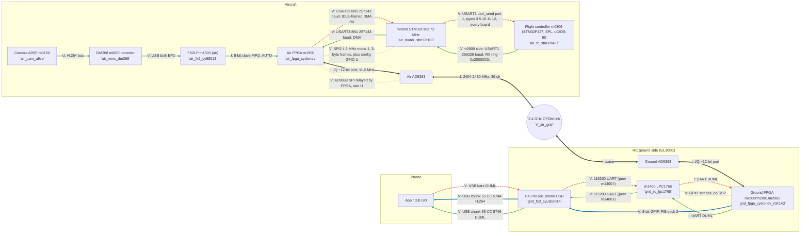
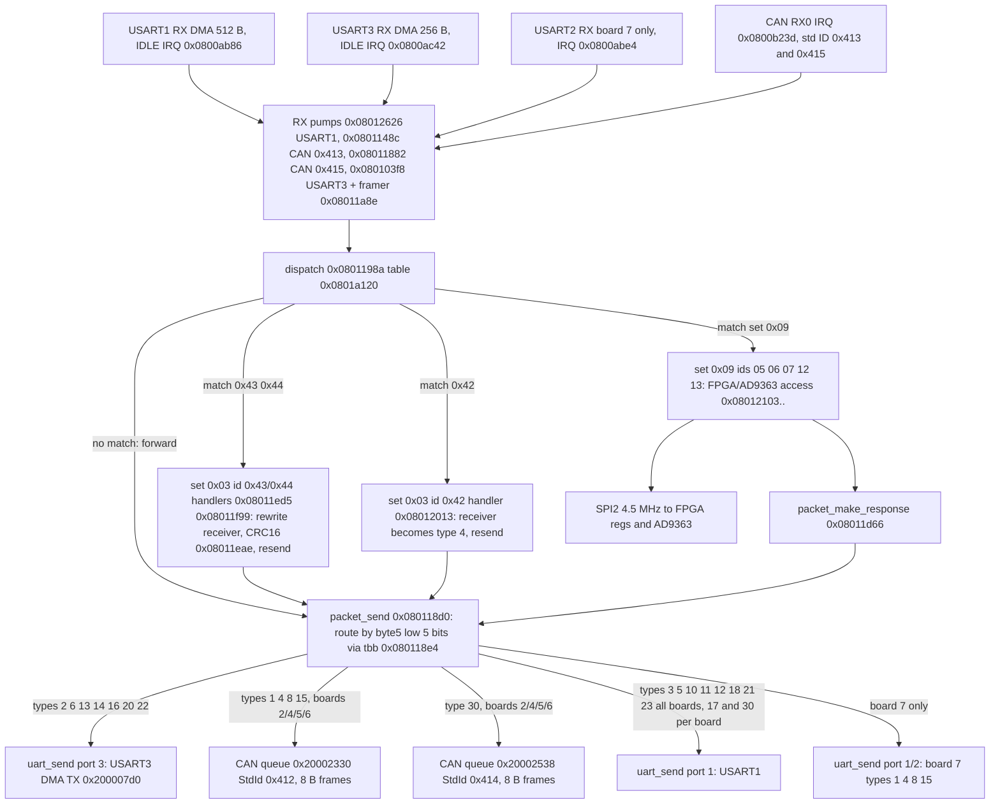
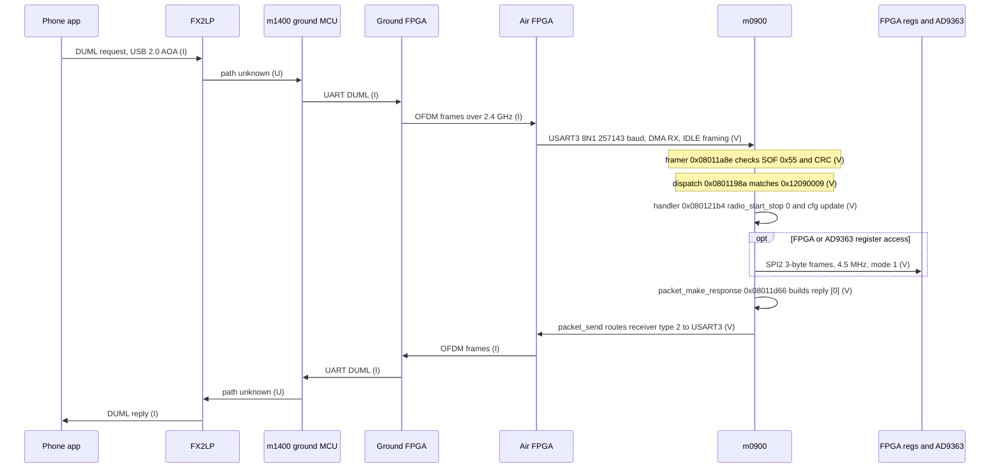
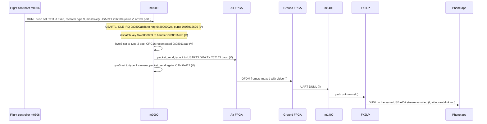

# System data flow — video, telemetry, control planes

Built from firmware evidence (m0900 `P3X_FW_V01.11.0020`, app base `0x08008000`) and the repo docs. **No DJI schematic exists on this machine**; every edge is tagged.

- **V** verified: read from m0900 code or Renode readback (address cited).
- **I** inferred: reasoned from firmware/docs/wiki, not observed.
- **U** unknown: no evidence either way.
- Bus rates: `docs/data/m0900-buses.tsv` (derivations there). Scope & safety: see `SAFETY.md`.

## 1. Rate summary (m0900 side, all derived)

| Bus | Framing | Rate | Tag |
|---|---|---|---|
| SYSCLK / PCLK1 / PCLK2 | HSE 12 MHz x6 PLL, APB1 /2 | 72 / 36 / 72 MHz | V (code), crystal I |
| SPI2 (FPGA bridge, AD9363) | 8-bit, mode 1 (CPOL0 CPHA1), 3-byte frames, CS=PB12 | 4.5 MHz SCK (36/8) | V (code + Renode CR1=0x355) |
| USART3 (to link side) | 8N1, DMA TX/RX, IDLE framing | 256000 nominal, 257143 actual (BRR 0x8C) | V |
| USART1 (FC / center-board DUML link, all boards) | 8N1, DMA | 256000 nominal, 256228 actual (BRR 0x119) | V |
| USART2 (board code 7 only) | 8N1, DMA | 250000 exact (BRR 0x90) | V |
| CAN1 (board codes 2/4/5/6) | std ID, two DUML links: TX 0x412 / RX 0x413 (camera/gimbal side) and TX 0x414 / RX 0x415 (receiver type 30 only), see `m0900-can-channels.md` | 1 Mbit/s (36 MHz / (3 x 12 tq)) | V |
| I2C, USB, SPI1 | not used | n/a | V (absence) |
| AD9363 sample port | ~12-bit I/Q | 11.2 MHz sample rate | I (`phy-params.md`) |

- USART3 payload ceiling = 257143 / 10 bit = ~25.7 kB/s (arithmetic, not measured).
- CAN ceiling ~ 1e6 / 111 bit x 8 B = ~72 kB/s (nominal frame, stuffing ignored).

## 2. Overview — three planes plus shared RF link

- Blue thick = video. Green solid = telemetry (aircraft to app). Red dashed = control (app to aircraft). Grey dotted = configuration. Dark thick = shared RF path (all planes ride it).
- Ground RC shown is the owner's **GL300C**: phone USB = **FX3 m1601**, DM365 (`m1300`) removed (`ground-fx3-m1601.md`). The GL300a/HDMI variant instead uses FX2LP `m1600` + DM365 `m1300` — not drawn.

- Air video (edges 0-2): DM368 sends raw H.264 over USB bulk EP2 into the air FX2 (`m1500`), which bridges an 8-bit slave FIFO to the air FPGA — V for the USB and FIFO config, I that the FIFO peer is the FPGA (`m0800-dm368-provenance.md` §5/§7).
- Ground video/DUML split (edges 7-8, 12-15): the ground FPGA feeds the FX3 video on an 8-bit GPIF port and DUML on a 115200 UART (peer m1400, I); the FX3 interleaves both to the phone as `55 CC`-tagged USB chunks (`ground-fx3-m1601.md`). V in FX3 code and a capture.
- Edge 10/17: that USART3 faces the air FPGA/link is **I**. `packet_send` sends receiver types 2, 6, 13, 14, 16, 20, 22 out USART3 on every board code (section 3). The USART3-to-FPGA wiring needs a schematic.
- Edge 9/18 (`m0900-can-channels.md`): `packet_send` routes types 3, 5, 10, 11, 12, 18, 21, 23 to `uart_send(1)` = **USART1 on every board** (V); the far end being the FC is **I** (receiver type 3). CAN 0x412/0x413 carries camera/gimbal (types 1, 4, 8, 15); CAN 0x414/0x415 carries only type 30.
- The docs' "CENTER UART 256000 8N1 to FC" **is** reproduced: CENTER = USART1 (section 5, item 1).

## 2a. Message flow in words

Same edges as the section 2 mermaid, as a words-only walkthrough. Canonical names from
`naming-map.md`. V/I/U per-hop as in the diagram; nothing here claims more than the diagram does.

**Control (phone → FC).** Phone → (V) `gnd_fx3_cyusb2014` USB, bare DUML → (V, FX3 end; peer
`gnd_rc_lpc1765` I) `uart_gnd_rc_fx3` 115200 UART → `gnd_rc_lpc1765` → (I) ground FPGA, UART DUML
→ (I) `rf_air_gnd` 2.4 GHz OFDM → (I) ground FPGA's air counterpart, `air_fpga_cyclonev` → (V)
`uart_air_router_fpga` USART3 257143 baud, DMA → `air_router_stm32f103` (m0900) → (V route; FC
end I) `uart_air_router_fc` USART1, `uart_send` port 1, types 3/5/10/11/12 → `air_fc_stm32f427`.

**Telemetry (FC → phone), using OSD General (set 0x03 id 0x43) as the concrete example.**
`air_fc_stm32f427` → (V m0900 side; FC source I) `uart_air_router_fc` USART1 256228 baud →
`air_router_stm32f103`, which **re-addresses and forwards twice** (both V, decompiled):
- byte5 → type 2 (app), CRC16 recomputed → (V) `uart_air_router_fpga` USART3 257143 baud →
  `air_fpga_cyclonev` → (I) `rf_air_gnd` → (I) ground FPGA → (I) `uart_gnd_rc_fpga` DUML-over-UART
  → `gnd_rc_lpc1765` → (V FX3 end; peer I) `uart_gnd_rc_fx3` 115200 UART → `gnd_fx3_cyusb2014` →
  (V) `usb_gnd_fx3_phone`, chunk `55 CC 5749` → phone.
- byte5 → type 1 (camera), CRC16 recomputed → (V) `can_air_primary` std ID `0x412` →
  `air_cam_a9se`. (Not drawn in the section 2 diagram; from the section 3 router trace.)

**Video (camera → phone).** `air_cam_a9se` → (U medium) H.264 bus → `air_venc_dm368` → (V)
`usb_air_venc_fx2` bulk EP2, raw H.264 → `air_fx2_cy68013` → (V config; peer=FPGA I)
`fifo_air_fx2_fpga` 8-bit slave FIFO, AUTO → `air_fpga_cyclonev` → (I) `rf_air_gnd` → (I) ground
FPGA → (V) `gpif_gnd_fpga_fx3` 8-bit GPIF, PIB socket 2 → `gnd_fx3_cyusb2014` → (V)
`usb_gnd_fx3_phone`, chunk `55 CC 574A` → phone.

Keep this in sync with the section 2 mermaid; an edge added/changed there should be reflected here.

## 3. Where DUML is injected and removed — m0900 as a router

Evidence is all in m0900 code (V). Sender and wire-level framing inside the link are not in m0900.

- m0900 is a **DUML router**, not just a radio configurator.
- Frame: byte 0 = 0x55, byte 5 = receiver (low 5 bits type, high 3 bits index), byte 9 = cmd set, byte 10 = cmd id.
- Dispatch `0x0801198a` walks the 8-byte records at `0x0801a120` (`[handler|1, type, index, set, id]`). Match: handler runs (packet is **consumed** here). No match: tail-call `packet_send` (`0x080118d0`): packet is **forwarded** by receiver type.
- Table `0x0801a0d8-0x0801a110` (ids `0x0901..0x0914`, `[handler|1, id16]`) is a second, 16-bit-id table. **Resolved 2026-10-25** (`air-router-deep-dive.md` §2): not a separate entry point — a *nested dispatch level*. The outer table's record for `cmd 0x2c / set 0x09 / type 9` is a one-instruction stub (`0x080125dc: b.w 0x080112da`) that tail-jumps into this table's matcher, which re-reads a 16-bit sub-id two bytes into that command's own payload.

Notes (all V unless marked):
- Receiver-type to port table decoded from the `tbb` at `0x080118e4`: types 2, 6, 13, 14, 16, 20, 22 go to USART3; types 1, 4, 8, 15 go to path A `0x0801141c` (CAN queue `0x20002330` on boards 2/4/5/6; USART1 or USART2 on board 7); types 3, 5, 10, 11, 12, 18, 21, 23 go to `0x08011938` = `0x0801261c` = `uart_send(1)` (USART1) on **every** board (corrected; `0x08011938` is past the board check); 17 goes to USART1 on boards 2/4/5/6 and to path A on board 7; 30 goes to CAN queue `0x20002538` (StdId 0x414) on boards 2/4/5/6 and to USART1 on board 7; all other types are dropped. `python3 scripts/re/m0900_can_channels.py` asserts this table.
- Names of types: 1 camera, 2 app, 3 FC, 4 gimbal, 6 RC are verified in `protocol-verification.md`; the others (8, 13, 14 as DM36x/ground modules) are **I** from module numbers.
- Handlers for set 0x03 ids 0x42/0x43/0x44 are keyed to receiver type 9 (m0900 itself). They rewrite byte 5 (0x43: to type 2 then type 1; 0x42: to type 4), recompute the CRC16 (seed 0x3692) and call `packet_send`. Reading: **FC pushes land on m0900, which fans them out to the app via USART3 and to camera/gimbal via CAN 0x412**. Sender of these pushes is not checked in the dispatch (FC is **I**; arrival port most likely USART1, I).
- Set 0x09 handlers (`docs/symbols/m0900_V01.11.0020.tsv`): cmd 05 FPGA read, 06 write (hi==0xFE: FPGA reg, else AD9363), 07 read, 12 radio SET, 13 radio GET. Replies go through `packet_make_response` then `packet_send`.
- Which physical port a given inbound packet arrived on is lost at the dispatch (no port field in the record): replies are routed by receiver type, not by arrival port.

### Injection and removal points

| Plane | Injected (generated) | Forwarded / re-addressed | Removed (consumed) | Tag |
|---|---|---|---|---|
| Telemetry (set 0x03 pushes, OSD General 0x43) | FC m0306 emits | m0900 `0x08011ed5` re-addresses to app (type 2) and camera (type 1), sends on USART3 | app/HUD at the end; air FPGA mux point not traced | V m0900; FC source I |
| Telemetry (link params ch/mcs/bw/snr/rssi) | m1400 tracks (`cpu-reversing-proof.md`) | n/a | n/a | V on m1400 string path; route to app U |
| Control (app to aircraft DUML) | App via FX2LP (I) | ground MCU/FPGA (I), air FPGA to m0900 USART3 (I) | m0900 consumes set 0x09 (radio) via dispatch; other sets forwarded by type, FC reached over USART1 (V route, FC I) | m0900 V, rest I |
| Video | DM368 (I) into air FPGA | air FPGA modem, ground FPGA, DM365, FX2LP | phone decoder (`libdjivideo`, docs) | I |
| Master-ID | owned by m1400, written to ground FPGA over GPIO/UART (`id-entry-point.md`) | n/a | n/a | V on m1400 |

- **Where DUML meets the video stream** (the physical mux of DUML bytes with H.264 inside OFDM frames) is **not visible from m0900**; m0900 only has a UART (USART3) into the FPGA. The mux is in the FPGA fabric (U).

## 4. Sequences

### 4a. One control command: DUML request to m0900, set 0x09 cmd 0x12 (radio SET)

- Key `0x12090009` = (cmd 0x12, set 0x09, receiver type 9 index 0). Handler `0x080121b4`: `radio_start_stop(0)`, loads cfg-word fields (channel index, etc), replies `[0]`.

- Hops marked I/U are architecture assumptions. No capture of a real session exists (`phy-params.md`: "Real DUML session driving this: unknown").
- Round-trip latency over the link: unknown.

### 4b. One telemetry message: OSD General (set 0x03 id 0x43)

- Rate of OSD pushes: handler runs a divide-by-10 counter (`0x08011f0e-0x08011f1e`); push rate itself not measured (U).

## 5. What we do not know

1. ~~Which USART is CENTER.~~ **Resolved 2026-10-24** (`m0900-can-channels.md`): USART1 (256000, PA9/PA10). `packet_send` sends types 3/5/10/11/12/18/21/23 there on every board, and pump `0x08012626` dispatches its RX. The earlier "no TX route" reading was a misread `tbb` target.
2. **Board code to hardware mapping.** `get_board_version` (RAM `0x200000d8`) is 0 in emulation. USART2 (250000) and the USART1/2 routes exist only for code 7. Which code is P01007.06: U.
3. **Air-side video path** DM368 to air FPGA (bus, width, rate): **partly resolved 2026-10-24** (`m0800-dm368-provenance.md` §5). V: the DM368 is USB host to a CY7C68013A FX2 (`usb_68013.ko`, `0547:1002`, loaded before `encode_usb` starts). V: raw H.264 slices go over USB bulk EP2 into the FX2, then an 8-bit synchronous slave FIFO (`m1500` `IFCONFIG=0x03`, AUTOOUT). I: the FIFO master is the air FPGA. FIFO clock rate: U.
4. **Board role.** `rf-sdr-and-repair.md` calls P01007.06 the "OFDM Receiver board" (RC side) yet wires CENTER to the ESC center board (aircraft). Air vs RC role: U.
5. Ground FPGA to DM365 to FX2LP versus FPGA directly to FX2LP: docs disagree.
6. **How DUML bytes are multiplexed with video** inside OFDM frames: U for the radio layer itself, but **narrowed at both ends (2026-10-24).** Air: the DM368 sends raw H.264 and the FX2 is AUTO (`m0800-dm368-provenance.md` §7). Ground: video reaches the FX3 on the FPGA parallel port and **all** DUML on a 115200 UART (V code, V capture), and the FX3 tags USB chunks `55 CC <type> <len>` (`ground-fx3-m1601.md`). I: the air and ground FPGAs are the mux and demux.
7. **Ground path to the phone (GL300C):** **resolved 2026-10-24** (`ground-fx3-m1601.md`). The phone talks only to the FX3 (`m1601`: iAP2 for iPhone, AOA host for Android). DUML runs FX3 ⇄ UART 115200 ⇄ (I: m1400); video runs ground FPGA → FX3 GPIF. **Ground AD9363 config path**: still U.
8. **Air over-the-air encryption** is not ruled out (`what-is-actually-secret.md` LAYER CAVEAT). MCU-layer DUML cleartext is shown; the link layer is not.
9. FPGA-to-AD9363 SPI rate, data-port mode (LVDS vs CMOS), width: U. Fref 40 MHz: I.
10. ~~Second CAN TX queue `0x20002538` ID word~~ **resolved**: StdId 0x414 (TX), paired with RX 0x415 (obj `0x20002554`, ring `0x200024b8+0xa0`, pump `0x08011882`, same parser callback and dispatch). Only receiver type 30 is routed to it, and whether it is live on a real bus is U (`m0900-can-channels.md`). ~~Still open: how table `0x0801a0d8` (id16 dispatch) is reached.~~ **Resolved 2026-10-25** (see item 2 above, `air-router-deep-dive.md` §2).
11. HSE 12 MHz is a compiled literal; crystal on the board not read: I.
12. Why SPI2 runs /8 (4.5 MHz) while PCLK1/2 would be 18 MHz: reason not recorded.

## 5a. Cross-check against the DJI GO 4 APK's cmdset-9 names (2026-10-23; resolved 2026-10-25)

Per the revised scope decision in `apk-analysis.md` section 0 (numeric facts from the
dynamically-unpacked dex only, never DJI's code), `docs/data/apk-dynamic-cmdset-ids.tsv` names
cmdset 9 (app's internal name: `OSD`; this doc's/dissector's name: `HD Link`) commands `SetFPGA`
(4), `GetFPGA`(5), `Set9363`(6), `Get9363`(7) - four separate named commands.

- **Resolved** (`air-router-deep-dive.md` §1b): the apparent mismatch was an earlier trace
  stopping at cmd `06` without separately checking `04`. A full dispatch-table walk found
  **cmd `0x04` is its own dedicated handler** (`0x080120e2`, direct `spi_fpga_raw_write`, no
  AD9363 branch) distinct from cmd `0x06` (`0x08012122`, AD9363 write with a legacy FPGA-write
  fallback for `hi==0xFE`). The firmware does have four separate handlers at 04/05/06/07,
  matching the apk's four separately-named commands — not a numbering mismatch after all.
- **I, still useful regardless:** cmdset 9 overall is confirmed real and rich - 58 named
  commands including signal quality, sweep frequency, channel status, MCS (modulation/coding
  scheme) control, LBT (listen-before-talk), link-mode, image-transmission-mode, reverse-link
  direction, and raw FPGA/AD9363 register access. This is the concrete, app-facing surface to
  capture traffic on (via the now-working AOA relay, `docs/aoa-live-test-2026-10-23.md`) to
  finally find a real scrambler-seed register write, if one exists - still open per
  `cpu-reversing-proof.md`'s status table.

## 6. Reproduce

- Clock/bus derivation: `python3 scripts/re/m0900_trace.py dis 0x0800ddc8 40`, `dis 0x0800dd28 60`, `dis 0x0800aca0 400` (uart_init), `dis 0x0800b536 60` (SPI2), `dis 0x0800b31c 60` (CAN).
- CAN/USART1 channels and the full routing table, with assertions: `python3 scripts/re/m0900_can_channels.py`.
- Routing: `dis 0x080118d0 90`, `dis 0x0801198a 40`, `dis 0x08011ed4 60`; tbb table bytes at `0x080118e4` (31 entries, target = `0x080118e4 + 2*byte`).
- Literal-pool peripheral scan: `python3 tmp/periph_scan.py`. Renode CR1 readback: `tmp/buses_probe.resc` (boot 2 s, read `0x40003800`; USART BRR is not modelled by Renode so those are static only).
