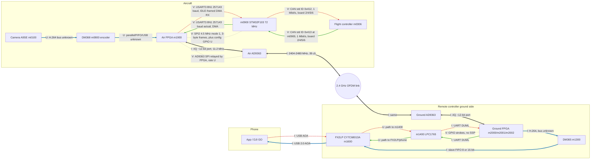
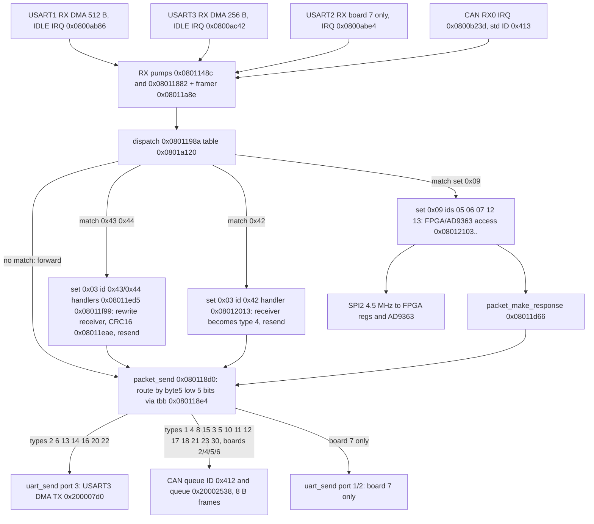
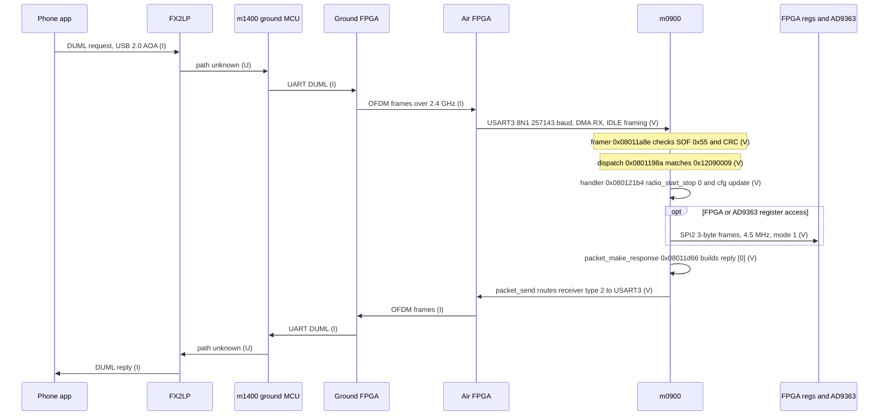
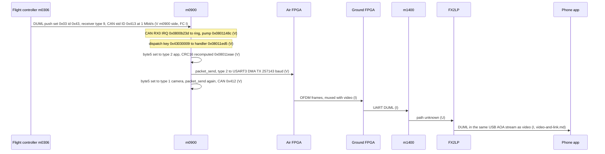

# System data flow — video, telemetry, control planes

Built from firmware evidence (m0900 `P3X_FW_V01.11.0020`, app base `0x08008000`) and the repo docs. **No DJI schematic exists on this machine**; every edge is tagged.

- **V** verified: read from m0900 code or Renode readback (address cited).
- **I** inferred: reasoned from firmware/docs/wiki, not observed.
- **U** unknown: no evidence either way.
- Bus rates: `docs/data/m0900-buses.tsv` (derivations there). Scope: architecture only, no keys, no geofence, no control bypass (`CLAUDE.md`).

## 1. Rate summary (m0900 side, all derived)

| Bus | Framing | Rate | Tag |
|---|---|---|---|
| SYSCLK / PCLK1 / PCLK2 | HSE 12 MHz x6 PLL, APB1 /2 | 72 / 36 / 72 MHz | V (code), crystal I |
| SPI2 (FPGA bridge, AD9363) | 8-bit, mode 1 (CPOL0 CPHA1), 3-byte frames, CS=PB12 | 4.5 MHz SCK (36/8) | V (code + Renode CR1=0x355) |
| USART3 (to link side) | 8N1, DMA TX/RX, IDLE framing | 256000 nominal, 257143 actual (BRR 0x8C) | V |
| USART1 | 8N1, DMA | 256000 nominal, 256228 actual (BRR 0x119) | V |
| USART2 (board code 7 only) | 8N1, DMA | 250000 exact (BRR 0x90) | V |
| CAN1 (board codes 2/4/5/6) | std ID, TX 0x412, RX 0x413 | 1 Mbit/s (36 MHz / (3 x 12 tq)) | V |
| I2C, USB, SPI1 | not used | n/a | V (absence) |
| AD9363 sample port | ~12-bit I/Q | 11.2 MHz sample rate | I (`phy-params.md`) |

- USART3 payload ceiling = 257143 / 10 bit = ~25.7 kB/s (arithmetic, not measured).
- CAN ceiling ~ 1e6 / 111 bit x 8 B = ~72 kB/s (nominal frame, stuffing ignored).

## 2. Overview — three planes plus shared RF link

- Blue thick = video. Green solid = telemetry (aircraft to app). Red dashed = control (app to aircraft). Grey dotted = configuration. Dark thick = shared RF path (all planes ride it).
- DM365 position between ground FPGA and FX2LP is **I**: `fpga-interfaces.md` draws FPGA to FX2LP directly, `video-and-link.md` puts DM365 between.

- Edge 10/16: that USART3 faces the air FPGA/link is **I**. Evidence: `packet_send` sends receiver types 2, 6, 13, 14, 16, 20, 22 (app, RC, ground modules) out USART3 on every board code (section 3). The USART3 to FPGA wiring needs a schematic.
- Edge 9/17: CAN to FC is **I**. Evidence: on boards 2/4/5/6 `packet_send` routes type 3 only to a CAN-transmit queue (`0x0800b468` calls CAN_Transmit); no UART route exists for type 3.
- The docs' "CENTER UART 256000 8N1 to FC" is **not** reproduced by the m0900 routing on boards 2/4/5/6 (section 5, item 1).

## 3. Where DUML is injected and removed — m0900 as a router

Evidence is all in m0900 code (V). Sender and wire-level framing inside the link are not in m0900.

- m0900 is a **DUML router**, not just a radio configurator.
- Frame: byte 0 = 0x55, byte 5 = receiver (low 5 bits type, high 3 bits index), byte 9 = cmd set, byte 10 = cmd id.
- Dispatch `0x0801198a` walks the 8-byte records at `0x0801a120` (`[handler|1, type, index, set, id]`). Match: handler runs (packet is **consumed** here). No match: tail-call `packet_send` (`0x080118d0`): packet is **forwarded** by receiver type.
- Table `0x0801a0d8-0x0801a110` (ids `0x0901..0x0914`, `[handler|1, id16]`) is a second, 16-bit-id table. How it is reached is not traced (U).

Notes (all V unless marked):
- Receiver-type to port table decoded from the `tbb` at `0x080118e4`: types 2, 6, 13, 14, 16, 20, 22 go to USART3; types 1, 4, 8, 15 go to path A `0x0801141c` (CAN queue `0x20002330` on boards 2/4/5/6; USART1 or USART2 on board 7); types 3, 5, 10, 11, 12, 18, 21, 23 go to `0x08011938` (CAN queue `0x20002538` on boards 2/4/5/6, `0x0801261c` on board 7); 17 and 30 are mixed; all other types are dropped.
- Names of types: 1 camera, 2 app, 3 FC, 4 gimbal, 6 RC are verified in `protocol-verification.md`; the others (8, 13, 14 as DM36x/ground modules) are **I** from module numbers.
- Handlers for set 0x03 ids 0x42/0x43/0x44 are keyed to receiver type 9 (m0900 itself). They rewrite byte 5 (0x43: to type 2 then type 1; 0x42: to type 4), recompute the CRC16 (seed 0x3692) and call `packet_send`. Reading: **FC pushes land on m0900, which fans them out to the app via USART3 and to camera/gimbal via CAN**. Sender of these pushes is not checked in the dispatch (FC is **I**).
- Set 0x09 handlers (`docs/symbols/m0900_V01.11.0020.tsv`): cmd 05 FPGA read, 06 write (hi==0xFE: FPGA reg, else AD9363), 07 read, 12 radio SET, 13 radio GET. Replies go through `packet_make_response` then `packet_send`.
- Which physical port a given inbound packet arrived on is lost at the dispatch (no port field in the record): replies are routed by receiver type, not by arrival port.

### Injection and removal points

| Plane | Injected (generated) | Forwarded / re-addressed | Removed (consumed) | Tag |
|---|---|---|---|---|
| Telemetry (set 0x03 pushes, OSD General 0x43) | FC m0306 emits | m0900 `0x08011ed5` re-addresses to app (type 2) and camera (type 1), sends on USART3 | app/HUD at the end; air FPGA mux point not traced | V m0900; FC source I |
| Telemetry (link params ch/mcs/bw/snr/rssi) | m1400 tracks (`cpu-reversing-proof.md`) | n/a | n/a | V on m1400 string path; route to app U |
| Control (app to aircraft DUML) | App via FX2LP (I) | ground MCU/FPGA (I), air FPGA to m0900 USART3 (I) | m0900 consumes set 0x09 (radio) via dispatch; other sets forwarded by type, FC reached over CAN (I) | m0900 V, rest I |
| Video | DM368 (I) into air FPGA | air FPGA modem, ground FPGA, DM365, FX2LP | phone decoder (`libdjivideo`, docs) | I |
| Master-ID | owned by m1400, written to ground FPGA over GPIO/UART (`id-entry-point.md`) | n/a | n/a | V on m1400 |

- **Where DUML meets the video stream** (the physical mux of DUML bytes with H.264 inside OFDM frames) is **not visible from m0900**; m0900 only has a UART (USART3) into the FPGA. The mux is in the FPGA fabric (U).

## 4. Sequences

### 4a. One control command: DUML request to m0900, set 0x09 cmd 0x12 (radio SET)

- Key `0x12090009` = (cmd 0x12, set 0x09, receiver type 9 index 0). Handler `0x080121b4`: `radio_start_stop(0)`, loads cfg-word fields (channel index, etc), replies `[0]`.

- Hops marked I/U are architecture assumptions. No capture of a real session exists (`phy-params.md`: "Real DUML session driving this: unknown").
- Round-trip latency over the link: unknown.

### 4b. One telemetry message: OSD General (set 0x03 id 0x43)

- Rate of OSD pushes: handler runs a divide-by-10 counter (`0x08011f0e-0x08011f1e`); push rate itself not measured (U).

## 5. What we do not know

1. **Which USART is CENTER.** Docs say CENTER = 256000 8N1 DUML to FC. m0900 has USART1 (256000, PA9/PA10) and USART3 (256000, PB10/PB11). On boards 2/4/5/6 `packet_send` never selects port 1; FC traffic goes to a CAN queue. USART1 role on those boards: U (RX armed, no TX route).
2. **Board code to hardware mapping.** `get_board_version` (RAM `0x200000d8`) is 0 in emulation. USART2 (250000) and the USART1/2 routes exist only for code 7. Which code is P01007.06: U.
3. **Air-side video path** DM368 to air FPGA (bus, width, rate): U. Hypothesis only: USB via CAMERA connector DP/DM and FX2LP slave FIFO (`rf-sdr-and-repair.md` lists CAMERA = USB DP/DM; not confirmed).
4. **Board role.** `rf-sdr-and-repair.md` calls P01007.06 the "OFDM Receiver board" (RC side) yet wires CENTER to the ESC center board (aircraft). Air vs RC role: U.
5. Ground FPGA to DM365 to FX2LP versus FPGA directly to FX2LP: docs disagree.
6. **How DUML bytes are multiplexed with video** inside OFDM frames (separate logical channel vs inline): U. Needs an SDR capture or FPGA RE.
7. **m1400 to FX2LP/phone path** for telemetry and control: U. **Ground AD9363 config path**: LPC1765 has no SSP use, so how the ground AD9363 is programmed: U.
8. **Air over-the-air encryption** is not ruled out (`what-is-actually-secret.md` LAYER CAVEAT). MCU-layer DUML cleartext is shown; the link layer is not.
9. FPGA-to-AD9363 SPI rate, data-port mode (LVDS vs CMOS), width: U. Fref 40 MHz: I.
10. Second CAN TX queue `0x20002538` ID word: not decoded. Table `0x0801a0d8` id16 dispatch entry path: not traced. Pump source of ring `0x200024b8+0xa0`: not traced.
11. HSE 12 MHz is a compiled literal; crystal on the board not read: I.
12. Why SPI2 runs /8 (4.5 MHz) while PCLK1/2 would be 18 MHz: reason not recorded.

## 5a. Cross-check against the DJI GO 4 APK's cmdset-9 names - numbering does not match (2026-10-23)

Per the revised scope decision in `apk-analysis.md` section 0 (numeric facts from the
dynamically-unpacked dex only, never DJI's code), `docs/data/apk-dynamic-cmdset-ids.tsv` names
cmdset 9 (app's internal name: `OSD`; this doc's/dissector's name: `HD Link`) commands `SetFPGA`
(4), `GetFPGA`(5), `Set9363`(6), `Get9363`(7) - **four separate named commands**, not the single
combined-write-with-discriminator-byte scheme this doc's own firmware trace found.

- **V, does not reconcile cleanly.** This doc's own `m0900` dispatcher trace (section above,
  `0x08012103`) found: cmd `05`=FPGA read, `06`=write (one command, internally distinguishing
  FPGA-register-vs-AD9363 via payload byte `hi==0xFE`), `07`=another read variant, `12`/`13`=radio
  SET/GET. `GetFPGA`(5) and `Get9363`(7) line up with the firmware's `05`/`07` reads, but
  `SetFPGA`(4) does not match the firmware's combined write at `06`, and the firmware's
  single-command-with-discriminator-byte design doesn't match having two separately named
  `Set*` commands in the app's enum.
- **U, not resolved:** whether this reflects (a) a different/later HD-Link generation's protocol
  than what this specific `m0900` firmware (`P3X_FW_V01.11.0020`) implements, (b) this
  particular APK version carrying dead/unused enum constants for a feature P3 doesn't support,
  or (c) an error in the original firmware-side numbering note above. Flagged rather than
  assumed - do not treat the two sources as confirming each other on this specific point.
- **I, still useful regardless:** cmdset 9 overall is confirmed real and rich - 58 named
  commands including signal quality, sweep frequency, channel status, MCS (modulation/coding
  scheme) control, LBT (listen-before-talk), link-mode, image-transmission-mode, reverse-link
  direction, and raw FPGA/AD9363 register access. This is the concrete, app-facing surface to
  capture traffic on (via the now-working AOA relay, `docs/aoa-live-test-2026-10-23.md`) to
  finally find a real scrambler-seed register write, if one exists - still open per
  `cpu-reversing-proof.md`'s status table.

## 6. Reproduce

- Clock/bus derivation: `python3 scripts/re/m0900_trace.py dis 0x0800ddc8 40`, `dis 0x0800dd28 60`, `dis 0x0800aca0 400` (uart_init), `dis 0x0800b536 60` (SPI2), `dis 0x0800b31c 60` (CAN).
- Routing: `dis 0x080118d0 90`, `dis 0x0801198a 40`, `dis 0x08011ed4 60`; tbb table bytes at `0x080118e4` (31 entries, target = `0x080118e4 + 2*byte`).
- Literal-pool peripheral scan: `python3 tmp/periph_scan.py`. Renode CR1 readback: `tmp/buses_probe.resc` (boot 2 s, read `0x40003800`; USART BRR is not modelled by Renode so those are static only).

## 7. CAN1 bus (m0900) - message inventory and driver layer (issue #36)

Source: `firmware/P3X_FW_V01.11.0020_m0900.bin` (sha256 `72156b4b...`), Ghidra 12.2 headless, ARM:LE:32:Cortex, raw load `0x08000000`. Rerun: `python3 scripts/re/m0900_can_ghidra.py` (post-script `scripts/re/ghidra/M0900Dump.java`). Output `tmp/m0900_can_ghidra/m0900_dump.txt`, literal scan `tmp/m0900_can_ghidra/literal_hits.txt`. Names below are ours; Ghidra project is not persisted (`-deleteProject`), so renames live here, not in a .gpr.

**Scope status:** driver layer and endpoint table resolved; frame-payload meaning of 0x412/0x413/0x414/0x415 is largely **U**. RX ISR body (`0x0800b23c`) does not decompile cleanly - see gaps.

### 7.1 Peripheral and state (V unless marked)

- CAN1 base `0x40006400`: literal `0x08000a1c` (used by `0x08000620`). Filter master `0x40006600`: literal `0x08000a20`.
- Pointer literals at `0x080034f0`: `[0]=0x40006400` CAN1 base, `[4]=0x200015d0` CAN endpoint table, `[8]=0x20000090` CAN state block, `[0xc]=0x40010800` GPIOA (CAN pins, I).
- CAN state block `0x20000090` (`DAT_080034f8`): `+0` TX-ready flag (set to 1 by `0x08003298`, cleared by `0x08003468`), `+4` TX endpoint count, `+8` RX endpoint count.
- Endpoint table `0x200015d0`: RX slots `+0..+0x30` (13 x u32), TX slots `+0x34..+0x64` (13 x u32). Max 13 each.

### 7.2 Endpoint objects (ID-keyed; V by arithmetic on the registration calls)

| Std ID | Dir | Object base | Queue size | Registered by |
|---|---|---|---|---|
| 0x412 | TX | `0x20002330` (= `0x20001f30`+`0x400`) | 0x200 | `0x080093a8` (gated, see 7.4) |
| 0x413 | RX | `0x2000234c` (= `0x20002130`+`0x21c`) | 0x200 | `0x080093a8` (gated) |
| 0x414 | TX | `0x20002538` (= `0x200024b8`+`0x80`) | 0x40 | `0x08009828` (ungated in `0x08005b00`) |
| 0x415 | RX | `0x20002554` (= `0x200024b8`+`0x9c`) | 0x40 | `0x08009828` (ungated) |

- So the doc's "CAN TX queue `0x20002538`" is the **0x414 TX endpoint**, not the 0x412 queue (V). The 0x412 TX endpoint is `0x20002330`, which the dispatch table already names as path A (types 1, 4, 8, 15, `dataflow.md` routing notes).
- Endpoint layout (V): `+0` std ID u32, `+0x06` queue size, `+0x08` size-1 mask, `+0x0a` owner pointer, `+0x0c` direction byte (1 = TX).
- RX endpoints also program a hardware filter: `0x0800072e` with ID `<<5` and mask `0xffff` (ST 16-bit list layout, V from code).

### 7.3 Driver functions (ST StdPeriph pattern, V unless marked)

| Address | Name (ours) | Role |
|---|---|---|
| `0x08000620` | `can_rcc_enable` | RCC APB1 enable, bit 25 (CAN1) or 26 (CAN2) by base compare |
| `0x08000646` | `CAN_Init` | MCR INRQ, wait INAK, MCR bits TTCM/ABOM/AWUM/NART/RFLM/TXFP, BTR = LBKM<<30, SJW<<24, BS1<<16, BS2<<20, BRP-1 |
| `0x0800072e` | `CAN_FilterInit` | filter bank setup from ID/mask struct |
| `0x080008a0` | `CAN_Transmit` | select empty TX mailbox from TSR (TME0 bit 26, TME1 27, TME2 28, else return 4 = no mailbox), write TIR/TDTR/TDLR/TDHR at `+0x180`, set TXRQ |
| `0x0800331c` | `can_bus_init` | GPIO/AFIO, RCC enable, `CAN_Init` with the values below, zero endpoint table |
| `0x080033ec` | `can_endpoint_register` | fills endpoint, appends to RX (+filter) or TX table |
| `0x080034e6` | `can_endpoint_reset` | zeroes two counters in an endpoint |
| `0x08003298` | `can_tx_pump` | scans TX table, first endpoint with pending bytes -> `CAN_Transmit` (ID = `*ep`, DLC = min(len,8)) |
| `0x08003468` | `can_send_bytes` | pushes N bytes into endpoint FIFO (`0x08004274`), when TX-ready flag set and len>0 sends one frame |
| `0x08005b00` | `app_init` (ours) | top-level bring-up; calls `0x0800331c` (board code 2/4/5/6 gate), `0x080093a8`, `0x08009828` |

Bit timing (V from `0x0800331c` stores): prescaler field 3 (BRP=2), BS1 raw 5 (6 tq), BS2 raw 4 (5 tq), SJW raw 0 (1 tq). 36 MHz / (3 x 12 tq) = 1 Mbit/s. Matches the 1 Mbit/s already in this doc.

### 7.4 Frame layout (V, from `0x080008a0` and `0x08003298`)

- Frame struct: `+0` std ID (u16 used; `ID<<21` into TIR), `+4` ext ID, `+8` IDE byte, `+9` RTR byte (OR'd raw into TIR, I on the bit value), `+10` DLC, `+11..+18` data D0..D7.
- Data words are packed little-endian into TDLR (D0..D3) and TDHR (D4..D7).
- `0x08003298` builds the frame ID from the endpoint's first word and takes payload bytes from the FIFO at endpoint `+4`, DLC capped at 8.

### 7.5 Board-code gate (V)

- `0x08004142` returns `*0x200000d8` (board code). Boards 2, 4, 5, 6 (values checked in that order) run `0x0800331c` and register 0x412/0x413 (`0x080093a8`). Board 7 does not use CAN here.
- `0x08009828` (0x414/0x415) is called unconditionally from `0x08005b00`. Whether it is needed on board 7 is **U**.

### 7.6 IDs in use (inventory so far)

- **0x412 TX, 0x413 RX**: board 2/4/5/6 (V). Relay path already in this doc (section 4 / push set 0x03 id 0x43).
- **0x414 TX, 0x415 RX**: registered on all boards (V registration; I that it is always used). Its TX endpoint is the target of routing types 3, 5, 10, 11, 12, 18, 21, 23 (`dataflow.md` routing notes).
- **Payload meaning of 0x412-0x415: U.** The DUML relay case is confirmed from the dispatch code, not from frame captures.

### 7.7 RX path (partial)

- Vector 36 (IRQ 20, `USB_LP_CAN1_RX0`) is `0x0800b23c` (the `0x0800b23d` in the spec is the Thumb address). The decompile of that handler is not reliable (register-pair confusion), so the RX read sequence (FIFO0 read, release, endpoint match by ID) is **U**.
- RX byte FIFO `0x200024b8+0xa0` is drained by `0x08009882`, which calls the framer `0x08009a8e` and dispatch `0x0800998a` on completion (V). Which code writes that FIFO from the ISR is **U**.

### 7.8 Gaps and next steps

1. Decode the RX ISR at `0x0800b23c` by hand from disassembly (decompiler output unusable here). Target: FIFO0 read and ID match.
2. Enumerate every caller of `0x08003468` (`0x08009460`, `0x0800987e`, both unnamed in Ghidra) to get the full TX ID/payload inventory.
3. Persist Ghidra renames in a project (the current pipeline discards it).

### 7.9 External corroboration - is CAN1 the motor/ESC bus? (2026-10-24)

Public RE community sources, not this repo's own analysis - see issue #36 for the search.

- **Confirmed for the P3 family** (`o-gs/dji-firmware-tools` wiki, "P3 Flight Controller aka MC" and "P3X ESC center board" pages): ESC control is shared UART (`U3_TX`/`U3_RX`, FC-to-ESC-MCU init/handshake/config) **plus** 4 separate PWM lines (`PWM1`-`PWM4`) for per-motor throttle - not CAN. Each ESC is a TMS320F28027F "Piccolo" driving a DRV8301 pre-driver; no CAN tie documented on that chip either.
- The FC board (`m0305`/`m0306`, STM32F427) does expose `CAN1_T`/`CAN1_R` service pads, separate from the `U3` ESC-UART pins - consistent with this doc's CAN1 = DUML-relay finding, not raw motor control.
- **Generational precedent only** (Phantom 4, WM330 FC Core board wiki page): same pattern - `CAN1_T`/`CAN1_R` pads present, separate from the FC Damping board's `PWM1`-`PWM4` ESC lines.
- **DroneCAN/UAVCAN**: no evidence DJI's aircraft stack uses or was influenced by it. DJI's RoboMaster line (ground robots, unrelated product) does use CAN for its C610/C620 ESCs with its own open protocol, but that's a different product family, not the Phantom aircraft.
- Net: nothing public contradicts the static finding that CAN1 on `m0900` carries relayed DUML rather than ESC/motor commands.
4. `0x0800c808` has 94 callers and looks like a generic helper, not CAN-specific. Not named yet.
