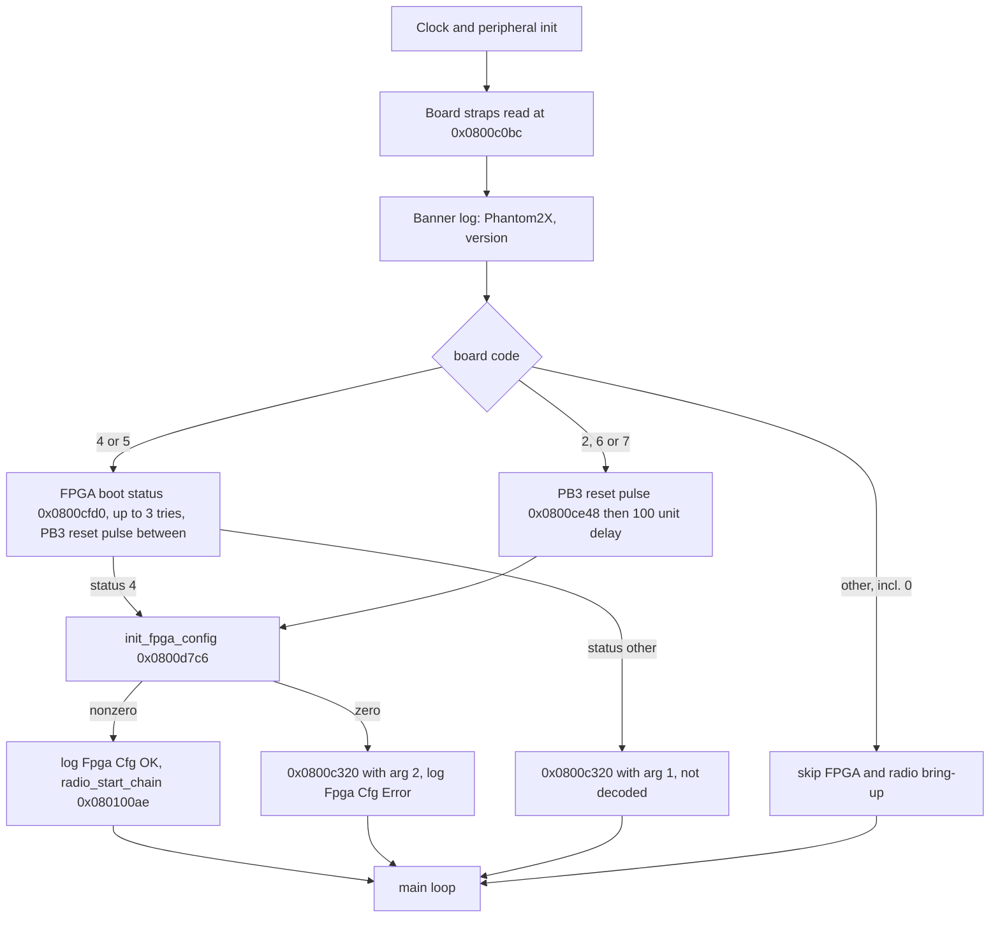

# m0900 boot: board straps, FPGA GPIO lines and bring-up sequence

Source: static disassembly of `P3X_FW_V01.11.0020_m0900.bin` (STM32F103, app base `0x08008000`)
plus one Renode cold-boot test. Reproduce: `python3 scripts/re/m0900_trace.py dis <addr> <n>`.
Tags: **verified** (read from code or reproduced), **inferred**, **unknown**.

## Corrects earlier docs

- Earlier claim "AD9363 bring-up is gated behind a DUML set 0x09 command": **wrong**.
- Real gate: `main` (`0x0800db00`) skips the whole FPGA/AD9363 bring-up when the board code is
  not in {2,4,5,6,7}. The code is read from GPIO straps; Renode read all straps as 0 (no pull-up
  model), so the bring-up never ran. (verified)

## Boot flow (`main` @ `0x0800db00`, verified)

- Log calls were compiled out (calls to empty `nullsub_1` at `0x0800c2b8`). The strings
  `Fpga Boot : %d` (`0x0800dcd4`), `Fpga Cfg : OK` (`0x0800dce8`), `Fpga Cfg : Error`
  (`0x0800dcf8`) are still in flash and map onto the three branches above.
- Main loop (`0x0800dc62`): three flags set by a tick counter (`0x0800c154`, divides by 5, 20
  and 100) at RAM `0x200000dc/dd/de` run periodic tasks: `0x80105da`, `0x8012626` (5-tick);
  `0x800b6ac`, `0x800b808`, `0x801148c`, `0x8011882`, `0x8011682`, `0x8011540`, `0x80118b8`,
  `0x800c34a` (20-tick); `0x800bd74` (100-tick). Task meanings not decoded except where noted.

## GPIO lines (verified from code; roles inferred)

| Line | Function | Direction | Evidence |
|---|---|---|---|
| PA0 | board strap bit 2 (value 4); input with pull-up | in | `0x0800c0bc` |
| PC15 | board strap bit 1 (value 2); floating input | in | `0x0800c0bc` |
| PC14 | board strap bit 0 (value 1); floating input | in | `0x0800c0bc` |
| PB3 | FPGA reset, active low, idle high; low pulse of ~200 loop iterations (role inferred from call site) | out | `0x0800ce14` init, `0x0800ce48` pulse |
| PA13 | control line, push-pull, driven low at init, set high by `0x0800ce6c` (role unknown; SWDIO pin repurposed, SWJ_CFG written at boot) | out | `0x0800ce14`, `0x0800ce6c` |
| PB12 | SPI2 chip select for FPGA bridge, active low | out | `0x0800b5e8/b5f6` |

- Board code = `(PA0 << 2) | (PC15 << 1) | PC14`.
- Board variants (outside source: dji-firmware-tools `lightbridge_stm32_hardcoder.py`, variant names `ad1`-`ad5`, `ar0`, `ar6`, `ar7`): codes 2, 4, 5 = Analog Devices transceiver boards (AD9363 family); codes 6, 7 = Artosyn AR8003 boards. Which code the owned board has: unknown (P01007.06 is the AD9363 + Cyclone V revision per the wiki; P01007.14 is Artosyn).
- Pull-up on PA0 means an unstrapped board reads at least 4.

## FPGA boot handshake (`0x0800cfd0`, partly decoded)

- Bit records at `0x0801623c`, 3 bytes each `[idx, fpga_reg, mask]`; helpers set (`0x0800cf48`),
  clear (`0x0800cf66`) and test (`0x0800cf86`) bits through SPI2. Records: 0 reg0 b0; 1 reg1 0x20;
  2 reg0F 0x02; 3 reg0 b0; 4 reg1 b0; 5 reg0x8A 0x03; 6 reg1 0x10; 7 reg0F b0; 8 reg0 0x80;
  9 reg0F b0; 10 reg2 b0.
- Sequence: write reg0=1, set reg0 bit7, delay 10 units, test reg 0x8A[1:0]; wait for it to
  clear (up to 200 polls); set reg0 b0 and wait for reg 0x8A[1:0]==1 (up to 400 polls); retry up
  to 3 times. Return codes seen: 3, 8, 9, and 4 (ready, proceeds to `init_fpga_config`).
- What reg 0x8A means is **unknown**. A modelled rule in the Renode tap did not satisfy the
  handshake (reverted); real FPGA behaviour is needed.
- Renode test (verified): with PA0 set, board code reads 4 and the firmware starts the FPGA boot
  on its own (about 500 SPI ops, all FPGA register reads/writes), then times out on reg 0x8A.

## Consequences

- No trigger is needed on real hardware: the radio comes up at power-on if the straps and the
  FPGA handshake succeed.
- `renode/scripts/m0900_trigger_capture.resc` still gives the AD9363 profile by calling
  `init_fpga_config` directly; its "DUML-gated" comments are corrected.
- The DUML set 0x09 handlers change settings at run time; they are not the power-on path.

## Open

- Meaning of FPGA regs 0x8A, 0x00 bits 0 and 7, 0x01, 0x0F, 0x02 (all bits tested above).
- Role of PB3 and PA13 on the board; which AD code (2, 4 or 5) matches P01007.06.
- Return codes 3, 8, 9 of `0x0800cfd0` and `0x0800c320` (called with 1 or 2 on failure paths).
