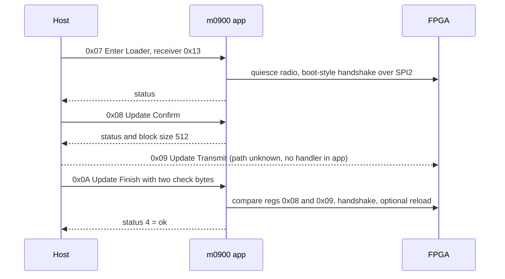

# m0900 (`air_router_stm32f103`): firmware / FPGA (`air_fpga_cyclonev`) upgrade path and chip ID

Source: static disassembly of `P3X_FW_V01.11.0020_m0900.bin` (app at `0x08008000`; the
bootloader at `0x08000000-0x08007FFF` is NOT in the container, so it is not analysed).
Command names from dji-firmware-tools `dji-dumlv1-general.lua`. Tags: verified / inferred / unknown.
Interop analysis only: no keys, no signing bypass (CLAUDE.md).

## Upgrade commands handled by the app (DUML set 0x00; dispatch table `0x0801a120`)

Dispatch key = `(cmd_id << 24) | (cmd_set << 16) | receiver_type`. Receiver types here: 9 (this MCU), 0x13 (FPGA).

| cmd | name (dissector) | handler | receiver 9 (MCU self-update) | receiver 0x13 (FPGA) |
|---|---|---|---|---|
| 0x07 | Enter Loader | `0x08012320` | writes marker `OOXX` to flash page at offset `0x7400` via `0x08012690`/`0x0800bc2c`; error 0xF6 if the write fails; after the reply sets RAM flag `0x200000c8` (consumer not decoded) | only boards 4/5: radio quiesce `0x08010286`, then FPGA upgrade-mode handshake `0x0800d112` (status 0 ok, 5/8/9 fail) |
| 0x08 | Update Confirm | `0x080123b8` | not handled | reply = `[status from 0x0800d1ea, block size 0x0200]` (512 B) |
| 0x09 | Update Transmit | **no handler** | - | **no handler**; type 9 and 0x13 are not forwarded by `packet_send` either (drop target `0x08011988`) |
| 0x0A | Update Finish | `0x080123e6` | not handled | `0x0800d206`: see below |
| 0x0B | Reboot Chip | `0x08012428` | not decoded | not decoded |
| 0x0C / 0x0D | Get Device State / Set Device Version | `0x08012458` / `0x080124bc` | not decoded | not decoded |

(verified: table, handlers, flow. Meanings of "block size" and the status codes are inferred.)

## FPGA upgrade handshake (helpers `0x0800d112`, `0x0800d1ea`, `0x0800d206`, `0x0800d2d8`)

- Uses the same bit records as the boot handshake (`docs/fpga-bringup.md`): FPGA regs 0x00, 0x01, 0x02,
  0x0F, 0x8A tested and set over SPI2.
- Update Finish `0x0800d206(payload+1)`: needs FPGA reg 0x0F bit1 set (else status 7); compares FPGA
  reg 0x09 with payload byte 1 and reg 0x08 with payload byte 2 (else status 6); then drives the
  records and polls reg 0x8A; status 4 = ok, status 2 also calls the reload `0x0800d2d8`.
  The two compared bytes look like a 16-bit checksum/version computed by the FPGA (inferred).
- Compares RAM `0x200000f4` with `0x010007ec` (a device/version word) in Confirm and Finish (meaning unknown).
- **Where the FPGA image bytes travel is unknown.** The app has no Update Transmit handler and does
  not forward type 0x13. Candidates: handled in the bootloader after Enter Loader, or sent to the FPGA
  by a path that does not pass through m0900. Not testable without the bootloader.

## Stored pages next to the bootloader (flash offsets from 0x08000000)

- `0x7400`: upgrade marker `OOXX` (written by Enter Loader, receiver 9)
- `0x7800`: second page with the same write/read helpers (`0x080126b8`, `0x080126d4`), use not decoded
- `0x7b00`: 256-byte config page loaded by `0x0801279a`, validated by `0x08011e7a` (CRC assumed, not
  verified), copied into the RAM struct at `0x200019b8`; board 6/7 fall back to defaults in flash

## Chip ID

- STM32 96-bit unique ID (`0x1FFFF7E8`) is read in exactly one place, `0x080127be`, which copies 12 bytes.
- Its only caller is the handler `0x080110f2` for request id `0x0904`; the reply (id `0x0954`) carries
  the 12 UID bytes in a 0x18-byte frame. (verified)
- The UID is NOT read or checked in the upgrade handlers above. No other UID, flash-size or DBGMCU
  ID reads exist in the app. (verified by search)
- FPGA ID: the MCU never reads an FPGA chip/die ID. The only FPGA values compared in upgrade are regs
  0x08/0x09 against two host bytes. (verified)
- Unknown: whether the bootloader checks the UID or signs/verifies the image (not in the container).

