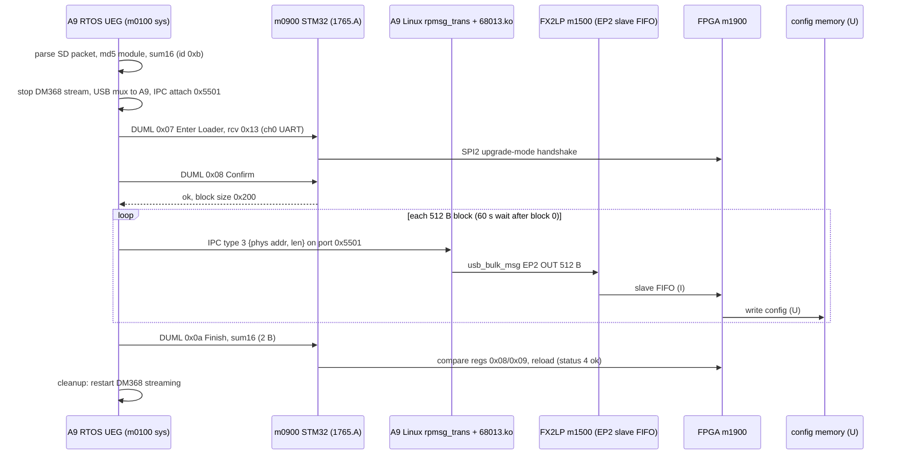

# Air FPGA image: write path during a Phantom 3 Professional update

Static analysis of P3X V01.11.0020. Script: `scripts/re/fpga_write_path.py` (log `tmp/logs/fpga_write_path.log`).
Tags: **V** verified in bytes (address given) / **I** inferred / **U** unknown. No key, cipher or signing values read.
Builds on [fpga-upgrade-path.md](fpga-upgrade-path.md) (m0900 handlers) and
[air-id-and-stream-survey.md](air-id-and-stream-survey.md) (UEG table, m1500). Not restated here.

## Answer

- V: FPGA image blocks do **not** travel as DUML Update Transmit (0x09) packets. No type-19 0x09 packet is ever built.
- V: the FPGA table entry uses `DjiUegFwUsbTransmitSend` (`0x0e89ec48`). Path: A9 RTOS UEG -> IPC msg type 3 -> A9 Linux `rpmsg_trans.ko` -> `68013.ko` -> `usb_bulk_msg` EP2 OUT, 512 B chunks -> FX2LP (m1500) slave FIFO.
- I: FX2LP FIFO master = FPGA (existing I in the survey doc); FPGA-side logic then writes its configuration memory.
- U: which chip finally writes the configuration flash/config memory. Evidence below says it is not m0900, m0100, or m1500.

## Correction to earlier docs (off-by-one entry)

- V: UEG entry base = path string - 0x42 (path at `+0x42`). Handler cells live at entry `+0x8c..+0xb8`; transmit-send cell = entry `+0xa4`.
- V: the earlier "transmit cell at path-0x5a" is `path-0x5a = entry-0x18` = previous entry's `+0xa4`. All FPGA/68013/1765 transmit and wrapper-id attributions shifted by one entry.
- V: fw-id = low byte of entry word 0 (agrees with the wrapper `mov r0,#id`). Corrected ids: 1765 = 10, **FPGA = 11 (0xb)**, 68013 = 12, DM368 = 13 (previously 9/10/11/12).
- V: own cells (`0x0edbae4c`, `PFPGAFw3.bin`, id 11, type 19): `+0xa4` = `DjiUegFwUsbTransmitSend`, `+0xb0` = `DjiUegFpgaFinishHandle` (`0x0e8998a8`), `+0xb4` = `DjiUegFpgaCleanUpHandle` (`0x0e8a00e8`). `+0xa8`/`+0xb8` null (no transmit/reboot response handler).
- V: 68013 entry (`0x0edbaf08`, id 12): `+0xa4` = generic DUML transmit, no special finish/cleanup cells.
- Affected text: survey doc "Upgrade engine (UEG)" bullets 2-4, `docs/symbols/air_modules.tsv` rows `ueg_entry_*`, `DjiUegFpgaFinishHandle`/`CleanUp` notes, `air_survey.py` `wrapper_fwid` and `path-0x5A` cell read. Not edited here.
- The names `DjiUegFpgaFinishHandle`/`CleanUp` now sit in the FPGA entry: consistent.

## Mode of the sys image (ARM vs Thumb)

- V: A32. Method (`mode_check()`): 8876 4-aligned `push {..,lr}` words and 2136 `bx lr` words vs 696 Thumb push halves; `DjiMsgChannelInit` (`0x0e861988`) decodes as `push {r4,r5,r6,lr}; sub sp,#0x28`; ARMv7 ops (`movw`, `movt`, `bfi`, `uxtb`, `ldrd`) throughout.
- V: IAR-style byte-table switches: `ldrb rN,[pc,rI]; add pc,pc,rN,lsl #2` (table at `ldrb_addr+8`, targets `add_addr+8 + 4*byte`).
- m0900 is Thumb (Cortex-M); handled separately in the script.

## 1. DUML routing: type 19 -> which channel

- V: send task `DjiMsgSendTask` (`0x0e866adc`): `blx [0x109bdc60]` with `r0 = &pkt[5]` (receiver byte), `r1 = &channel`; then `blx [0x109bdc5c]` (send fn) after checking channel-open flag.
- V: cells set once by `0x0e868248` from `DjiMsgInit` (`0x0e8685c0`): init `0x0e861988`, recv `0x0e861bbc`, send `0x0e861c40`, route `0x0e861cc4`.
- V: route fn `0x0e861cc4`: byte-table `0x0e861ce4`, index = (receiver byte & 0x1f) - 1.
  - ch2: type 8 (DM368.A), type 15 (68013.A).
  - ch1: type 30.
  - drop (-1): types 24, 25, 26, 28, 29.
  - type 1 (CAMERA): self check only.
  - ch0: everything else, **including type 9 (1765.A) and type 19 (FPGA.A)**.
- V: `DjiMsgChannelInit` switch (`0x0e8619bc`, bytes `00 2f 34 39`): ch0/ch1/ch2 = UART config (first config word `0x1c200`, I: 115200 baud); ch3 = IPC command channel (`0x0e861628`).
- V: send fn `0x0e861c40` table: ch0..2 -> `0x0e7f1c30` (UART write, uart index = ch+1 via `0x0e861dd0`); ch3 -> `0x0e861934` (IPC).
- V: alternate route fn `0x0e861d60` is selected only by the test command `DjiMsgTestRouteSet` (`0x0e86b08c`); not default. In it type 19 -> ch2.
- V: type 19 DUML (Enter 0x07, Confirm 0x08, Finish 0x0a, built by generic `MsgEntrySend`/`ConfirmSend`/`FinishSend`) goes out on ch0 = UART index 1.
- I: m0900 sits on that UART (it handles `0x07/0x08/0x0a` for receiver 0x13, see fpga-upgrade-path.md). Not proven from the camera side.

## 2. Transmit step (FPGA entry)

- V: `DjiUegFwUsbTransmitSend` (`0x0e89ec48`):
  - file = packet `.bin` on SD (`fw+8`), offset = `[fw+0x48] + [fw+0x458]*[fw+0x460]` (module offset + block size * index), reads `[fw+0x458]` bytes (`0x0e89ed80`).
  - sends `[fw+0x458]` bytes from a 0x400-byte zeroed stack buffer via `DjiIpcSendDataSyn` (`0x0e913978`, chan = `[fw+0x450]`, resp NULL, timeout 0x3e8 = 1000 ms) at `0x0e89ee84`.
  - last block must read short only at index `[fw+0x45c]-1`, else "Read File Fail".
  - after block 0: sleep 0xea60 = 60000 ms (`0x0e89ef24`); I: flash erase time.
- V: block size = u16 from the Confirm reply when ccode 0 (`0x0e89df04`: `ldrh [r6]; str [r5,#0x458]`). m0900 replies 0x200 (fpga-upgrade-path.md). 512 B = FX2 EP2 bulk packet size (m1500 `EP2CFG=0xA0`). I: one block = one bulk packet.
- V: no packet header, no per-block index on the wire: the IPC payload is the raw 512 B block. (The DUML variant at `0x0e89e018` frames `[u8][u32 idx][u16 len][data]` instead; not used for FPGA.)
- V: prep gated on `fw-id == 0xb` in `DjiUegFwUpdateById` (`cmp r0,#0xb` at `0x0e8a4a6c`), in order:
  - wait for Linux boot (`MCCTRL` ready flag `[0x1096e154]`, 20 tries; "Linux Boot Up Fail" `0x0e8a4ad4`);
  - `DjiIpcAttach(0x5501)` (`0x0e8a4b68`) -> store IPC channel in `[fw+0x450]` (`0x0e8a4c44`);
  - "Switch To USB Host" (`MCCTRL_SetUsbMode`, `0x0e8dd078`, poll `0x0e8dce24` bit 1, 10 tries);
  - `DjiUegDm368StreamControl` stop (`0x0e8423d0`, 20 x 500 ms; "Stop Streaming Fail").
- I: USB host switch = USB mux between DM368 and A9, A9 takes the FX2LP (names `MCCTRL_SetUsbMode`, "connect usb to A9 / DM368").
- V: Finish step (`DjiUegFwMsgFinishSend`, `0x0e89e608`): for fw-id 0xb payload = **2-byte sum16** from `[fw+0x484]`; other modules send 16-byte md5 from `[fw+0x474]` (`0x0e89e760` compare). Matches m0900 Finish comparing FPGA regs `0x08/0x09` with payload bytes 1/2: the "16-bit checksum" in fpga-upgrade-path.md is now V on the camera side (algorithm U).
- V: cleanup step (`DjiUegFpgaCleanUpHandle`) restarts DM368 streaming; role per survey doc.

## 3. Package selection and verification (sys UEG + m0101)

- V (strings, xrefs): SD file patterns `C:/P3X_FW_V??.??.????.bin`, `..._????.bin`, `C:/PFC300XFw3.bin` exist in **m0101** (`0x5670..0x56a0`) and the UEG ("Packet Detected").
- V: m0101 = camera-only loader: model-name check, firmware header check, per-partition CRC32 ("Invalid CRC32 code!"), writes camera NAND. Counts of `fpga`/`FPGA`/`68013`/`usb` strings in m0101: 0. m0101 is not in the FPGA path.
- V: UEG packet stage (names): `DjiUegPktHeaderGet`/`HeaderCheck` (MagicCode, Manufacturer, ProductName, version triple, rollback), `VersionCheck` ("Skip Unneed Firmware ModuleId[%d %d]"), `UserConfirm`, `DjiUegPktFwInfoInit` (`0x0e8a9100` region).
- V: module header entry (in `FwInfoInit`): byte 0 = module id (type 5 bits, index 3 bits) looked up against the table by `0x0e89a500`; `+4` version (copied to `fw+0x4c`); `+8` data offset (`fw+0x48`); `+0xc` data size (`fw+0x454`).
- V: md5 of the module bytes checked against the header (retry 3, "Vertify MD5 Fail", helper `0x0e8a93d0`); 16-byte md5 stored at `fw+0x474`.
- V: only for fw-id 0xb: sum16 over the module bytes (`0x0e839b14`, 3 tries must agree, "Calc Sum16 Fail" `0x0e8a9724`) stored at `fw+0x484`.
- V: the Rx-side CRC/MD5/size checks (`DjiUegFwRxFinishHandle`, `0x0e8a35b8..0x0e8a3a84`) are for firmware received over the link into the camera, not for modules sent out.
- I: bytes written to the FPGA path = the module data of `PFPGAFw3.bin` straight from the SD packet (the m1900 container), unmodified. Not compared byte-for-byte.
- U: the sum16 algorithm and whether the FPGA recomputes it over the same bytes (m0900 only compares two FPGA regs).

## 4. Linux hop (A9 Linux 3.8.0 rootfs)

- V: IPC message header (`0x0e913414..0x0e913540`): u16 magic `0x7788` at +0; src port `0x5500|n` at +4; dst port `0x6600|n` at +6; `DjiIpcSendDataSyn` sets type 3 (+8), size 0x1c (+0xa), data pointer (+0x10), length (+0x14).
- V: `rpmsg_trans.ko` `ul_rxproc_usbdrv` (+0x610): checks magic `0x7788`; type 3 -> `ambarella_phys_to_virt(+0x10)`, `ambcache_inv_range`, `usb_cy7c68013a_write_s(buf, len)` (+0x744). Type 2 -> second `usb_cy7c68013a_write_s` call (+0x7bc).
- V: `68013.ko` `usb_cy7c68013a_write_s` (+0x38): loop of `usb_bulk_msg`, chunk = min(remaining, 512), pipe = bulk | endpoint 2 | OUT | devnum, timeout 0x30d40 = 200000 ms per message.
- V: `68013.ko` matches only `usb:v0547p1002` (the m1500 runtime id after `fxload Vend_Ax.iic`).
- I: RTOS port `0x5501` is the rpmsg `dji_usbdrv` channel. Basis: the type-3 layout above is exactly what `ul_rxproc_usbdrv` consumes, and no other `ul_rxproc_*` calls the USB writer (`ul_rxproc_app` just forwards via netlink). The port-to-channel table (`rpmsg_trans_id_table`, `gstRpmsgChn`) was not decoded.
- V: m1500 EP2 = bulk OUT 512 B quad, AUTOOUT into slave FIFO (survey doc). Bytes leave the A9 on USB; nothing in the camera interprets them after `usb_bulk_msg`.

## 5. m0900 re-check (point 4 of the brief)

- V: dispatch fn `0x0801198a` matches `[rcv type][rcv idx][cmd set][cmd id]` against the 28-record table `0x0801a120`. Receiver-0x13 keys: cmd `01`, `07`, `08`, `0a`, `0c`, `ff` (set 0). No key for cmd `0x09` in any set 0 record.
- V: no-match default `0x080118d0`: tbb table `0x080118e4` by receiver type; type 19 -> `0x08011988` = `pop {r4-r6,pc}` (drop). Types 1/4/8/15 -> `0x0801141c`; 2/6/13/14/16/20/22 -> `0x0800b0a4`; 3/5/10/11/12/18/21/23 -> `0x0801261c`; 30 conditional.
- V: so a 0x09 to receiver 0x13 would be silently dropped by m0900. Consistent with the camera never sending one.
- V: cmd `0xff` rcv 0x13 handler `0x0801253b` copies a 0x1a-byte string (version/info query), not data.
- V: SPI2 base literal `0x40003800` appears once (`0x08009c04`, register driver). Enter Loader helper `0x0800d112` sets bit 0x80 in FPGA reg 0 and polls reg 5 (retry loops); `0x0800d2d8` polls reg 5 for status 3. Register handshake only, no data loop found.
- V: m0900 app is 75796 B; the FPGA module span is ~2 MB (survey doc, m1900). m0900 cannot hold or stage the image in its own flash.
- U: the bootloader (`0x08000000-0x08007fff`) is not in the container; nothing shows it receives FPGA data (no UART data path for it either: Enter Loader for rcv 0x13 does not reboot).

## Final path

## Chip that writes the configuration memory

- U. Candidates and evidence:
  - m0900: V no data path (no Transmit handler, type 19 dropped, SPI2 register-only helpers, too small). Excluded as data writer; it only gates and checks the FPGA.
  - m0100 / A9: V sends bytes over USB only; no SPI/JTAG/config-pin driver referenced (survey doc: no `fpga/jtag/spidev/uio` strings in kernel or rootfs).
  - m1500 FX2LP: V transparent FIFO bridge (EP2 AUTOOUT), no flash logic. Full Ghidra
    disassembly (issue #31, `scripts/re/m1500_fx2_disasm.py`, `docs/air-id-and-stream-survey.md`
    "m1500" section): of 118 `MOVX` instructions in the whole 2748 B image, none addresses
    the EP2/EP6 FIFO buffer range (`0xF000`-`0xFFFF`); the core only configures/polls
    `0xE5xx`-`0xE7xx` control/status registers. Confirms the FX2 has no data path to touch —
    it cannot be the writer, and cannot be reordering/translating the stream either.
  - FPGA-resident logic receiving the FIFO and writing its configuration flash: I, the only remaining sink. Needs confirmation.

## Not determined, and what would settle it

- Final writer and the config device (serial flash type, wiring): board schematic or a photo of the air board; or a decode of the running FPGA image showing a FIFO-fed flash controller (`mistral-cv` on m1900 once the die is identified, fpga-images.md issue #3).
- FX2 FIFO peer = FPGA: trace the FIFO data/flag nets on the air board (continuity) or a logic capture of the FX2 slave-FIFO bus during an update.
- Port `0x5501` -> `dji_usbdrv`: decode `rpmsg_trans_id_table` / `gstRpmsgChn` and the RTOS `DjiIpcInit` port table (`0x1096d1cc` is runtime-filled), or a runtime `/proc/dji/trans/stat` counter read.
- m0900 physically on camera UART ch0 / UART index 1: A9 UART base addresses from `0x0e7f1c30` vs board wiring; or a UART capture.
- sum16 algorithm and the FPGA-side recomputation: decode `0x0e839b14`; compare against FPGA regs `0x08/0x09` readback on a bench.
- m0900 bootloader behaviour after Enter Loader: dump of `0x08000000-0x08007fff` (not in the container).
- Whether the 0x400-byte stack buffer is zero-padded on the short last block (buffer zeroed at entry by `0x0e614c6c`; sent length is always the full block size): I.
