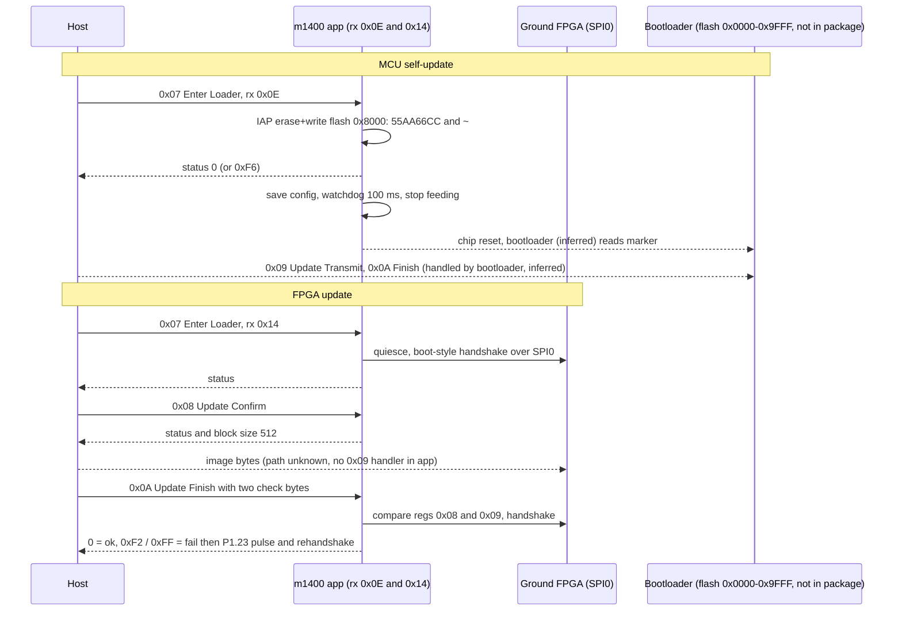

# C1 ground: firmware / FPGA upgrade path and chip ID (m1400)

Source: static disassembly of `C1_FW_V01.06.0000_m1400.bin` (LPC1765, Cortex-M3). Tool: `scripts/re/mcu_trace.py`
(capstone). Symbols: `docs/symbols/c1_m1400.tsv`. Scope & safety: see `SAFETY.md`. Tags: **verified** (read from code/data), **inferred**, **unknown**.
Air-side counterpart: `docs/fpga-upgrade-path.md`, `docs/fpga-bringup.md`.

## Addressing (correction)

- Addresses in this doc and the TSV are **image offsets** (file offset, same as earlier radare2 `-m 0` notes).
- Flash address = offset + `0xA000`. (verified: the 7 default-handler stubs `b .` at offset `0x11d30` match
  vectors `0x1bd33..0x1bd3d`; reset handler at offset `0x19ba8` jumps to `main` flash `0xA0CC`.)
- Flash `0x0000-0x9FFF` (bootloader area) is not in the container (see Q4).

## Receiver types handled locally (verified)

- Router `0x5bb0`: `frame[5] & 0x1f` = 0x0E or 0x14 -> local dispatch `0x53c8`; type 0 is rewritten to 0x0E and
  handled locally; 0x1F = local + forward; all other types are forwarded by a TBB at `0x5c8c` to a port.
- Local dispatch `0x53c8` switches on `frame[9]` (cmd_set) via TBB at `0x53d4`; set 0 sub-switch on `frame[10]`.
- Receiver 0x0E = this MCU (inferred: self-update and reboot handlers only accept it). Receiver 0x14 = ground FPGA
  (inferred: every 0x14 handler runs FPGA register code; mirrors air 0x13 on m0900). Names from the dissector not checked.

## Q1: upgrade commands (DUML set 0x00)

| cmd | name | handler | receiver 0x0E (MCU self) | receiver 0x14 (FPGA) |
|---|---|---|---|---|
| 0x07 | Enter Loader | `0x5266` | payload[0] must be 0. `0x158b0` writes the loader marker (below); status 0, or 0xF6 if IAP fails. After the reply: save config `0x254`, watchdog 100 ms, stop feeding, spin = watchdog reset | `0xd71e` quiesce, delay, `0xe000` FPGA upgrade-mode handshake (returns 0 ok, 5/8/9 fail): status 0, or 0xF6 on failure |
| 0x08 | Update Confirm | `0x5218` | not handled (falls to default `0x4e3a`) | reply `[status from 0xe0d8, 0x0200]` (block size 512) |
| 0x09 | Update Transmit | **none** (explicit ignore at `0x5408`) | - | **none** |
| 0x0A | Update Finish | `0x518a` | not handled | `0xe0f4(payload+1)`: 4 = reply 0; 6 = reply 0xF2 then reset pulse; other = reply 0xFF then reset pulse |
| 0x0B | Reboot Chip | `0x5124` | payload[1] must be 0/1 (else 0xE3); after reply: save config, watchdog timeout = u32 at payload+2 (ms), stop feeding | not handled |
| 0x0C | Get Device State | `0x50c0` | reply `[0,0,u32=0]`; payload[0]>>4 must be 0 (else 0xE3) | same, u32 = RAM `0x1000034c` |
| 0x0D | Set Device Version | `0x5062` | writes 16 payload bytes to flash sector 9 offset 0 (`0x9000`); 0xF4 on failure; reply echoes 16 B read back | not handled |
| 0xFF | Query Device Info | `0x47b4` | string `WM610 A7_1765 20160321/01` (`0x4bb8`); no chip ID | same handler |
| 0x01 | Get Device Version | `0x52ea` | words from RAM handoff pair `0x10007f70/74` and `0x10000000/6/8` | RAM `0x10000344/48` = FPGA id word (below) |

(verified: table, handlers, receiver checks, status values. Meaning of "block size", 0xF2/0xFF is inferred.)
(0x30 -> `0x4fd2`, 0x32 -> `0x47ea` also exist in set 0: not decoded. No handler for cmd 0x0F Upgrade Self Request.)

### Loader marker and reboot-to-loader (verified code, consumer unknown)

- `0x158b0`: reads 0x100 B at flash `0x8000` (sector 8), sets word0 = `0x55AA66CC` and word at +0x10 = `~0x55AA66CC`,
  erases sector 8 (IAP 52), rewrites 0x100 B (IAP 51). IAP wrappers: prepare `0x15a08`, erase `0x156dc`, copy `0x156fc`.
- Flash `0x8000` is below the app (`0xA000`), so the marker sits in the bootloader area. (verified)
- Nothing in the app reads the marker (only literal reference is the write). Bootloader consuming it: **inferred**.
- No `OOXX` string in m1400 (that is the m0900 marker); the ground marker is the 32-bit magic above.
- Reset mechanism: `0x17318` programs the watchdog timeout (ms x 1000 us), `0x1734a` sets RAM byte `0x100005d5` so
  `0x172c6` stops feeding; the WDT then resets the chip. WDMOD reset-enable was not traced (inferred).
- Enter Loader with receiver 0x0E resets the chip; with 0x14 it does not.

### Other flash pages written by the app (verified)

- Sector 9 (`0x9000`): +0x00 16 B device version (cmd 0x0D), +0x20 other record, +0x32 0x86 B config (`0x254` compares
  RAM `0x100005e8` against it, logs `something change` / `no change`, writes back when different).
- Sector 7 (`0x7000`) offsets 0/0x20/0x100 and sector 8 offset 0x20 also have read/write wrappers (`0x15922..0x1596c`), use not decoded.
- Sector start table at offset `0x25460` (LPC176x map: 4 KB x 16 then 32 KB at 0x10000..0x38000).
- `0x157d8` writes a log buffer to sectors 19-21 (`0x28000-0x3FFFF`); no callers found (unknown).

## Q2: FPGA image upgrade path

- MCU to FPGA bus is **legacy SPI0** (`0x40020000`), not GPIO bit-bang: `0xdddc` writes S0SPDR and polls SPIF.
  SCK P0.15, MISO P0.17, MOSI P0.18 (PINSEL0/1 in `0xdd54`), CS = GPIO P2.9 (FIO2SET/CLR bit 9, `0xbdca`), 4 MHz
  requested (`0x3d0900`; divider search in `0xdd54`). (verified)
- **Corrects `docs/id-entry-point.md`**: it scanned only SSP0/SSP1 (`0x40088000`/`0x40030000`) and concluded "no SPI".
  The LPC176x legacy SPI block at `0x40020000` is used. GPIO FIOSET/FIOCLR lines (P0.16, P1.22, P3.25 in `0x1234`) are
  extra control strobes beside it. The Master-ID path conclusions need re-checking with this transport in mind (inferred).
- Protocol is the **same register file as m0900**: write `[0x0E, reg, val]` (`0xbdf6`), read `[0x0F, reg, 0xFF]`
  (`0xbe24`), AD9363 bridge via FPGA reg 1 (`0xbec8`/`0xbf16`), and the bit-record table at `0x249b1` is
  byte-identical to m0900 `0x0801623c`. (verified)
- Boot handshake `0xde96` (3 tries, returns 4 = ready) = m0900 `0x0800cfd0`; run from the boot task around `0x8172`,
  followed by `0xbb86` (P1.23 pulse, then record scripts at `0x20310`, `0x1d1d4`, `0x23d68` by mode). (verified call chain; script contents not decoded)
- Upgrade-related FPGA helpers: `0xe000` (enter mode), `0xe0d8` (confirm), `0xe0f4` (finish: reg 0x0F bit1 must be set else
  status 7; compares FPGA reg 0x09 with payload byte 0 and reg 0x08 with byte 1 unless the id word is `0x010007ec`, else status 6). (verified)
- Reset pulse in Update Finish failure paths (`0x51ba..0x51d6`): P1.23 output, low, delay 2, high, delay 200, rerun `0xde96`.
  Role of P1.23 (FPGA reset vs nCONFIG-style reload strobe): **inferred**, not distinguishable from code. The same pin is
  pulsed during normal boot (`0xbb86`).
- **Where the image bytes travel: unknown.**
  - m1400 has no Update Transmit handler and never forwards type 0x14 (verified).
  - The LPC1765 has 256 KB flash; the FPGA images are 2.1-4.8 MB (`docs/fpga-images.md`), so the config flash is external (verified by size).
  - MCU-side bulk SPI helpers exist (`0xbe50` burst write, `0xbe8a` burst read) but have **no callers and no pointers** (verified).
  - The MCU supervises (enter mode, confirm, compare two FPGA-computed bytes, reset). The FPGA receives data some other way:
    candidates are another module (m1300 DM365, m1601 FX3 USB, or the host over USB) feeding the FPGA directly (inferred, no evidence).
  - Which chip writes the config flash (FPGA logic vs another device): **unknown**.

## Q3: chip / die ID

- LPC1765 serial number: IAP command 58 (`0x3a`) in `0x15774`, via the only IAP entry reference (`0x1fff1ff1` at `0x15a04`). (verified)
- Two callers: `0x396` (init) stores the 16 bytes at RAM `0x100005d8` and derives CRC16 / CRC8 / XOR bytes at `0x1000001c..`;
  `0xd6c8` (inside `0xd55c`, radio start) retries until IAP succeeds, then CRC8 (seed 0x99) into a state byte. (verified)
- DUML reply carrying it: set 9 (TBB idx 9 -> `0x56e4`), cmd_id 0x2C -> `0xba1c`; u16 key at `frame+0xd` = **0x0904** ->
  `0xb820` replies key **0x0954** with the 16 UID bytes (frame length 0x18). Same key pair as m0900. (verified)
- Upgrade handlers (`0x5266`, `0x5218`, `0x518a`, `0x5124`) never reference `0x100005d8`, `0x1000001c` or `0x15774`. (verified by literal search)
- The UID is not checked in the app during upgrade; whether the bootloader checks it: **unknown**.
- Other ID-like words: Query Device Info returns the fixed string above; Get Device Version (rx 0x14) returns the **FPGA id word**
  read from FPGA registers 0x8B..0x8E (`0xde5c`) into RAM `0x10000344`. This is a user-logic register, not the Cyclone V silicon ID
  (inferred); compared against `0x010007ec` in confirm/finish (meaning unknown).
- No Cyclone V die/JTAG ID read found: the only FPGA reads are register-file reads (`0xbe24` users); no JTAG-style pin sequence recognised (static search only, inferred).
- Secure element (ATSHA204 cluster, `Chip_Info err`, `Encrypt change`) is separate and not analysed here (scope).

## Q4: bootloader location

- m1400 contains **no bootloader**: no second vector table, no boot/loader/ISP strings (searched), no `OOXX`/`XXOO`. The 11 SP/reset-like pairs
  found are stack-pointer/entry pairs with both values inside the app (inferred RTOS task descriptors, not vector tables).
- Image loads at flash `0xA000` (see above); vector word 7 is not an LPC ISP checksum, so this image alone would not pass the LPC ROM
  user-code check (verified arithmetic). A bootloader at flash `0x0000-0x9FFF` that jumps to `0xA000` is **inferred**.
- App uses sectors 7, 8, 9 (`0x7000-0x9FFF`) for config and the loader marker, so the bootloader fits in `0x0000-0x6FFF` at most (inferred).
- Top-of-RAM word pair at `0x10007f70/74` (value, ~value) is read by Get Device Version and never written by the app: inferred bootloader handoff.
- LPC internal ISP ROM exists in the chip but is not part of the package (verified by absence). Whether the DJI bootloader receives the DUML
  Update Transmit data: **unknown** (same open question as m0900).

## Other modules (header .ini + magic bytes)

- `m1400` 04.10.0006: "LPC1765 GROUND LB2" (this doc).
- `m1401` 04.10.0006: ".ini: lightbridge MCU on ground model 01". String `WM610 A7_1549 20160321/01`; vector table SP `0x02008f60`
  (LPC1549 SRAM region) -> **LPC1549 variant of m1400** (verified strings/SP; part number inferred from `1549`). Contains
  `FpgaErr` and `Encryption_Check_And_Set_Chip_Info` / `Common_Encrypt_Get_Chip2` assert strings. Not analysed further.
- `m1300` 02.26.0000: video decoder (DM365). File starts with ASCII `Salted__` = OpenSSL salted-encrypted blob (verified header; not decrypted, out of scope).
- `m1600` 01.03.0256: ".ini: IG810 LB2_68013_RX". 2750 B, starts `C2 47 05 31 21`: Cypress FX2 (68013) EEPROM/boot load image (inferred from the C2 header).
- `m1601` 02.00.0006: ".ini: IG810 LB2_CY2014_RX". Starts `43 59 1C B0`: "CY" Cypress FX3 boot image signature, ARM code follows (inferred part: FX3).
- `m2000/m2001/m2002` 01.00.2107 / 01.01.2107 / 01.02.2109: ground FPGA config images, board models 00/01/02, each 8 MiB padded with 0xFF
  (payload from offset `0x80`/`0x20`/`0x80`, ends at `0x470325`/`0x2058f0`/`0x49416c`). m2000/m2002 are Cyclone V streams (encrypted); m2001 is Cyclone III/IV-format (best match EP4CGX150), payload not decoded
  (see `docs/fpga-images.md`). 8 MiB = serial config flash sized (inferred, flash part unknown).

## Ground vs air (m1400 vs m0900)

| Item | Air m0900 (STM32F103) | Ground m1400 (LPC1765) | Tag |
|---|---|---|---|
| Image base | `0x08008000`, bootloader `0x08000000-0x08007FFF` | flash `0xA000`, bootloader `0x0000-0x9FFF` | verified (air per doc), inferred (ground bootloader) |
| Receivers | 9 (MCU), 0x13 (FPGA) | 0x0E (MCU), 0x14 (FPGA) | inferred pairing |
| Enter Loader (MCU) | writes `OOXX` at `0x7400` | writes `0x55AA66CC` + `~` at flash `0x8000`, then WDT reset | verified |
| Update Confirm / Finish | FPGA only | FPGA only | verified |
| Update Transmit | no handler | no handler | verified |
| FPGA bus | SPI2 (hardware), CS PB12 | legacy SPI0, CS P2.9, 4 MHz | verified |
| FPGA register protocol | `0E`/`0F` read-write, bit records, reg 0x8A handshake | identical, same records | verified |
| FPGA reset line | PB3 | P1.23 (role inferred) | inferred |
| FPGA id word | none read | regs 0x8B-0x8E -> RAM `0x10000344` | verified |
| Chip UID | STM32 96-bit at `0x1FFFF7E8`, reply 0x0954 | LPC IAP 58 128-bit, reply 0x0954 | verified |
| UID used in upgrade handlers | no | no | verified |
| Reboot | not decoded | watchdog expiry after save-config | verified |

## Open

- Data path of the FPGA image on both sides (neither MCU handles Update Transmit).
- Consumer of the `0x55AA66CC` marker and the `0x10007f70/74` pair; bootloader contents.
- Role of P1.23; scripts at `0x20310`, `0x1d1d4`, `0x23d68`.
- Re-check `docs/id-entry-point.md` and the "set 6" statement in `docs/cpu-reversing-proof.md` (code routes `0x56e4` from set **9**; the `frame[9]==6`
  test at `0x5c76` is a separate special case for receiver 0x19, cmd 0x40).

