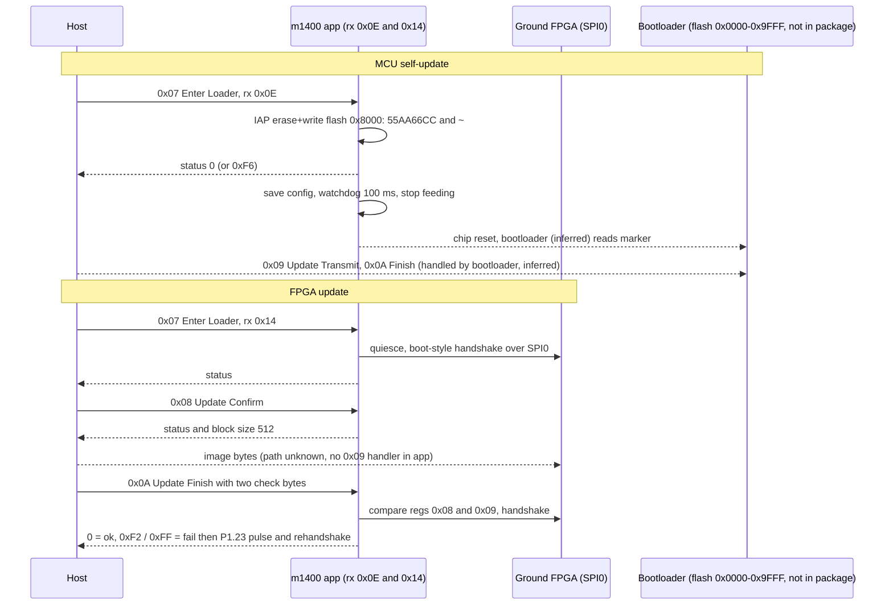

# C1 ground: firmware / FPGA upgrade path and chip ID (m1400, `gnd_rc_lpc1765`)

Source: static disassembly of `C1_FW_V01.06.0000_m1400.bin` (LPC1765, Cortex-M3). Tool: `scripts/re/mcu_trace.py`
(capstone). Symbols: `docs/symbols/c1_m1400.tsv`. Scope & safety: see `SAFETY.md`. Tags: **verified** (read from code/data), **inferred**, **unknown**.
Air-side counterpart: `docs/fpga-upgrade-path.md`, `docs/fpga-bringup.md`.

## Chip identity (m1400 = LPC1765, not STM32) [fw+spec]

Settles the conflict with `docs/control-plane-re.md` (which said the remote MCU is STM32F103; now corrected).

## Ground OS status (explicit)

- Ground MCU m1400: µC/OS-III, not Linux, not bare-metal (V, PendSV/SysTick + string fingerprint).
- Ground video decoder m1300 (DM365): image starts `Salted__` (encrypted, not decrypted). Its OS is
  **not checked**, so "ground unit Linux-free" is **not established**.
- Air-side m0800 is also DM365 and runs Linux (`air-id-and-stream-survey.md`, camera-linux notes).
  Do not assume m1300 is bare-metal because the MCU is.
- Vector word 0 = `0x10007F60`, word 1 = `0x00023BA9` (reset, flash `0x23BA8`). SP is inside the LPC176x
  32 KB local SRAM (`0x10000000-0x10007FFF`); STM32 would be `0x2000xxxx`. (verified, image vector table)
- Header: `LPC1765 GROUND LB2`; source path `@LPC17xx_LIB\lpc17xx_rtc.c`; IAP entry `0x1FFF1FF1` (see Q3). (verified)
- Other C1 modules, none STM32: `m1401` LPC1549 (SP `0x02008F60`); `m1600` FX2 header; `m1601` "CY" FX3 header;
  `m1300` starts `Salted__` (encrypted, not checked for STM32 inside); `m2000-m2002` FPGA images. (verified by header)
- Mechanical peripheral scan (`scripts/re/lpc17xx_periph_scan.py`, log `tmp/logs/lpc17xx_periph_scan.log`,
  input `firmware/unpacked/C1_FW_V01.06.0000/C1_FW_V01.06.0000_m1400.bin`). Counts are aligned words
  whose value falls in a block window. **Bases below are `[spec]`** (NXP LPC176x5x CMSIS-SVD,
  `awto-dan/docs/embedded/reversing/lpc17xx/svd/LPC176x5x.svd`) — the original pass used `[oss]`
  guessed bases; two were wrong (see `control-plane-re.md` "SVD + peripheral-map corrections"):
  **USB's real base is `0x5000_8000`** with **zero** hits (unused) — the old "USB @ `0x2008C000`,
  12 hits" bucket was actually AHB SRAM (data, not MMIO); PWM1/I2C0 were both one slot low.

  | block | base | words | note |
  |---|---|---|---|
  | GPIO FIO (fast) | `0x2009C000` | 29 | FIO pins used by the FPGA/control strobes (see Q2); **GPIO1 bits 21/24/27 are the board-strap input (see "Board-strap" below)** |
  | UART0 | `0x4000C000` | 27 | most-referenced serial block; **role resolved: `port_send` port 3** (frame-forward dispatch target, `control-plane-re.md` "Full GPIO/bus survey") |
  | SYSCTL | `0x400FC000` | 18 | clock/power setup |
  | PINCONNECT | `0x4002C000` | 17 | pin mux |
  | AHB-SRAM | `0x2007C000` | 47 | RAM data pointers (corrects the earlier wrong "USB" bucket above) |
  | UART1 | `0x40010000` | 12 | **role resolved: `port_send` port 4** |
  | RTC | `0x40024000` | 8 | role `[?]` |
  | CAN1 | `0x40044000` | 10 | **role resolved: `port_send` port 5** — ground-side DUML relay bus (CAN1/CAN2 together), same architectural role as air-side `m0900`/`m0306` CAN relay (`dataflow.md` §7.10); payload content not decoded |
  | ADC / CAN2/CANAF/CANAFRAM / UART2/UART3 / DAC / TIMER1/TIMER2 / WDT / RITIMER / MCPWM / GPIO-INT / BOOTROM | various | 1-5 each | WDT used by reset path (Q1); **UART3 role resolved: `port_send` port 2; UART2 is clocked/configured at boot but does NOT appear in the port_send table — role still open, candidate: a dedicated link to `m1300`** |
  | SSP0 `0x40088000`, SSP1 `0x40030000`, I2C0/I2C1/I2C2, USB `0x50008000`, EMAC, GPDMA, I2S, QEI, PWM1 | - | 0 | genuinely unused by this firmware (SVD-confirmed bases, not a guess landing on the wrong block); **confirmed by a second, independent method — Ghidra's own base-address xref scan over the full disassembly also finds 0 hits on I2C0/I2C1/SSP0/SSP1, so this is not a literal-scan undercount artifact. No I2C bus, no second SPI/SSP bus on this chip.** |
  | legacy SPI `0x40020000` | - | 5 | only `0xDDF8` is the base pointer (used by the Q2 S0SPDR writer); `0x40022302`/`0x40022502` are data values, not pointers |

  Hits are candidates only. Confirm each with `scripts/re/mcu_trace.py lit VALUE` / `who ADDR` before naming a register.
- Full Ghidra pass (789 functions, 38,426 instructions, all 511 SVD register labels applied) done:
  `control-plane-re.md` "`m1400` ... Ghidra pass"; project archived at `re/ghidra-projects/m1400_radio.tar.gz`.
- **Board-strap mechanism (issue #39 follow-up):** `m1400` DOES read a GPIO board/variant
  code at boot (`boot_init`, offset `0x05B0`) — `(GPIO1.27<<2)|(GPIO1.21<<1)|GPIO1.24` into
  RAM `0x10000006` — the ground-side analogue of `m0900`'s `(PA0<<2)|(PC15<<1)|PC14`. Gates
  4 separate things (DUML version-query reply, `cmd_set0`/cmd `0x30`, two periodic
  radio-telemetry builders, and the RF profile selected inside `radio_start` itself). Full
  detail, consumers and addresses: `control-plane-re.md` "Board-strap mechanism found on
  `m1400`". Not yet tied to which specific `m200N` FPGA image gets selected — that step is
  still inside the undecoded Q2 record scripts below.
- **`cmd_set 9` dispatch table is now fully decoded** (all 13 low entries, not just `0x0C`);
  **`cmd_set 6`/`0x40` resolves the "set 6" open item below**; **`m1400` runs µC/OS-III, not
  bare-metal** (PendSV/SysTick disassembly + RTOS string fingerprint). All three:
  `control-plane-re.md`, same section group.

## Addressing (correction)

- Addresses in this doc and the TSV are **image offsets** (file offset, same as earlier radare2 `-m 0` notes).
- Flash address = offset + `0xA000`. (verified: the 7 default-handler stubs `b .` at offset `0x11d30` match
  vectors `0x1bd33..0x1bd3d`; reset handler at offset `0x19ba8` jumps to `main` flash `0xA0CC`.)
- Flash `0x0000-0x9FFF` (bootloader area) is not in the container (see Q4).

## Receiver types handled locally (verified)

- Router `0x5bb0`: `frame[5] & 0x1f` = 0x0E or 0x14 -> local dispatch `0x53c8`; type 0 is rewritten to 0x0E and
  handled locally; 0x1F = local + forward; all other types are forwarded by a TBB at `0x5c8c` to a port.
- Local dispatch `0x53c8` switches on `frame[9]` (cmd_set) via TBB at `0x53d4`; set 0 sub-switch on `frame[10]`.
- Receiver 0x0E = this MCU (inferred: self-update and reboot handlers only accept it). Receiver 0x14 = ground FPGA
  (inferred: every 0x14 handler runs FPGA register code; mirrors air 0x13 on m0900). Names from the dissector not checked.
- **The `0x5c8c` TBB and its ports are now resolved** (issue #39 follow-up; full table in
  `control-plane-re.md` "Full GPIO/bus survey"): it maps the 32 receiver-type values to a
  `port_send(port, frame)` switch — port 0 = host/ACK ring buffer, port 1 = chunked radio-TX
  queue (the Lightbridge link itself, and the default for most receiver types), ports 2/3/4
  = UART3/UART0/UART1, port 5 = CAN1/CAN2. `0x0E`/`0x14` resolve to a no-op in this table
  (already intercepted earlier as local, per the bullet above).

## Q1: upgrade commands (DUML set 0x00)

| cmd | name | handler | receiver 0x0E (MCU self) | receiver 0x14 (FPGA) |
|---|---|---|---|---|
| 0x07 | Enter Loader | `0x5266` | payload[0] must be 0. `0x158b0` writes the loader marker (below); status 0, or 0xF6 if IAP fails. After the reply: save config `0x254`, watchdog 100 ms, stop feeding, spin = watchdog reset | `0xd71e` quiesce, delay, `0xe000` FPGA upgrade-mode handshake (returns 0 ok, 5/8/9 fail): status 0, or 0xF6 on failure |
| 0x08 | Update Confirm | `0x5218` | not handled (falls to default `0x4e3a`) | reply `[status from 0xe0d8, 0x0200]` (block size 512) |
| 0x09 | Update Transmit | **none** (explicit ignore at `0x5408`) | - | **none** |
| 0x0A | Update Finish | `0x518a` | not handled | `0xe0f4(payload+1)`: 4 = reply 0; 6 = reply 0xF2 then reset pulse; other = reply 0xFF then reset pulse |
| 0x0B | Reboot Chip | `0x5124` | payload[1] must be 0/1 (else 0xE3); after reply: save config, watchdog timeout = u32 at payload+2 (ms), stop feeding | not handled |
| 0x0C | Get Device State | `0x50c0` | reply `[0,0,u32=0]`; payload[0]>>4 must be 0 (else 0xE3) | same, u32 = RAM `0x1000034c` |
| 0x0D | Set Device Version | `0x5062` | writes 16 payload bytes to flash sector 9 offset 0 (`0x9000`); 0xF4 on failure; reply echoes 16 B read back | not handled |
| 0xFF | Query Device Info | `0x47b4` | string `WM610 A7_1765 20160321/01` (`0x4bb8`); no chip ID | same handler |
| 0x01 | Get Device Version | `0x52ea` | words from RAM handoff pair `0x10007f70/74` and `0x10000000/6/8` | RAM `0x10000344/48` = FPGA id word (below) |

(verified: table, handlers, receiver checks, status values. Meaning of "block size", 0xF2/0xFF is inferred.)
(0x30 -> `0x4fd2`, 0x32 -> `0x47ea` also exist in set 0: not decoded. No handler for cmd 0x0F Upgrade Self Request.)

### Loader marker and reboot-to-loader (verified code, consumer unknown)

- `0x158b0`: reads 0x100 B at flash `0x8000` (sector 8), sets word0 = `0x55AA66CC` and word at +0x10 = `~0x55AA66CC`,
  erases sector 8 (IAP 52), rewrites 0x100 B (IAP 51). IAP wrappers: prepare `0x15a08`, erase `0x156dc`, copy `0x156fc`.
- Flash `0x8000` is below the app (`0xA000`), so the marker sits in the bootloader area. (verified)
- Nothing in the app reads the marker (only literal reference is the write). Bootloader consuming it: **inferred**.
- No `OOXX` string in m1400 (that is the m0900 marker); the ground marker is the 32-bit magic above.
- Reset mechanism: `0x17318` programs the watchdog timeout (ms x 1000 us), `0x1734a` sets RAM byte `0x100005d5` so
  `0x172c6` stops feeding; the WDT then resets the chip. WDMOD reset-enable was not traced (inferred).
- Enter Loader with receiver 0x0E resets the chip; with 0x14 it does not.
- **0x0B Reboot Chip, confirmed against real hardware 2026-10-24:** sent via
  `GroundCommands.restartDevice` (`app/awto_dji_app/lib/link/ground_commands.dart`),
  payload byte1=1, watchdog=1000ms. Observed: RC's USB-serial device
  re-enumerated and its DUML sequence counter reset to 0, right when sent -
  consistent with the stop-feeding-watchdog/reset mechanism above. 1000ms is
  untried-elsewhere-but-conservative, not measured as a minimum. No raw
  capture of this specific test was kept; this is the only record.

### Other flash pages written by the app (verified)

- Sector 9 (`0x9000`): +0x00 16 B device version (cmd 0x0D), +0x20 other record, +0x32 0x86 B config (`0x254` compares
  RAM `0x100005e8` against it, logs `something change` / `no change`, writes back when different).
- Sector 7 (`0x7000`) offsets 0/0x20/0x100 and sector 8 offset 0x20 also have read/write wrappers (`0x15922..0x1596c`), use not decoded.
- Sector start table at offset `0x25460` (LPC176x map: 4 KB x 16 then 32 KB at 0x10000..0x38000).
- `0x157d8` writes a log buffer to sectors 19-21 (`0x28000-0x3FFFF`); no callers found (unknown).

## Q2: FPGA image upgrade path

- MCU to FPGA bus is **legacy SPI0** (`0x40020000`), not GPIO bit-bang: `0xdddc` writes S0SPDR and polls SPIF.
  SCK P0.15, MISO P0.17, MOSI P0.18 (PINSEL0/1 in `0xdd54`), CS = GPIO P2.9 (FIO2SET/CLR bit 9, `0xbdca`), 4 MHz
  requested (`0x3d0900`; divider search in `0xdd54`). (verified)
- **Corrects `docs/id-entry-point.md`**: it scanned only SSP0/SSP1 (`0x40088000`/`0x40030000`) and concluded "no SPI".
  The LPC176x legacy SPI block at `0x40020000` is used. GPIO FIOSET/FIOCLR lines (P0.16, P1.22, P3.25 in `0x1234`) are
  extra control strobes beside it. The Master-ID path conclusions need re-checking with this transport in mind (inferred).
- Protocol is the **same register file as m0900**: write `[0x0E, reg, val]` (`0xbdf6`), read `[0x0F, reg, 0xFF]`
  (`0xbe24`), AD9363 bridge via FPGA reg 1 (`0xbec8`/`0xbf16`), and the bit-record table at `0x249b1` is
  byte-identical to m0900 `0x0801623c`. (verified)
- Boot handshake `0xde96` (3 tries, returns 4 = ready) = m0900 `0x0800cfd0`; run from the boot task around `0x8172`,
  followed by `0xbb86` (P1.23 pulse, then record scripts at `0x20310`, `0x1d1d4`, `0x23d68` by mode). (verified call chain; script contents not decoded)
- Upgrade-related FPGA helpers: `0xe000` (enter mode), `0xe0d8` (confirm), `0xe0f4` (finish: reg 0x0F bit1 must be set else
  status 7; compares FPGA reg 0x09 with payload byte 0 and reg 0x08 with byte 1 unless the id word is `0x010007ec`, else status 6). (verified)
- Reset pulse in Update Finish failure paths (`0x51ba..0x51d6`): P1.23 output, low, delay 2, high, delay 200, rerun `0xde96`.
  Role of P1.23 (FPGA reset vs nCONFIG-style reload strobe): **inferred**, not distinguishable from code. The same pin is
  pulsed during normal boot (`0xbb86`).
- **Where the image bytes travel: unknown.**
  - m1400 has no Update Transmit handler and never forwards type 0x14 (verified).
  - The LPC1765 has 256 KB flash; the FPGA images are 2.1-4.8 MB (`docs/fpga-images.md`), so the config flash is external (verified by size).
  - MCU-side bulk SPI helpers exist (`0xbe50` burst write, `0xbe8a` burst read) but have **no callers and no pointers** (verified).
  - The MCU supervises (enter mode, confirm, compare two FPGA-computed bytes, reset). The FPGA receives data some other way:
    candidates are another module (m1300 DM365, m1601 FX3 USB, or the host over USB) feeding the FPGA directly (inferred, no evidence).
  - Which chip writes the config flash (FPGA logic vs another device): **unknown**.

## Q3: chip / die ID

- LPC1765 serial number: IAP command 58 (`0x3a`) in `0x15774`, via the only IAP entry reference (literal `0x1fff1ff1` at `0x15a50`, loaded by `ldr r2; bx r2` at `0x15a04`). (verified)
- Two callers: `0x396` (init) stores the 16 bytes at RAM `0x100005d8` and derives CRC16 / CRC8 / XOR bytes at `0x1000001c..`;
  `0xd6c8` (inside `0xd55c`, radio start) retries until IAP succeeds, then CRC8 (seed 0x99) into a state byte. (verified)
- DUML reply carrying it: set 9 (TBB idx 9 -> `0x56e4`), cmd_id 0x2C -> `0xba1c`; u16 key at `frame+0xd` = **0x0904** ->
  `0xb820` replies key **0x0954** with the 16 UID bytes (frame length 0x18). Same key pair as m0900. (verified)
- Upgrade handlers (`0x5266`, `0x5218`, `0x518a`, `0x5124`) never reference `0x100005d8`, `0x1000001c` or `0x15774`. (verified by literal search)
- The UID is not checked in the app during upgrade; whether the bootloader checks it: **unknown**.
- Other ID-like words: Query Device Info returns the fixed string above; Get Device Version (rx 0x14) returns the **FPGA id word**
  read from FPGA registers 0x8B..0x8E (`0xde5c`) into RAM `0x10000344`. This is a user-logic register, not the Cyclone V silicon ID
  (inferred); compared against `0x010007ec` in confirm/finish (meaning unknown).
- No Cyclone V die/JTAG ID read found: the only FPGA reads are register-file reads (`0xbe24` users); no JTAG-style pin sequence recognised (static search only, inferred).
- Secure element (ATSHA204 cluster, `Chip_Info err`, `Encrypt change`) is separate and not analysed here (scope).

## Q4: bootloader location

- m1400 contains **no bootloader**: no second vector table, no boot/loader/ISP strings (searched), no `OOXX`/`XXOO`. The 11 SP/reset-like pairs
  found are stack-pointer/entry pairs with both values inside the app (inferred RTOS task descriptors, not vector tables).
- Image loads at flash `0xA000` (see above); vector word 7 is not an LPC ISP checksum, so this image alone would not pass the LPC ROM
  user-code check (verified arithmetic). A bootloader at flash `0x0000-0x9FFF` that jumps to `0xA000` is **inferred**.
- App uses sectors 7, 8, 9 (`0x7000-0x9FFF`) for config and the loader marker, so the bootloader fits in `0x0000-0x6FFF` at most (inferred).
- Top-of-RAM word pair at `0x10007f70/74` (value, ~value) is read by Get Device Version and never written by the app: inferred bootloader handoff.
- LPC internal ISP ROM exists in the chip but is not part of the package (verified by absence). Whether the DJI bootloader receives the DUML
  Update Transmit data: **unknown** (same open question as m0900).

## Q5: the RC's own micro-USB port — m1400's own on-chip stack, not a second bridge chip

`fc-usb-port.md` captured a second DJI USB identity live, distinct from the phone-facing FX3
(`gnd_fx3_cyusb2014`, `m1601`): `2ca3:0008`, manufacturer `DJI  CONFIF  `, product
`DJI    CONTROLLER`, serial `0001A0000000`, answering DUML GetVersion with build
`WM320_A7_LPC1 20170828/00`. Open question was whether this is **m1400's own USB peripheral**,
a **second FX2/FX3 bridge chip** (DJI reuses FX2LP as a generic USB bridge elsewhere: `m1500`,
`m1600`), or something else (an LPC boot-ROM mode was floated and ruled out below).

- **V, confirmed directly against the real binary (2026-10-25).** `c1.bin`
  (`C1_FW_V01.06.0000.bin`) re-obtained from `https://dl.djicdn.com/downloads/lightbridge2/
  C1_FW_V01.06.0000.bin` (live, confirmed by exact SHA-256 match against `data-manifest.md` on
  download) and unpacked with `xv4_extract.py`; `c1_m1400.bin`'s hash also matches exactly. A
  `strings`/UTF-16LE scan of **this real file** finds the same literal constants reported
  earlier from a symbol-map cross-check: `'DJI  CONFIF  '` (file offset `0x25397`), `'DJI
  CONTROLLER'`, `'0001A0000000'`, `'VCOM'`, `'MSCM'`, `'0001AA000000'`. The offset matches the
  IDA symbol map's `aDjiConfif` address (`0002F397`) exactly once the documented `+0xA000`
  flash-offset convention (Addressing, above) is applied (`0x25397 + 0xA000 = 0x2F397`) —
  confirms the earlier symbol-map corroboration and this direct read describe the same build.
- **New caveat this direct read surfaces that the symbol map alone couldn't show: this
  container's m1400 submodule is not the operator's current build.** Its own `Query Device
  Info` string (cmd `0xFF`) reads `WM610 A7_1765 20160321/01` — dated **2016-03-21**. The
  operator's actual hardware answered DUML GetVersion live (`fc-usb-port.md`) with `WM320_A7_LPC1
  20170828/00` — dated **2017-08-28**, ~17 months later, different naming scheme entirely
  (`WM610` is the Inspire-1/shared-Lightbridge-codebase tag per `data-manifest.md`'s
  `WM610_FW_V01.11.01.50.bin` entry, not evidence of wrong hardware — the ground-radio firmware
  is shared across products; it just means DJI pushed a newer m1400 build to the operator's unit
  since this container was cut). So: the container hash matches `C1_FW_V01.06.0000` exactly, and
  its other submodules (`m2001`, independently confirmed byte-identical to the operator's own
  dump in `ground-fx3-m1601.md`) do match the operator's hardware — but **DJI updates modules
  independently inside what looks like one version tag**, and this specific m1400 build predates
  the one actually running. The `VCOM`/`MSCM`/`DJI CONFIF` pattern is confirmed real and part of
  this firmware lineage; whether the *exact* live build still carries it at the same offsets
  needs a newer package (or a live SWD/flash dump) to fully close.
- No Ghidra project exists for m1400 at all (only `scripts/re/mcu_trace.py`, a lighter
  capstone-based disassembler) — unlike the STM32 modules (`m0306`/`m0900`/`m0100`), which were
  all taken through full Ghidra decompiler projects; `stm32-reversing-process.md` is explicitly
  STM32-scoped and doesn't name m1400 as a target for that exact checklist (see
  `lpc-reversing-process.md`).
- **Settles it: this rules out a second bridge chip.** A separate FX2/FX3 (or any other) bridge
  would hold its own descriptor strings in its own firmware/EEPROM, not inside m1400's compiled
  code. Finding them here means **m1400 implements its own USB device stack** directly.
- **Rules out "just an LPC boot-ROM/ISP mode" too, independently**: the port answers a real DUML
  GetVersion with the *application's* build string — a bare ROM-level ISP bootloader doesn't
  speak DUML (an application-layer protocol m1400's own firmware implements). The full running
  app is behind this port.
- **Matches the aircraft FC's pattern exactly.** `fc-usb-port.md`'s front micro-USB port carries
  the identical `VCOM`/`MSCM` class-tag pair. DJI wrote the same composite CDC-VCOM +
  Mass-Storage-Class USB device into **both** the STM32F427 (FC) and LPC1765 (RC) application
  firmware independently, from a shared template — neither MCU delegates to a bridge chip for
  its own-port USB identity.
- **New, unresolved by this pass:** `MSCM` implies this port also exposes **mass storage** (a
  flight/RC log, mirroring the FC side's `DJI DATA LOG 2.00` SCSI inquiry string) — what it
  actually serves up here is not yet traced. The second serial `'0001AA000000'` (vs the primary
  `'0001A0000000'`) is also unexplained — possibly a second logical unit/interface.
- Reproduce: `strings -n4` + a UTF-16LE ASCII-run scan (`(?:[\x20-\x7e]\x00){4,}`) over the
  m1400 image; no `0x2008c0xx` LPC17xx USB-peripheral-base literal dword was found by a flat
  scan (base likely reached via `MOVW`/`MOVT` or a literal pool, not yet traced).

## Q6: m1401 — a second, richly-named ground-radio variant (LPC1549, not LPC1765)

`m1401` is a **different chip target**, not a second copy of m1400: SP `0x02008f60` sits in
LPC15xx's SRAM0 region (`0x02000000+`), distinct from LPC17xx's `0x10000000+`. Same build
vintage as m1400 (`WM610 A7_1549 20160321/01`, dated 2016-03-21 — confirmed directly against
the real binary, re-extracted from the verified `c1.bin`, SHA-256 `85171a35...df49` matching
the container's own listing).

- **V, richer upstream symbols than m1400's own map.** `o-gs/dji-firmware-tools` vendors a
  separate `C1_FW_V01.06.0000_m1401.map` (9.7 KB) + `.idc` (1.26 MB) — present locally at
  `tools/symbols/` but not previously examined in this project. Named functions include
  `App_TaskAdcKey_Worker`, `App_TaskRadio_Worker`, `App_TaskUnpack_Worker`,
  `packet_hw_receive`, **`get_board_version`**, `ofdm_init_instruction`, and numerous
  `cmd_exec_setXX_cmdYY` handlers — community RE annotations (upstream's own work, GPL-3.0),
  not DJI's original symbols.
- **`get_board_version` (file offset `0x11ce4`, decompiled this session, V for the
  disassembly, I/U for full semantics):** calls a shared compare-and-log helper (same
  "something change" / "no change" string pattern already documented for m1400's own sector-9
  config-compare routine, `0x254` above) against a stored value at RAM `0x2000600`, logging the
  result. **U:** no caller found by a direct BL/B.W scan (`who`) — likely reached via a function
  pointer in one of the `cmd_exec_set*` tables rather than a direct call; not yet traced. What
  exactly it reports as "the board version" (which register/strap, and how it maps to
  `m2000`/`m2001`/`m2002` selection) is **the same open question as `fpga-air-vs-ground.md`'s
  item (b)** — this function is the concrete next anchor for that, not yet fully traced.
- The reset handler at file offset `0xa334` decodes cleanly (checks a RAM flag bit, branches on
  stored byte values) — confirms this chip's `.text` segment sits at file offset 0 directly
  (`--load 0`, no `+0xA000` correction, unlike m1400); the IDA map's `0003:` segment prefix is
  `.text` starting at image offset 0 (map's own segment table, `Start 0003:00000000 Length
  0000193E0H`).
- **Open: which chip family does the operator's actual GL300C use — m1400 (LPC1765) or m1401
  (LPC1549)?** The live-reported build (`fc-usb-port.md`: `WM320_A7_LPC1 20170828/00`) uses a
  generic `LPC1` tag that doesn't disambiguate, and **neither** this 2016-03-21 `m1400` nor this
  2016-03-21 `m1401` matches that later date regardless of which family is correct. Settling
  this needs either the chip's own package marking (ties to the same board-opening work as
  #59) or a newer firmware build for whichever family is actually fitted.

## Other modules (header .ini + magic bytes)

- `m1400` 04.10.0006: "LPC1765 GROUND LB2" (this doc).
- `m1401` 04.10.0006: ".ini: lightbridge MCU on ground model 01". String `WM610 A7_1549 20160321/01`; vector table SP `0x02008f60`
  (LPC1549 SRAM region) -> **LPC1549 variant of m1400** (verified strings/SP; part number inferred from `1549`). Contains
  `FpgaErr` and `Encryption_Check_And_Set_Chip_Info` / `Common_Encrypt_Get_Chip2` assert strings. See Q6 below — now analysed.
- `m1300` 02.26.0000: video decoder (DM365). File starts with ASCII `Salted__` = OpenSSL salted-encrypted blob (verified header; not decrypted, out of scope).
- `m1600` 01.03.0256: ".ini: IG810 LB2_68013_RX". 2750 B, starts `C2 47 05 31 21`: Cypress FX2 (68013) EEPROM/boot load image (inferred from the C2 header). Full Ghidra pass below.
- `m1601` 02.00.0006: ".ini: IG810 LB2_CY2014_RX". Starts `43 59 1C B0`: "CY" Cypress FX3 boot image signature, ARM code follows (inferred part: FX3). Full Ghidra pass below.
- `m2000/m2001/m2002` 01.00.2107 / 01.01.2107 / 01.02.2109: ground FPGA config images, board models 00/01/02, each 8 MiB padded with 0xFF
  (payload from offset `0x80`/`0x20`/`0x80`, ends at `0x470325`/`0x2058f0`/`0x49416c`). m2000/m2002 are Cyclone V streams (encrypted); m2001 is Cyclone III/IV-format (best match EP4CGX150), payload not decoded
  (see `docs/fpga-images.md`). 8 MiB = serial config flash sized (inferred, flash part unknown).

## m1600 / m1601: full Ghidra pass, compared against each other and air's m1500 (issue #42)

Firmware: `firmware/unpacked/C1_FW_V01.06.0000/C1_FW_V01.06.0000_m1600.bin` (2748 B record payload,
2818 B flat code image) and `..._m1601.bin` (190,836 B). Air baseline: `m1500` (issue #31, see
`docs/air-id-and-stream-survey.md` "m1500"). Reproduce:
`python3 scripts/re/m1600_fx2_disasm.py` (log `tmp/logs/m1600_fx2_disasm.log`) and
`python3 scripts/re/m1601_fx3_disasm.py` (log `tmp/logs/m1601_fx3_disasm.log`). Both Ghidra
projects archived: `re/ghidra-projects/m1600_fx2.tar.gz`, `re/ghidra-projects/m1601_fx3.tar.gz`.

| | m1500 (air, FX2LP) | m1600 (ground, FX2) | m1601 (ground, FX3/ARM9) |
|---|---|---|---|
| Core | 8051 | 8051 (same part family) | ARM926EJ-S-class (ARMv5TEJ), ThreadX RTOS |
| Image | 2748 B `.iic` | 2748 B `.iic` (near-identical layout, not byte-identical) | 190,836 B "CY" boot image, 5 load sections |
| Ghidra pass | 32 funcs, 1353 instrs (issue #31) | 32 funcs, 1391 instrs | 485 funcs, 37,863 instrs |
| Active bulk endpoints | EP2, EP6 (2 total; EP4/EP8 invalidated) | EP2, EP4, EP6, EP8 (4 total, all valid) [see below] | up to 4 bulk endpoints per personality, switchable at runtime (`fx3-usb-modes.md`) |
| Device VID:PID (runtime) | `0547:1002` | `0547:1002` (same) | switches between `2ca3:1004` and `0547:1002` depending on GPIO41/stored config bit |
| Touches FIFO payload bytes (0xF000-0xFFFF)? | **no** (V, exhaustive MOVX trace) | **no** (V, same exhaustive MOVX trace) | n/a (no 8051-style FIFO window); real protocol logic found instead (dispatch table, persistent config) |
| Beyond USB housekeeping? | no | no | **yes** (V) |

### m1600 (ground FX2): same pipe pattern as m1500, but 2x the endpoints

- V: `.iic` header `C2 47 05 31 21`, boot-time VID:PID:DID `0547:2131:0000` — **identical boot PID**
  (`0x2131`) to m1500's `.iic` header (`docs/air-id-and-stream-survey.md` "m1500"). Runtime device
  descriptor (file offset `0x7b3`): VID:PID `0547:1002` (same as air m1500's runtime descriptor),
  `bcdDevice=0x0000`, `iSerialNumber=0`.
- V: core init sequence is byte-for-byte structurally identical to m1500's: `IFCONFIG=0x03` (slave
  FIFO, sync, external IFCLK) at 8051 `0x00a9`; `REVCTL` cleared at `0x00bf`; `EP1OUTCFG`/`EP1INCFG`
  bit7 (VALID) cleared at `0x00d3`/`0x00ea`.
- V (the actual difference from m1500): `EP2CFG=0xA2` (`0x0101`+3) and `EP6CFG=0xE2` (`0x0117`+3) —
  air's values were `0xA0`/`0xE0` (`docs/air-id-and-stream-survey.md`), i.e. bit1 is set on both
  here where air left it clear. U: which TRM field bit1 is — `EP2FIFOCFG`/`EP6FIFOCFG` still pair
  as AUTOOUT/AUTOIN exactly as in air (below), and an endpoint whose FIFOCFG is AUTOOUT only makes
  sense if it is still OUT-direction, so this is probably not the DIR bit despite the position I'd
  otherwise guess from the TRM; not resolved against the actual Cypress register map in this pass,
  flagged rather than asserted. **And** `EP4CFG=0xA0` (`0x012d`+3) / `EP8CFG=0xE0` (`0x0143`+3) are
  written **valid** here — air explicitly invalidates both (clears bit7, never sets a value).
  `EP2FIFOCFG=0x10`/`EP4FIFOCFG=0x10` (AUTOOUT) and `EP6FIFOCFG=0x08`/`EP8FIFOCFG=0x08` (AUTOIN) are
  all four written (`0x0218`/`0x0244`/`0x022e`/`0x025a`) — **four** live auto-commit bulk endpoints
  versus air's two (EP2/EP6 only; EP4/EP8 invalidated in air). I: consistent with the `.ini`
  names — air's module is "..._TX", ground's is "..._RX ground"; the ground chip is wired for
  twice as many simultaneous FIFO channels as the air chip needs. U: which two streams
  (video+telemetry? diversity antenna pair? uplink+downlink?) — not resolvable from firmware alone.
- V: same exhaustive-MOVX methodology as the m1500 pass (every `MOVX @DPTR`/`MOVX @Ri` operand
  traced): 118 total `MOVX @DPTR` (109 literal-DPTR, 9 computed — same split as m1500), 1
  `MOVX @Ri`. **Zero** touch the `0xF000-0xFFFF` FIFO buffer range despite the extra endpoints.
  **Same conclusion as m1500: the 8051 core is a pure hardware pipe here too** — more endpoints
  configured, but still no byte reordering, buffering or protocol translation in code.

### m1601 (ground FX3, ARM9/ThreadX): first FX3 target in this repo, and genuinely NOT a pure pipe

No native Ghidra loader exists for Cypress FX3 "CY" boot images, so this is a new technique for
the project: `scripts/re/ghidra/DumpFX3.java` imports a throwaway dummy blob just to create a
Ghidra `Program` (selects the `ARM:LE:32:v5t` processor), then rebuilds the real memory map itself
by reading the 5 section records straight off the original file (same record format
`scripts/re/fx3_trace.py`'s `sections()` already parses for the capstone-based pass in
`docs/fx3-usb-modes.md`), before seeding disassembly and running full auto-analysis.

- V: 5 load sections — VA `0x100` (8744 B, boot stub), `0x40003000` (64 KiB), `0x40013000`
  (64 KiB, contains the entry point `0x40018208`), `0x40023000` (24,032 B), `0x40030000`
  (26,932 B). Entry point and all 5 sections match the capstone pass's addressing.
- V: full auto-analysis finds **485 functions, 37,863 instructions**. Per-section instruction
  coverage: `0x100` 90.5%, `0x40003000` 90.7%, `0x40013000` 95.0%, `0x40023000` 91.0% of bytes
  resolve to valid instructions — the remainder is literal pools/padding, not under-analysis.
  The 5th section (`0x40030000`, 26,932 B) is **0% instructions**: pure data, matching the
  capstone pass's device/config descriptors at VA `0x40030460`+.
- V: every address the prior capstone-based pass (`docs/fx3-usb-modes.md`) already identified
  resolves, independently, to a real Ghidra function at that exact entry point — cross-validation,
  not just a re-run of the same tool: `0x400068b8` (1452 B, USB descriptor registration),
  `0x40007c70` (152 B, cmd-set/id dispatch table consumer), `0x4000e2dc` (268 B, persistent
  16-byte config record loader at storage address `0x60000`), `0x40007618`/`0x400078e0`
  (config set/get), plus the GPIO41/"K"-bit mode-selection getters.
- V: ThreadX strings: `Copyright (c) 1996-2008 Express Logic Inc. * ThreadX ARM9/RVDS Version
  G5.1.5.1`, and 7 named threads: `01_DMA_THREAD`, `02_SYSTEM_THREAD`, `03_PIB_THREAD` (FX3's
  GPIF-II parallel-bus block — the same class of interface FX2's slave FIFO exposes, just on a
  more capable peripheral), `04_UIB_THREAD` (USB), `05_LPP_THREAD` (UART/SPI/I2C), `06_SIB_THREAD`
  (storage — SD/eMMC capability present in the RTOS config even if unused on this board),
  `07_DEBUG_THREAD`, plus a `USB_DEBUG` diagnostic tag string and `@DJI`/`@xV4` container markers
  embedded in the image (the project's standing interest in diagnostic surfaces, CLAUDE.md).
- **V, answers task item 4 directly: yes, the FX3 does real work beyond USB housekeeping**, on two
  independent kinds of evidence: (1) the capstone pass already found a DUML-style command
  dispatch table (`0x40030480`/`0x40030498`), persistent configuration storage with checksum
  validation, and runtime USB-personality switching (GPIO41 + a stored bit swap the whole
  descriptor set between an Apple-accessory-style identity `2ca3:1004` and an "internal" identity
  `0547:1002` — the **same VID:PID family as air's m1500/m1600**); (2) this Ghidra pass shows it
  running a full ThreadX RTOS across 7 dedicated peripheral/system threads rather than a bare
  superloop — architecturally using far more of the chip than m1600's bare-metal 8051 pipe ever
  could. I: no direct byte-level evidence either chip's video/telemetry payload bytes are
  inspected or transformed by m1601's code (that would need live traffic capture, out of scope
  here) — the dispatch/config logic found is control-plane (DUML commands, mode select), not
  shown touching the bulk-endpoint payload itself.

### Why two bridge chips on the ground side (I, not fully settled)

- I: the `0547:1002` VID:PID overlap between m1601's "internal" personality and air's
  m1500/m1600 suggests a division of labour — **m1600** (FX2, 4-endpoint slave-FIFO pipe) is the
  ground-side counterpart that terminates the Lightbridge/FPGA-facing data path, doubled relative
  to air's single-stream m1500 to sink two simultaneous channels at once (U: which two — video +
  telemetry/OSD, or an antenna-diversity pair, cannot be determined from firmware alone); **m1601**
  (FX3) is the externally-facing bridge that talks to the **phone / accessory / PC** side, a role
  air's design never needs because air's only USB peer is the internal DM368 camera SoC, not an
  external host.
- U: whether m1600 and m1601 sit on the same physical USB topology (e.g. m1601 enumerating as USB
  host with m1600 as a downstream device) or are both wired independently to the ground MCU/FPGA
  with no direct USB link between them. Not resolvable from static firmware analysis; would need
  the ground PCB's USB topology or a live descriptor walk from the RC's own USB host.

## Ground vs air (m1400 vs m0900)

| Item | Air m0900 (STM32F103) | Ground m1400 (LPC1765) | Tag |
|---|---|---|---|
| Image base | `0x08008000`, bootloader `0x08000000-0x08007FFF` | flash `0xA000`, bootloader `0x0000-0x9FFF` | verified (air per doc), inferred (ground bootloader) |
| Receivers | 9 (MCU), 0x13 (FPGA) | 0x0E (MCU), 0x14 (FPGA) | inferred pairing |
| Enter Loader (MCU) | writes `OOXX` at `0x7400` | writes `0x55AA66CC` + `~` at flash `0x8000`, then WDT reset | verified |
| Update Confirm / Finish | FPGA only | FPGA only | verified |
| Update Transmit | no handler | no handler | verified |
| FPGA bus | SPI2 (hardware), CS PB12 | legacy SPI0, CS P2.9, 4 MHz | verified |
| FPGA register protocol | `0E`/`0F` read-write, bit records, reg 0x8A handshake | identical, same records | verified |
| FPGA reset line | PB3 | P1.23 (role inferred) | inferred |
| FPGA id word | none read | regs 0x8B-0x8E -> RAM `0x10000344` | verified |
| Chip UID | STM32 96-bit at `0x1FFFF7E8`, reply 0x0954 | LPC IAP 58 128-bit, reply 0x0954 | verified |
| UID used in upgrade handlers | no | no | verified |
| Reboot | not decoded | watchdog expiry after save-config | verified |
| Board/variant strap | `(PA0<<2)\|(PC15<<1)\|PC14`, gates whole FPGA/radio bring-up | `(GPIO1.27<<2)\|(GPIO1.21<<1)\|GPIO1.24` -> RAM `0x10000006`, gates version-reply, cmd `0x30`, telemetry records, and the `radio_start` RF profile (not a single on/off gate) | verified (issue #39) |
| RTOS | bare-metal, ST StdPeriph, no RTOS | **µC/OS-III** (PendSV/SysTick disassembly + string fingerprint) | verified (issue #39) |

## Flash-writer consolidation (issue #43, ground side)

Ground-side half of the full-container distribution map; air side (and the full
m0800/ESC/m0400 depth) is in `air-id-and-stream-survey.md` "Flash-writer
consolidation (issue #43)". Per-module answer to "which chip/code path performs
the actual nonvolatile write", not just "which chip acks".

| Module | Receiving chip / interface | Flash-writer | Confidence |
|---|---|---|---|
| `m1400` (LPC1765, ground radio MCU, self) | DUML receiver 0x0E, UART ports per `port_send` | **partial self**: Enter Loader writes marker `0x55AA66CC`/`~` to flash sector 8 via real IAP erase(52)+program(51) (verified bytes/code). No Update Transmit handler — actual app reflash inferred to happen in the bootloader (flash `0x0000-0x9FFF`, **not in the container**) after the WDT-reset the marker triggers | V (marker write) / I-U (app reflash, bootloader absent) |
| `m1400`, FPGA entry (receiver 0x14) | DUML over the same UART, legacy SPI0 to the ground FPGA | **unknown** — same structural gap as air issue #18: no Update Transmit handler, no forwarding of type 0x14, MCU-side bulk SPI helpers (`0xbe50`/`0xbe8a`) exist but have no callers/pointers. MCU only supervises (enter mode, confirm, compare two FPGA bytes, reset pulse) | U — doubles the air-side gap, not a one-off |
| `m1401` (LPC1549 variant of `m1400`) | not independently analysed beyond header/string ID | likely the same marker-write self-flash pattern as `m1400` by chip-family resemblance; not confirmed | I, unconfirmed |
| `m1600` (ground FX2, 8051) | USB slave-FIFO pipe, 4 live bulk endpoints (vs air `m1500`'s 2) | **none** — same exhaustive-`MOVX` method as `m1500`/air: zero touches of the `0xF000-0xFFFF` FIFO buffer range despite more endpoints live. Pure hardware pipe, not a flash-write target. How the `m1600` image itself reaches the ground FX2 chip (fxload-equivalent from `m1601`'s ARM side, I) not independently confirmed | V (not a writer) / I (own load path) |
| `m1601` (ground FX3, ARM9/ThreadX) | USB, switches `2ca3:1004`/`0547:1002` personalities (GPIO41) | **writes its own persistent 16-byte config record** (storage address `0x60000`, V, Ghidra-confirmed function `0x4000e2dc`/`0x40007618`/`0x400078e0`) — a real nonvolatile write, but of its own mode/personality config, not of a DJI firmware image. No evidence found of `m1601` rewriting its own code flash (FX3 boot images load from an external SPI/I2C boot source per Cypress FX3 norms — not traced in this pass, no FX3 boot-source driver identified in the disassembly) | V (config write) / U (own firmware self-write) |
| `m2000`/`m2001`/`m2002` (ground FPGA config images, boards 00/01/02) | legacy SPI0 register handshake (same chip, same mechanism as `m1400`'s FPGA entry above) | **unknown** — structurally identical open question to air's `m1900`/issue #18. Payload not decoded (`m2001` Cyclone III/IV-format undecoded; `m2000`/`m2002` encrypted Cyclone V streams, per `fpga-images.md`). No evidence either `m1400` or any other ground module writes ground config flash directly | U — same confirmed gap, ground side |

**Net for the ground side:** `m1400` is the one chip with a confirmed (V) self-flash
action (the IAP marker write), exactly mirroring air's `m0900` — strong
cross-confirmation that "write a reboot-to-loader marker via IAP, let an
undumped bootloader do the rest" is DJI's standard Cortex-M self-update pattern
on this product line, found independently on two different silicon families
(STM32F103 air, LPC1765 ground). The FPGA write-path gap (issue #18) is
structurally identical on both sides — ground doesn't resolve it, it reproduces it.

## Open

- Data path of the FPGA image on both sides (neither MCU handles Update Transmit).
- Consumer of the `0x55AA66CC` marker and the `0x10007f70/74` pair; bootloader contents.
- Role of P1.23; scripts at `0x20310`, `0x1d1d4`, `0x23d68` (now tied to the board-strap
  finding — these almost certainly contain the actual `m200N` FPGA-image/RF-profile select,
  per `control-plane-re.md` "Board-strap mechanism" — still not decoded).
- ~~Re-check `docs/id-entry-point.md` and the "set 6" statement in `docs/cpu-reversing-proof.md`~~
  **resolved (issue #39):** `frame[9]==6`/cmd `0x40` at `0x5c76` is a genuinely separate,
  small dispatch (`control-plane-re.md` `duml_set6_cmd40`, offset `0x579a`) — not part of the
  set-9 table, not further decoded past "stores a payload value + a flag".
- New from this pass: role of `UART2` (clocked but not in the `port_send` table); payload
  content of the CAN1/CAN2 relay (port 5); bodies of `0xdb60`/`0xdc30`'s indexed param table
  (candidate RF/link-config fields); `cmd_set0`/`0x30` sub-handler bodies beyond the
  board-strap branch point; which GPIO straps load which `m200N` image.

