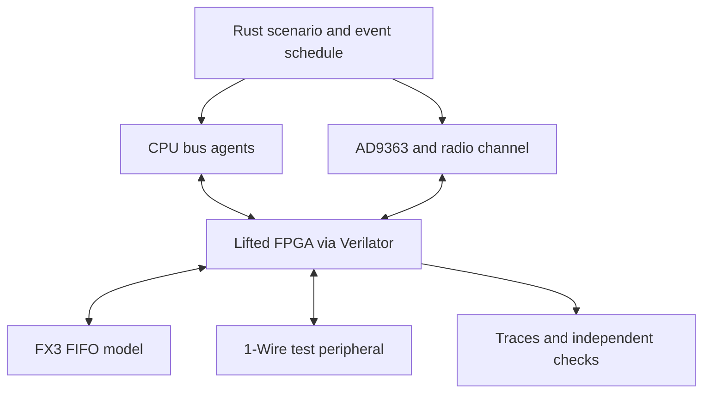

# Lightbridge FPGA simulation harness in Rust

Design proposal, 31 October 2026. Target: the recovered ground-side m2001 EP4CGX150 image. This is an implementation plan, not an implemented simulator or a claim that Lightbridge has been decoded. Proposed repository location: `docs/lightbridge-rust-simulation-design.md`.

## Recommended design

Use Rust to model the board around the **actual lifted FPGA**, compiled with Verilator. Keep cycle evaluation in C++ behind a small C ABI. Start with scripted or recorded CPU bus transactions, a behavioural AD9363, an FX3 FIFO sink and the existing dummy-secret 1-Wire device. Add captured radio I/Q replay before attempting a synthetic Lightbridge transmitter. Do not rewrite the FPGA into a Rust behavioural model: that would remove the very logic being investigated.

The useful first outcome is a repeatable experiment: replay an MCU boot transaction sequence, observe its radio SPI writes, inject a short I/Q window and inspect whether the actual receive datapath advances. Successful video reconstruction is a later milestone contingent on the lifter, clock plan and waveform format.

## Existing foundation and limits

Pluribus supplies the generic flat/readable RTL emitters, inline M9K/MAC models and FPGA tests. awto-dji owns this DJI board/system design, firmware traces and radio/peripheral interpretation. Consume a pinned Pluribus model artifact; keep lifter and FPGA-family fixes upstream in Pluribus. Rust would own experiment orchestration and peripheral behaviour, not bitstream decoding. Implementation is deferred at Dan's request (31 October 2026); awto-dji issue #87 tracks research and design only.

| Existing item | Reuse | Limit that the harness must expose |
|---|---|---|
| `cycloneiv_clean_image_sim.py` | Pad mappings, SPI stimulus, model preparation | `same` clocks are all 100 MHz; `ratio` assigns a 2:1 ratio by domain population. Neither is a measured board clock plan. |
| `cycloneiv_clean_rtl_image_compare.py` | Flat/RTL differential comparison | Updated `cycloneiv-clean-rtl.md` reports zero output/FF differences for the tested idle/SPI stimulus; the old AA7 discrepancy was a testbench-stimulus issue. Shared lifter semantics are not independent hardware evidence. |
| `cycloneiv_clean_af3_engine.py` | Small model to prove Rust integration cheaply | Default `WEMODE=2`, `PREREAD=1`; zero FF initialisation and two self-input substitutions. These are explicit experiment assumptions. |
| `ad9363_regdecode.py` | Interpretation of radio register traces | A register decoder is not a complete AD9363 behavioural model. |
| `lightbridge_ofdm_demod.py` | Measured waveform parameters and analysis comparison | Modulation, coding and MIMO processing remain unresolved. |

The older image-simulation document retains a superseded AA7 mismatch; the newer RTL document at Pluribus commit `4b39103` records the correction. The image-simulation document also reports many unresolved sources tied to zero. Current counts and resolved clock roots must be re-exported from the exact source revision used for each run. The document's assertion that the RAM write-enable issue was fixed conflicts with open issue #178; do not assume all affected tiles are correct.

## Rust workspace and model boundary

Proposed components:

| Component | Responsibility |
|---|---|
| `lb-sim` | CLI, scenario files, experiment manifests, assertions and reporting |
| `lb-sim-core` | Deterministic time, events, bus ownership, fixture replay, checkpoints |
| `lb-fpga-sys` | Opaque Verilator handle, generated port IDs, C ABI and native build |
| `lb-peripherals` | CPU bus agents, AD9363 control/port model, FX3 FIFO, 1-Wire device |
| `lb-radio` | Complex I/Q sources, channel impairments, quantisation and candidate OFDM generation |

Keep high-rate sample packing in Rust and high-rate FPGA pin stepping in C++. Rust supplies batches of timestamped transitions or I/Q frames; the native loop consumes these, evaluates the model and accumulates output events. Do not make a Rust FFI call for each clock edge, sample bit or LUT.

The wrapper exports a versioned interface such as `create`, `describe_ports`, `enqueue_events`, `run_until`, `drain_events`, `save`, `restore` and `destroy`. Handles own their model/context; errors cross the ABI as status records, never C++ exceptions. Events contain integer time, stable port ID, value, drive mask and validity mask. Return on queue exhaustion, requested observation, assertion, simulation finish or time limit. Bounded input/output queues stop deterministically rather than dropping data.

Generate `ports.json` from the lifted I/O records. Each entry gives role, package ball, direction, width, output-enable polarity, clock association, evidence and confidence. Keep physical pad identifiers independent of the flat emitter's `pad_` and readable emitter's `io_` naming. Unknown mappings are candidates, not silent defaults.

For bidirectional ports, expose FPGA input, output and OE separately. Resolve external drive, FPGA drive and pull-up in the wrapper. Contention and floating required inputs produce errors or explicitly unknown samples. Verilator's ordinary two-state evaluation must not turn an undriven line into a trustworthy zero. AF3 needs wired-low/open-drain semantics, while the FX3 data bus needs push-pull turnaround handling.

## Time, clocks and boot

Use exact rational clock periods and a deterministic integer tick schedule. A period accumulator avoids long-term drift when a selected tick size cannot represent a frequency exactly. Record the resolution and accumulated phase error bound. Never advance by floating-point wall time.

At each time: apply pre-edge data/reset changes; resolve buses and settle; apply all truly simultaneous independent clock edges together; evaluate; settle derived outputs and buses to a bounded fixed point; then record sampled outputs and schedule peripheral responses at their documented delays. Data must be established before its sampling edge. Crossing a clock boundary is an explicit event, not an arbitrary ordering determined by a Rust collection.

Only the harness or the HDL owns a clock, never both. If the emitted model exposes global clock roots, the harness drives those roots according to an explicit clock manifest. If a derived clock is already produced by actual lifted logic, observe and propagate it without independently ticking its FFs. Detect conflicting ownership at startup.

Provide three named clock profiles:

1. `legacy-same`: reproduce existing testbench assumptions for regression only.
2. `decoded-ratios`: apply evidenced PLL/domain relationships, with unresolved frequency/phase entries visibly marked and configurable.
3. `board-observed`: measured clocks, reset sequencing and port timings, with capture provenance. Required for board-fidelity claims.

The unknown B14 frequency and the apparent 20-40 MHz AF3 timing must remain separate unresolved constraints. Do not select 40 MHz for every clock because AF3 slot timing fits it. Likewise, the unresolved AD9363 `/64` final divider must be reported when replayed configuration disagrees with a requested 11.2 MS/s waveform.

Boot is a scenario: initial FF/RAM policy, power/reset events, clocks, CPU activity, radio readiness and optional peripheral presence. Do not globally clear every source merely because it resembles an async-clear input. Reproduce legacy initialisation in one profile and track it as an assumption. Cold restart rebuilds model state and peripheral state from the manifest and seed.

## CPU models: simulate the bus masters first

The ground image is the initial target. Instantiate only processors/peripherals demonstrably connected to it. Air-side MCU behaviour can configure a synthetic source radio later, but this image is not the air-side FPGA.

Each CPU agent has a queue of SPI/GPIO/UART transactions, waits and assertions. The first ground MCU agent drives FPGA MOSI AB11, SCK AA8, active-low CS AA9 and samples MISO AA7. Use the confirmed write opcode `0x0E`; test `0x0F` read behaviour as a candidate, preserving both-edge observations until timing is settled. Preserve real wait/poll loops and abort on deadlines rather than unconditionally advancing through boot.

Support three back ends behind the same bus contract:

| Back end | Use |
|---|---|
| Scripted agent | Minimal register experiments and negative tests |
| Recorded transaction replay | Repeat captured firmware I/O, including poll outcomes and delays |
| CPU emulator adapter, later | Run firmware only after CPU type, memory map, reset vector and required peripherals are independently established |

Annotate every fixture as hardware-captured, firmware-extracted or synthetic. Firmware-extracted write lists may omit conditional control flow and cannot be called a complete boot trace. A CPU agent must use the FPGA's actual bridge mode and pins to access the radio; a direct out-of-band radio write is a separately labelled diagnostic shortcut.

## AD9363 and radio simulation

Separate three layers so each can be tested independently:

**Control model.** Decode AD9363 SPI transactions, preserve register state, model selected read-only/status/reset fields and log every unsupported access. Track ENSM state, active channels, sample-rate/filter chains, LO retunes and calibrations where implemented. Strict mode stops on an unsupported register that affects operation. A permissive trace-replay profile may return observed status values, but marks them as fixture responses. Never fabricate “calibration complete” or PLL lock to make firmware progress and then call that path validated.

**Digital-port model.** Convert signed I/Q samples into the selected CMOS/LVDS, SDR/DDR and channel/frame format. Start with the CMOS dual-port DDR hypothesis and explicitly selectable channel order, I/Q order, sign, frame phase and edge mapping. Validate packing with independently authored sample counters and known patterns. Do not infer differential operation merely from paired ball names. Drive DATA_CLK only when the selected configuration supports it, and capture TX using the FPGA-supplied FB_CLK/frame and OE behaviour.

**Channel model.** Operate at complex baseband, without simulating a 2.4 GHz carrier. Initially support deterministic gain/delay, carrier-frequency offset, sample-clock offset, AWGN, clipping and a small multipath FIR. Model two RX observations as `y_r = sum(h_rt * x_t) + noise`; distinguish two transmitter streams from two receiving antennas. Add retune blackout and burst loss. Optional AD9363 analogue/filter approximations need their own stated fidelity, rather than a claim to reproduce its silicon.

Input modes, in increasing difficulty:

1. Known digital ramps/PRBS, useful for port capture and RAM activity.
2. Recorded post-radio digital samples, when available, to isolate RF/control uncertainty.
3. Captured over-air I/Q, with source sample rate, channel count, receiver effects and provenance. Resample/scale into the model with declared assumptions; a single receiver recording cannot reconstruct two independent spatial observations.
4. Synthetic candidate OFDM with independent payload/oracle. The 1024 FFT, 128 CP, 864 occupied/96 pilot counts motivate an IEEE 802.16 band-AMC comparison. These counts alone do not identify a 2x3 bin/symbol grouping: compare SISO and MIMO allocations, including Matrix A/B pilot/null patterns and alternate groupings. Treat this as possible reuse of PHY structures, without assuming WiMAX framing, network entry, MAC or interoperability. This is a hypothesis profile, not a confirmed Lightbridge encoder. Coding, interleaving, pilot phases, antenna mapping and burst framing must be separately selectable and evidenced.

Observe RX pad capture, receive RAM writes, activity/valid strobes and finally FX3 traffic. A valid-looking waveform that activates logic is useful evidence, but is not a successful payload decode. Internal RAM/FIFO injection is allowed for isolating later stages and labelled as bypassing the receive path.

## FX3 and remaining peripherals

Model the FX3 as a finite-depth synchronous slave FIFO: PCLK, data/OE, select/address, write/read strobes, flags and PKTEND. Implement flag polarity, watermark and response latency from the selected GPIF configuration; generic app-note defaults are candidates until firmware/capture confirms them. Include backpressure, slow host draining, full FIFO and bus turnaround. Record payload bytes and packet boundaries separately. USB wrapping is a separate postprocessor, not something invented by the FPGA sink.

An Annex-B parser can report start codes, NAL types and SPS consistency. A known fixture payload must compare byte-for-byte before “video recovered” is reported. H.264 decoding is an optional independent consumer.

Port the existing 1-Wire dummy-secret responder as an independent peripheral contract. Test absent device, valid response, wrong response and bad CRC. Keep experimental secret overrides, RAM preread and self-loop substitutions in the manifest. Authentication behaviour does not establish RF decryption or security gating elsewhere.

## Evidence, observability and reproducibility

Every run stores source/image/model hashes, compiler/Verilator versions, lifted model type, semantic fixes, unresolved/tied sources, port/clock manifests, scenario and fixture hashes, seeds and all diagnostic overrides. Keep commercial image-derived outputs local and reproducible through an external image path, consistent with existing repository practice.

Default observations are compact event logs and selected counters, with triggered FST windows around the first divergence or failure. Full FF tracing is an explicit slow mode. Capture radio SPI, retunes, FIFO flags, packet boundaries, unsupported accesses, bus contention and first activity per receive stage.

Snapshots must include FPGA state, simulation time, clock accumulators, pending native/Rust events, CPU replay positions, radio/filter/RNG state and FIFO contents. Save at quiescent batch boundaries; validate restore against a continuous-run output hash. Pin snapshots to the exact model binary/version. If native `--savable` support fails, use deterministic restart and trace-prefix replay first; do not implement partial snapshots that omit peripherals.

| Evidence tier | What a passing test establishes |
|---|---|
| Peripheral unit test | A model obeys its own independently specified contract |
| Flat vs readable RTL | Emitters agree under that stimulus, not that the lift matches silicon |
| Recorded bus/IQ comparison | Model agrees with a particular captured observation |
| FPGA hardware comparison | Lift agrees with physical FPGA behaviour for tested inputs |
| Known over-air payload recovered | End-to-end decode works for that fixture and configuration |

Forced internals, dummy responses and stubbed status reads must downgrade the result automatically. Use “unsupported” or “inconclusive” instead of pass when a required model behaviour is missing.

## Delivery milestones and acceptance gates

| Milestone | Concrete deliverable | Acceptance gate |
|---|---|---|
| M0: freeze baseline | Manifest exporter; reconcile summary/source disagreements; inventory #178 fixes and tied inputs | Existing tests reproduced with all assumptions visible; no unsupported hardware-fidelity claim |
| M1: native/Rust bridge | Wrap AF3 cone, batch ABI, event log, dummy 1-Wire device | Same pass/fail and bus-event sequence as existing C++ experiment; repeatable restart hash |
| M2: ground board control | Whole-image wrapper, MCU SPI agent, AD9363 SPI model, explicit clock profiles | Scripted writes reach intended register copies; radio bridge/engine transfers match observed traces; unsupported accesses visible |
| M3: radio port and FX3 | Digital I/Q packer, TX capture, finite FIFO and backpressure | Independent ramp-pattern/edge tests; no contention; deterministic FIFO/PKTEND timing tests |
| M4: captured receive experiment | Short I/Q fixture and probes through receive stages | Repeatable progress report or first blocked stage; no requirement to manufacture video success |
| M5: candidate waveform search | Parameterised OFDM/MIMO source and independent payload oracle | Score hypotheses on pilots/stage progression; claim decode only on correct recovered payload |
| M6: optional firmware/co-simulation | Real CPU emulator adapter or paired air-side lift | Firmware identity/peripherals independently established; deterministic bus equivalence with replay |

Benchmark M1/M2 before scheduling long captures. Existing documentation reports around 33k simulated clocks/s without probes on one loaded machine. At that historical rate, 1.4 million cycles take roughly 42 seconds, and a 14 ms window at 200 MHz is 2.8 million cycles or roughly 85 seconds before additional overhead. These are scale estimates, not a runtime promise. Use short windows, selected cones, cached builds and checkpoints; faster Rust orchestration cannot eliminate full FPGA evaluation cost.

## Defaults and open decisions

Use the updated readable RTL as the initial system target and the flat lift for differential checks. Pin source and generated-model hashes. Do not treat the superseded AA7 discrepancy as a current expected failure: newer evidence attributes it to the testbench and reports matching outputs and snapshots. Use single-threaded deterministic peripheral scheduling; benchmark Verilator evaluation threading separately. Use TOML scenarios and JSONL event logs, immutable binary I/Q fixtures and a seed per impairment source. No UI is necessary initially.

Open blockers are the actual board variant, correct package/pad mapping, clock/reset wiring, residual RAM semantics, RX frame/IQ ordering, a suitable capture with known payload, and control traces that include reads/delays rather than only register writes. None prevents the AF3/ABI milestone. Several prevent credible end-to-end radio claims.

## Sources and implementation anchors

Pluribus source references (generic lifter and model provider), inspected 31 October 2026; pin exact commits before implementation:

- https://github.com/awtoau/pluribus/blob/main/docs/lightbridge-fpga.md
- https://github.com/awtoau/pluribus/blob/main/docs/cycloneiv-clean-image-sim.md
- https://github.com/awtoau/pluribus/blob/main/docs/cycloneiv-clean-pll-clocks.md
- https://github.com/awtoau/pluribus/blob/main/docs/cycloneiv-clean-af3-engine.md
- https://github.com/awtoau/pluribus/blob/main/scripts/cycloneiv_clean_image_sim.py
- https://github.com/awtoau/pluribus/blob/main/scripts/cycloneiv_clean_rtl_image_compare.py
- https://github.com/awtoau/pluribus/blob/main/scripts/cycloneiv_clean_af3_engine.py
- https://github.com/awtoau/pluribus/issues/178

Primary external references:

- Verilator model integration and event evaluation: https://verilator.org/guide/latest/connecting.html
- Verilator save/restore: https://verilator.org/guide/latest/simulating.html
- AD9363 datasheet, digital interface and clocks: https://www.analog.com/media/en/technical-documentation/data-sheets/ad9363.pdf
- Infineon FX3 slave FIFO timing and flags, AN65974: https://www.infineon.com/dgdl/Infineon-AN65974_Designing_with_the_EZ-USB_FX3_Slave_FIFO_Interface-ApplicationNotes-v17_00-EN.pdf
- Candidate authentication prior art, Altera WP-01033: https://cdrdv2-public.intel.com/691466/wp-01033.pdf
- Candidate AMC 2x3 waveform comparison, Venkatesan et al., 2009, DOI 10.1155/2009/963547: https://repositori-api.upf.edu/api/core/bitstreams/efc2dc68-19b5-4a17-9d99-02b707bd7c47/content

External references specify peripheral contracts or candidate lineage. They do not independently validate the recovered DJI wiring or the current bitstream lift.

**First useful deliverable:** a narrow ground-side boot/control harness that replays a captured MCU transaction trace through the current lifted FPGA model, checks readback and resulting radio SPI transactions, and reports the first unsupported response or divergence. Use AF3 only to bring up and verify the Rust/native boundary cheaply. Add radio waveforms after that control experiment is reproducible.
